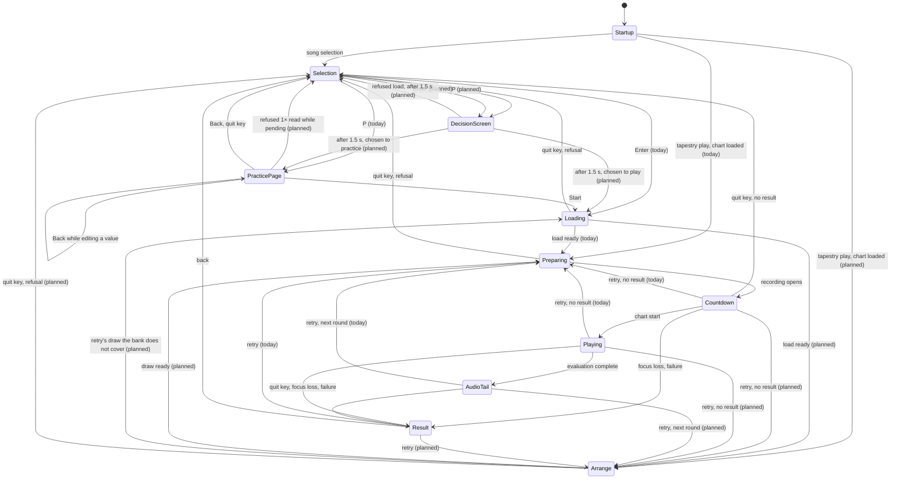

# BMS Player Basic Design

The basic design of a Windows-only BMS player (a 7-key + scratch music game). Centered on an evaluator that can recompute judgments from the input log, it defines the boundaries out to rule presets, skin compatibility, a custom IR, and chart distribution.

Target: Windows 10/11 / Time unit: integer µs / Core language: Rust (recommended)

## Goals and Scope

Build a BMS player that plays like beatoraja or Lunatic Rave 2. Its biggest distinguishing feature is that every input during play is recorded with a timestamp, so judgments, score, and gauge can be recomputed later under a different rule. You normally play with "beatoraja-style", and on the result screen you can switch over to see "how it would have gone under LR2-style".

### Goals

- A game that feels good to press (key sounds, judgment display, frame stability) and makes you want to replay it again and again
- Running alongside streaming or recording software without significantly impairing their operation
- Fair judgment based on input timestamps, robust enough for play that competes over a single point of score
- Judgment, gauge, and scoring rules switchable via presets (data)
- The same input log and the same preset produce the same result on any environment
- Existing skin assets (beatoraja JSON and Lua, then LR2 CSV) usable through importers, and a skin of tapestry's own format that also builds a beatoraja skin

### Non-goals

- **Exactly reproducing the judgment of beatoraja or LR2.** We provide "-style" presets that reproduce their target's rules but not its machine (floating-point gauges, frame and poll granularity), and each lists where its results can differ ("What a -style Preset Reproduces").
- **Making the judgment of the commercial game this is based on the standard.** The default is the beatoraja-style preset; no standard preset reproduces the judgment of the commercial game this is based on.
- **Importing or converting commercial game data.** It goes neither in core nor in official extensions.
- Support for platforms other than Windows.

## Design Principles

> **Evaluation is a pure function**
>
> Judgment, score, and gauge are determined solely by `(chart, input log, preset)`. Evaluation does not read the clock, audio, rendering, or global state, and does not modify the chart.

> **Input is every edge, timestamped**
>
> Every press and release, without exception, is appended along with the QPC time at the moment it was received. Never keep only the "current state" of the keys.

> **Time is integer µs**
>
> The clock is the monotonically increasing QPC. Chart, input, and judgment all use `i64` µs, and the gauge is computed in fixed point.

> **Core is closed; extend outside it**
>
> The evaluator has no plug-in points. Extensions are placed only before evaluation (preparing the chart and input) and after it (receiving judgment events).

Live play, results, replays, and the IR server all use the same evaluator code. This structurally eliminates any room for the in-play display and the numbers on the result screen to diverge.

> **Prohibited: do not write the name of the commercial game this is based on**
>
> Do not put the title, series name, maker name, or online service name of the commercial game this is based on into code (identifiers, comments, strings, log messages, test names, asset or file names). Use generic terms such as "7-key", "scratch", and "BMS". Matching against the banned-word list is done by calling the same check script from both the git pre-commit hook and CI. The hook is for noticing locally before a commit and can also be skipped locally, so the final gate that fails on any hit is CI. Matching targets the self-authored code, file names, and documents managed in the repository, normalizes case and Unicode, and is done at word boundaries. Only the dedicated file that holds the banned-word list is exempt; external dependencies and license documents are out of scope. Commit messages are out of scope. The list holds only these names and their common spellings, not general game terms, so it never blocks ordinary development. Periodic reviews of the tree and history catch other problem expressions; each fix adds the missed term to the list.

Strictness is required only around judgment, time, and the input log. Everything else (screens, effects, skins, settings screens) is built lightly, on the assumption that it will be reworked while checking it by playing.

## Game Experience

This is a game, and the correctness of judgment is merely the foundation for "being pleasant to play". The quality of the design is judged by whether it actually feels good when played.

### Feel Targets

| Item | Target | Reason |
| --- | --- | --- |
| From press to key sound | 10 ms or less on the low-latency path; shared mode follows the device period ("Path from Press to Sound") | Audio latency is felt as "heavy" before judgment deviation is |
| From press to judgment and bomb appearing on screen | 1–2 frames | The feel of a press is determined by the screen's response |
| Frame stability | No drops at 144/240 Hz, watched through the frame pacing indicators ("Frame Pacing in Refreshes") | Even a momentary hitch in the note flow breaks reading |
| From song selection to play start | 1–2 seconds | It is a game you replay many times, so waiting time turns directly into frustration |
| Retry | One action, instant | Repeating the same chart is the core of play |

### Gameplay Loop

- **Song selection**: Search and sorting that narrow down even a library of tens of thousands of songs instantly, selection by difficulty table, and song preview playback. Library scanning runs in the background and processes only the differences.
- **Play**: Judgment text, combo, bombs, lasers, and gauge movement respond pleasantly the instant you press. Effects are built by receiving the judgment event stream, so they can be elaborated freely.
- **Result**: The score and the difference from the personal best, the gauge history, the early/late distribution, and the results under other presets can be seen on one screen. Show information that makes you want to play one more time.
- **Practice**: Section repeat, speed change, and offset adjustment (a recommended value is derived from the input log). Improvement itself makes up most of the play, so practice features are not postponed.

### How We Build It

- The first target is a state where "one song can be played pleasantly to the end". IR, distribution, and skin compatibility are added after that.
- Effects, screens, and the default judgment and gauge values are treated as things tuned by playing. Tuning can be tried without restarting, by reloading presets and skins.
- The default look (custom skin) and the default judgment are the face of this game. Make the standard setup fun to play without relying on compatible skins.
- Build it to completion with the fewest extensions first. Every extension point exists in code from the start, but only the extensions the first playable version needs are plugged into them ("Extension Boundaries"). Variations (other PCs and refresh rates, running alongside other software, skins, presets) are then added one at a time. If a design flaw blocks one of them, the affected part is rebuilt from scratch with that flaw taken into account. This is a personal project, so finishing the concept matters more than the effort it takes.
- Performance comes from doing what game development normally does (the "Performance" section): no wasted resources, and no over-engineering. Measured figures are tracked to find problems; they are not targets that stop work.

## Overall Architecture

*Figure: The input thread appends to the input log, and the evaluator on the logic thread, together with the rule preset, evaluates up to the input watermark and emits the judgment event stream. The audio thread, the render thread, and results and replays receive it; rendering goes through the skin runtime model.*

| Thread | Role | Must not |
| --- | --- | --- |
| Input | Receives device events, attaches QPC times, and appends them to the input log. Publishes the watermark | Judgment, processing that allocates memory, console output (its messages travel with its replies and the logic thread prints them) |
| Logic | Wakes on input publication and watermark updates, and advances the evaluator up to the watermark. Passes judgment events to audio and rendering | Waiting on rendering or file I/O |
| Audio | Mixes in the WASAPI callback. Plays key sounds and BGM | Acquiring locks, allocating memory |
| Render | Reads the state snapshot and draws the skin | Writing to the evaluator or the chart |
| Loading | Loading charts, audio, and BGA, and decoding video | Heavy processing during play (finish it beforehand) |

Threads are connected by lock-free single-producer single-consumer queues. One queue is placed per input source, one for logic→audio, and one for logic→render (effect events), and all data that must not be dropped is passed through queues. Triple buffering is used only for the render state snapshot, where only the latest value is needed. There is no shared mutable state.

- The input thread runs under MMCSS "Games" and wakes on input, on its wake event, and while a play records or its audio tail plays on a heartbeat of a high-resolution waitable timer at most 1 ms after its last publication ("Raw Input reception" under "Input"); between plays it has no timer. The audio thread runs on the WASAPI event under MMCSS "Pro Audio". The render thread waits on the swap chain's waitable object, a dedicated window thread runs the winit event loop (created with `with_any_thread`) while the game keeps the main thread, and loading uses a bounded pool that ends before the countdown.
- The queues are `rtrb` and the snapshot is `triple_buffer`, both proven allocation-free on every hot path in stage 0. Our own ring of atomics would be code to own and verify for no gain, and `crossbeam-channel` is an MPMC queue with heavier synchronization than one producer needs.
- The input thread wakes the logic thread with `Thread::unpark` after each publication, and the logic thread waits with `park_timeout`, at most 2 ms during a play and its audio tail. This is portable, allocation-free and survives a missed wake ("What Wakes the Logic Thread"). A Win32 event would make `game` Windows-only. Outside a play the same thread parks until the window or the system unparks it (a command, a focus change, a settings key) or for 250 ms at most, the next look at what has no wake of its own (a screen failure).

### Mechanisms for Testing

The following three would mean rework if added later, so they are built in from the start.

- **Swappable clock**: QPC is not read directly but through `TimeSource`. Production uses the real QPC; tests use a virtual clock that the test advances itself. Input, logic, audio, and rendering all read time through it.
- **Processing that can advance without threads**: Logic processing is written as a function that "advances to a specified time", and threads only call it. Tests call the same function sequentially, without threads.
- **Swappable I/O**: Input can be replaced with fake input fed from an input log or a test scenario. Audio can be replaced with an output that generates waveforms offscreen, or an output that records scheduled sounds and sample positions. Rendering can draw to an offscreen texture.

In tests, a test runner advances the whole system in the same order as production: feed fake input → publish the per-source watermarks → advance the evaluator up to the watermark → process one audio block → render. The evaluator is never advanced directly, bypassing the watermark. The runner also simulates the audio playback position and its QPC time, injecting clock drift, read jitter, and discontinuities from resume, to verify the same audio clock correction as production.

## Time Base (QPC)

The correctness of this design depends on aligning all times to a single clock. The base is `QueryPerformanceCounter` (QPC), and all three clocks (input, audio, and display) are mapped to QPC. Wall clocks (`system_clock`, etc.) are not used.

### Handling QPC

- QPC is consistent across all cores and never goes backward. CPU affinity is not pinned. Times taken on different threads cannot be ordered when they differ by ±1 tick, so the order of events is determined by a total order of time and sequence number.
- The frequency (`QueryPerformanceFrequency`) is read once at startup. On many environments it is 10 MHz (100 ns ticks). Conversion to µs multiplies first and then divides, in `i128`. Rounding is fixed to mathematical floor (toward the smaller side even for negative values; `div_euclid` in Rust).
- The QPC value at play start is the chart's 0 µs, and every later time is expressed as the elapsed µs from there. Only relative times are written to the input log, and raw QPC values never leave the PC (because they reveal the time since boot).
- QPC keeps advancing during sleep. When the game window receives the suspend and resume notifications (`PBT_APMSUSPEND` of `WM_POWERBROADCAST` and the resume notification; on Modern Standby environments, also register for the notifications), that play is aborted and the input log is marked "incomplete". Other power notifications, such as a change in AC power connection, do not abort play.

### Timestamps Used for Judgment

Judgment uses the QPC taken immediately after the input thread receives the event (the receive time). The watermark guarantee (the "Input" section) holds on receive times. Keyboards and dedicated controllers are received via Raw Input and MIDI via callbacks, and all of them are treated the same.

GameInput input carries µs timestamps that can be compared with `IGameInput::GetCurrentTimeStamp`. However, the official specification does not tell where that timestamp is attached, its exact correspondence with QPC, or whether the clocks drift relative to each other. Also, input read out later can carry a time earlier than an already-finalized watermark, so using it for judgment as is would break the watermark guarantee. For now, it is therefore handled as follows.

- GameInput timestamps are recorded in the input log alongside the receive times and used only for measurement (the variability of the latency until receipt). The mapping to QPC is obtained by repeatedly measuring `GetCurrentTimeStamp` reads bracketed by QPC reads, and its uncertainty is also recorded.
- Judgment switches to GameInput timestamps only if measurement confirms that the latency until receipt has an upper bound. In that case the watermark is "the receive-time watermark minus that bound", and any input delayed beyond the bound marks the input log "incomplete".

### Mapping the Three Clocks

| Clock | How it is mapped to QPC | Used for |
| --- | --- | --- |
| Input | The QPC immediately after receipt (previous subsection) | Judgment |
| Audio | At each buffer event, the first frame still queued (frames written minus padding) and the QPC time of the engine pass that reads it (the wake plus one period). The least-late wake of a sliding window anchors the mapping, and it is re-anchored on every period. `IAudioClock::GetPosition` is recorded as a diagnostic only | Scheduling sound starts on the judgment timeline (the "Time and Offsets" section) |
| Display | The QPC time of a past vertical sync (`SyncQPCTime`) in the DXGI frame statistics (`GetFrameStatistics`), and the corresponding display-refresh count | Aiding the prediction of note draw positions, and measuring display latency |

- DXGI frame statistics are only an aid to prediction. The first time, right after a display mode change, when the statistics are stale, and when the refresh period is irregular under VRR, prediction uses only QPC and the configured display latency.
- The display's lag and the scan-out time down to the judgment line are calibrated as the display latency offset. Do not double-add the portion derived from the statistics and the offset.
- wgpu does not expose the raw swap chain, so the DXGI swap chain is reached from inside the DX12 backend (`as_hal`). This part is confined to `render`.

### What Determines Timing Accuracy

What determines the fairness of judgment is not the resolution of QPC, but the latency from the press until the receive time is attached, and its variability.

- **USB polling**: With a 125 Hz device, waiting for the USB report alone introduces a spread of up to 8 ms (1 ms at 1000 Hz). Report intervals are recorded, and the polling rate is estimated only when the conditions for a report to arrive on every change are met. If it can be estimated and the rate is low, a warning is shown; if it cannot be estimated, "not estimable" is recorded.
- **Latency until the OS delivers**: The roughly constant part is corrected by the input latency offset.
- **Variability in thread wake-up**: The input thread wakes when input is queued, not on a timer, and the time is attached immediately on waking; events are read in batches with `GetRawInputBuffer`. The input thread is prioritized with MMCSS. Events read in one batch get the same receive time, and their individual occurrence times cannot be recovered: an event queued during a drain is read in it and gets its stamp, which can be earlier than its arrival. Input is read at most once per 125 µs, so input arriving faster waits at most that long. The stamping delay this leaves has not been measured on hardware, and the input offsets are measured with it.

The receive method (Raw Input, MIDI, etc.), the record of report intervals, and the estimated polling rate (or "not estimable") are recorded in the input log as device information. The measurement display shows the distribution of report intervals, the variability in thread wake-up, and the deviation in the mapping of the three clocks, so the timing quality of that environment can be checked in numbers.

## Time and Offsets

- **Judgment timeline**: The elapsed µs from play start, based on QPC (the "Time Base (QPC)" section).
- **Unit**: Chart, input, and judgment times are all `i64` µs. There is no rounding to ms.
- **Chart time**: Time computation, including BPM changes and STOPs, is done with rational numbers, and rounding to µs happens only once. This eliminates accumulated floating-point error and environment-dependent differences.
- **What is rounded**: Only values compared with a clock are floored to µs, once, from the exact value: the judgment times of notes and long-note ends, sound start times (BGM and key sounds), and the playhead of a frame, read at the frame's µs and shared by everything on screen. Object identity and order (which objects are the same, which survives a conflict, long-note pairing, a note inside a long note) and display geometry (object positions, scroll-map anchors and STOP extents, culling) come from the exact source position and exact time, never from floored µs. Objects at distinct positions stay distinct even when they floor to one µs, so one lane may hold several notes at one µs, a long note may start and end at one µs, and a note may start at the µs where the previous long note ends. Judgment needs no rule of its own for them: the existing note assignment takes them one press each, nearest first and earlier on a tie ("Algorithms").

### Aligning Audio to the Judgment Timeline

The audio device's clock drifts gradually relative to QPC. The judgment timeline is fixed to QPC, and the drift is absorbed on the audio side. This way, judgments can be reproduced without keeping an audio clock conversion history in the replay.

- The mapping comes from the buffer events, not from `IAudioClock::GetPosition`. On a tested interface, `GetPosition` advanced a whole period at a time against a current QPC, so its position is recorded only as a diagnostic. At each event, the first frame still queued is read by the next engine pass, one period after the wake. Wakes come late by a scheduler-dependent amount and engine passes do not, so over a sliding window the least-late wake anchors the mapping between frames and the judgment timeline. It is re-anchored on every period, which follows the device clock's drift against QPC.
- Every sound start is scheduled through this mapping: a key sound at the first frame not yet written (two queued periods put it about 2–3 periods after the command is received), and a BGM event at the frame its chart time maps to, minus the audio output latency. A start whose frame is already written moves to the first frame not yet written; the head of a sound is never cut.
- Re-anchoring keeps every sound start on the QPC timeline without resampling during play. Drift then shows only inside one long, already running sound (about 9 ms over 3 minutes at 50 ppm). The measured drift (ppm) is recorded per play. The mixer resamples to correct drift (the "Audio clock correction" row in "Key Libraries and Algorithms") only once a chart whose single-file BGM is heard drifting against key sounds, or a recorded drift that would reach a display refresh over a song, calls for it.
- The mapping is re-established on start, on an underrun (a wake that finds the buffer empty), and on a jump such as resume.

### Three Separate Offsets

| Name | Meaning | Where used |
| --- | --- | --- |
| Input latency | The delay from the press until the input thread receives it | Evaluator (subtracted from the receive time to get the evaluation time) |
| Audio output latency | The remaining delay from the device playback position until the sound actually reaches the ear | Audio scheduling position |
| Display latency | The delay from rendering until it appears on screen | Note draw position only |

The `GetPosition` position represents the position the device has already played. Therefore, the delay already included in it must not be double-added as audio output latency. Audio output latency represents only what remains in measurement.

The three offsets are recorded in the replay as inputs to evaluation.

### Automatic Offset Adjustment

- **Suggestion (always)**: After play, a recommended value is derived from the input log. It is produced even when adjustment is disabled.
- **In-play adjustment (optional)**: When enabled by the session policy, the input latency offset is moved gradually during play. The adjustment rules (range of observed deviations, moving-average window, update interval, allowed range, maximum rate of change) are held as a versioned session policy.
- **Recording**: The offset changes actually applied are kept in the input log. Which offset you played with is treated as part of the input, just like how you pressed.
- **When recomputing**: The adjustment rules are not rerun; the recorded changes are applied as is. Whichever preset is used for recomputation, judgment uses the same offsets as during play.
- **Verification**: The adjustment rules are determined solely by the judgment deviations up to that point. Recomputing with the preset and rules used during play should reproduce the recorded changes, so the IR checks this and rejects records that do not match.

### Offset Changes and the Watermark

Offsets are expressed per source as a function of receive time, `offset_i(t)`, and the evaluation time is `t − offset_i(t)`.

- Changes do not jump at once; they move continuously as a piecewise linear function with an upper bound (less than 1) on the slope with respect to receive time. Values are integer µs, and interpolation within a segment is computed with a fixed rounding method (floor).
- A new change is added only as a segment that starts at a receive time later than the point at which it was decided. Segments up to the published watermark are never rewritten.
- Adjustment uses only finalized judgments as its material, and when the next segment starts is decided by a rule fixed by the evaluator version.

This keeps the mapping from receive time to evaluation time always monotonically increasing, and past mappings never change, so an input with an evaluation time earlier than the finalized watermark never shows up later.

In-play adjustment works in the direction of shrinking judgment deviation, so it is treated as a kind of assist feature. For now, the IR separates records with adjustment enabled from the normal rankings.

Offset changes during play are not built yet: the input log has no offset change segments, so the input latency offset changes only between plays. Display latency and volume change at any time, since they do not affect judgment.

## Chart Loading

The loader (`bms-parser`) turns chart bytes into a resolved chart: judgment times in integer µs and display positions in fractions of a beat. The rules of the current loader version (which channels and headers it reads, how conflicts resolve, what warns, what is refused) are listed in the crate documentation (`crates/bms-parser/src/lib.rs`), and changing any of them bumps `LOADER_VERSION`, which every record carries ("Determinism"). The resolved-chart hash covers the version, so a bump gives every chart a new identity: re-evaluation refuses a record of another loader version, the bests are cleared and rebuilt under the new interpretation tuple, where such records are refused ("Personal Bests"), and each chart's loudness is measured again at its next load, since the measurement's key holds the resolved-chart hash ("Algorithms"). A change of how text is decoded also changes what the library stored from the chart headers, so it bumps the library's schema version as well, and the next scan reads every chart again ("Loading and Song Selection").

### Chart Model

- The chart is fully resolved: per-lane note vectors sorted by time (lane 0 scratch, 1–7 keys), with `Tap`, `Long { end, end_pos, end_sound }` and `Mine { damage }`, each head and long-note end holding its time in µs (the real time at the practice speed it was loaded at, "Practice Speed Changes") and its display position; BGM events; the `#WAV` table (the name as written and the path resolved inside the chart folder); bar lines as display positions (never compared with a clock); the scroll map; metadata (title, the judgment-header declarations, the chart's LN mode); and the identity (SHA-256 and MD5 of the file bytes, the resolved-chart hash, the played-chart hash, the loader version, the `#RANDOM` results).
- Per lane, because the evaluator keeps a cursor per lane and rendering finds the visible range per lane. One time-sorted list in measure positions would make every consumer redo the rational conversion, and the evaluator would see notation instead of time.
- Within a lane, times and display positions never decrease: a note starts no earlier than the previous one ends, a long note ends no earlier than it starts, and its end position is not below its head's. Equal times and equal positions are allowed, since distinct source positions may floor to one µs and positions closer than 2^-80 beat to one position. Bar-line positions never decrease. `Chart::validate` checks this for the loader's output, charts built in code and the output of every chart transform alike, so the renderer can cull by position.
- **Judgment headers.** The loader keeps the active `#RANK`, `#DEFEXRANK` and `#TOTAL` declarations, those left after `#RANDOM`/`#IF` resolution, in file order, and does not decide which one counts or what it means. Each declaration holds its header, its lexical class (an integer token such as `120`, `+3` or `007`; a decimal written with a point or an exponent, such as `120.0`, `120.5` or `1E2`, whose value says whether it has a fractional part; or not a number, which includes a value outside the decimal bounds) and, for a number, its exact value as `n / 10^18` within the decimal bounds of "Chart Time". That is the canonical form: the text, its whitespace, the header's case and the line number are not kept. There is at most one declaration per line, so the line limit bounds them, and each is backed by its line's bytes (a 48-byte entry, held at its exact size). Each preset's header policy reads them during preparation ("Evaluation Stages"), so another preset can read the same chart differently, for a what-if too. Resolving one rank and one `#TOTAL` in the loader, as loader version 6 did, would lose what a policy needs: after `#TOTAL 200` and `#TOTAL 0` it kept 0, and `#DEFEXRANK 120` and `120.0` became one value.
- The resolved-chart hash covers the resolved objects with their display positions, the scroll map, the sound names as written and the judgment-header declarations in their canonical form, independently of any preset; never resolved paths or the `#RANDOM` results that chose them, so moving a chart folder keeps its identity and two draws that resolve alike share one hash. It covers the 1× chart, whose times and scroll map the loader builds in the same pass at any practice speed, so a chart's identity is the same at every speed and the speed is recorded beside it. That identity does not pin what a play at a speed was judged on: two files can resolve alike at 1× and floor apart at a speed (BPMs 10^-18 apart put a note at 2,000,000 or 2,000,001 µs at 50 %, and a press 20.001 ms late is then GREAT instead of PERFECT). The played-chart hash pins it: the same encoding over the chart as loaded, under its own tag and with the speed's k, recorded always and equal to the resolved-chart hash at 1×, so every record has one layout and one check. What identifies the chart across speeds stays the resolved-chart hash; verification compares both.
- `bms-model` uses no floating point. A display position is an `i128` count of 2^-80 beat, the scroll map is a piecewise linear function from integer µs to positions (a STOP segment has slope 0), and the renderer converts position differences to pixels in floating point on its own side.

### Chart Time

- Time is accumulated per segment between BPM changes and STOPs as an exact rational of arbitrary-precision integers (`Ratio<BigInt>`), and each object's time is floored to µs once and narrowed to `i64` with `try_from`; at a practice speed `k/20` the exact time is multiplied by `20/k` before that one floor ("Practice Speed Changes"). The value is exact, so it equals what any other exact representation gives. A STOP's length in judgment time is exact too; the scroll map samples the exact curve at whole µs ("Display position" below), so a STOP's extent there follows from its sampled boundaries.
- **Display position.** An object's display position is its exact beat count (the spans of the earlier measures plus `index / count` of its own measure's span), floored once to 2^-80 beat. It is computed per position from small rationals (its reduced denominator is below 2^83) and never touches the running time; BPM changes and STOPs add no beats. The scroll map, which gives the playhead, has one segment per BPM change, STOP start and STOP end. A segment starts at `ceil(T)`, the first whole µs at or after its exact time `T`, with the anchor `floor(2^80 × P(ceil T))` on the exact curve `P` (beats over time) and the slope `floor(2^80 × r)` for the exact rate `r` in beats per µs (0 during a STOP). Changes whose starts are equal coalesce in exact event order, the later replacing the earlier, so same-position precedence stays the timeline's. The map is read only at integer µs: a segment covers queries up to one before the next start and stays at or below the exact curve there, so it reaches the next anchor without passing it. The playhead therefore never decreases, a section or STOP shorter than 1 µs still shifts what follows through the next anchor, and the error since the last anchor stays below one unit per µs, 2^-48 beat over the whole domain. Before time 0 the map runs at the initial rate of the `#BPM` header, kept apart from the segments, since the first segment may be flat (a STOP at time 0); there the error is likewise at most one unit per µs, above the exact curve.
- **Position range.** A BPM below 10^12 advances less than 2^14.03 beats per µs, so over ±2^32 µs positions stay below 2^46.03 beats, 2^126.03 units, and every anchor and every slope × Δt fits `i128`. Eighty fractional bits keep the finest scale (0.000001 BPM shown over a 100 ms visible time on a 2160-pixel lane, about 2^39.8 pixels per beat) within 2^-8 pixel: a floored slope loses at most 2^-48 beat over 2^32 µs. The map is defined on ±2^32 µs and clamps a query outside it. Compiling it checks starts against the domain, and anchors, cross-segment steps and end-of-domain products with checked arithmetic; conversions split quotient and remainder so no intermediate overflows, and the parser keeps rationals wide until a checked narrowing. Only retained positions and anchors are narrowed, so measures past the chart's end, which are dropped, never refuse it. Out of range is a load error naming the measure; accepted charts cannot reach it, and with raised limits it refuses retained times beyond 2^32 µs.
- Decimal values (BPM, measure length, `#STOP`, and the judgment headers `#RANK`, `#DEFEXRANK` and `#TOTAL`) are parsed from the trimmed text straight into rationals. The text must match `[+-]?(?:[0-9]+(?:\.[0-9]*)?|\.[0-9]+)(?:[eE][+-]?[0-9]+)?`; commas, inner whitespace, `NaN`, `Infinity` and hex floats are not numbers. Counting digits without the zeros that do not change the value, a value has at most 12 integer digits and a positive exponent at most 18; digits past the 18th fractional one are cut off toward zero, and a negative exponent only moves digits past that point (`1E-100` is 0), so it may be larger but is at most 18 digits long (its own leading zeros do not count). Every bound is checked on these counts before any number is built, so a long run of digits costs a scan and nothing more, and every value is `n / 10^18` with `|n| < 10^30`.
- A BPM below 0.000001 (`≤ 0` included) and a measure length `≤ 0` are load errors: reverse scroll, which some charts use on purpose, is a later feature, and a measure without length has no timing. Time and display positions use the exact BPM.
- **Size cap.** The running time is the only value that grows with the chart: its reduced denominator divides the least common multiple of every segment's denominator, so distinct BPMs multiply in (20 distinct odd prime BPMs already pass 2^128). The text limits bound every other value: a position inside a measure is `index / count`, and a line has fewer than 2^23 slots in a 16 MiB file, so the span between two positions of one measure has a denominator below 2^46; measure lengths and BPMs are `n / 10^18` (10^18 < 2^60, `n` < 2^100), so a segment's µs, `Δbeats × 60,000,000 / BPM`, has a denominator below 2^46 × 2^60 × 2^100 = 2^206, and a STOP's below 2^166. The time's denominator is capped at 16384 bits, checked after every addition in a canonical order (positions in order, bar lines first, then file order); the numerator stays within 32 bits of it because the duration cap (below 2^32 µs) is checked after every addition too. Exceeding the cap is a load error naming the measure, never a wrap. Display positions do not grow with the chart: only the scroll map's anchors touch the running time.
- **Cost.** Each position is one addition (two with a STOP), done with the reduced-sum method (Knuth, TAOCP vol. 2, 4.5.1), whose GCDs run against the term's small denominator only. At the cap an addition is about 8,000 limb operations, and the object limits allow about a million additions: an estimate of several seconds. A display position costs a few products of small integers per position. A scroll-map anchor costs, per BPM change and STOP end at a fractional µs, one division by a small multiple of the running time's denominator. Measured on the development PC (release build), a fixture driven to the cap loads in 4.0 s, against 0.9 s for as many events with a small denominator; a fixture that reaches the cap and then anchors 240,000 BPM changes, each with a kept note, loads in 3.6 s, 1.8 s of it for the anchors. A chart may use every hex BPM (least common multiple 362 bits) and about 800 further pairwise-coprime BPMs; not every chart within the limits fits this budget, since the 1295 `#BPMxx` definitions alone can reach about 130,000 bits.
- Big integers allocate on every operation, which is why time and positions are computed only while loading; the chart model holds only `i64` µs and `i128` positions.
- Alternatives: `Ratio<i128>` overflows on charts with many distinct BPMs, which then cannot load. Fixed-point time in sub-µs units, or integer µs per segment, rounds every segment, so objects drift onto other µs. `f64` depends on operation order and platform, and its 53 bits are too few for positions. Positions in millionths of a beat (`i64`) collapse low BPMs and saturate high ones; 64 or 72 fractional bits drift by about 220 or 0.9 pixels at the finest scale; exact rational slopes overflow `i128`; a big integer per object would allocate during play; and segments starting at the floored change time would anchor on the previous curve.

### `#RANDOM`

Branches follow the rule charts are written and tested against, with jbms-parser's `BMSDecoder` as the reference: `#RANDOM` and `#SETRANDOM` push a value wherever they are, and `#ENDRANDOM` pops one; `#IF k` pushes a flag, and `#ENDIF` pops whatever flag is on top, so `#IF`s left open stack and each block is read by its own value. `#SETRANDOM` and `#ELSE` are our additions; `#ELSEIF` is unsupported. Parity covers well-formed operands only: an operand that is not a positive 32-bit integer decides which notes exist, so it is a load error rather than whatever the reference happens to do. Draws use our own SplitMix64 with the seed recorded; `rand`'s output streams may change across versions, which would break replays. A run draws with its own seed; the library's planned summaries draw with the fixed seed 0 ("Loading and Song Selection").

### Seeds per Attempt

Planned (docs/stage3.md S10, item 8). Today one seed per run, taken from the clock at startup, resolves `#RANDOM` for every chart and every retry, the chart transform (the pass-through only) gets the same seed, and a retry reuses the loaded chart.

- **One seed per attempt.** Every full play, the first and each retry, takes a new seed once, when the choice or the retry is taken and before its chart is resolved, and hands it to Arrange (a retry that passes through the loading state takes no other), as other players draw new branches and a new lane arrangement on a normal retry. One recorded seed serves both draws: `#RANDOM` uses it directly (SplitMix64, as now), and the chart transform draws from a stream derived from it with a fixed domain constant, so the two never share draws while a record carries one seed, which is what a start grant issues (docs/stage4.md C4). The seed comes from a seed source the session is given: a per-run generator keyed from the operating system's randomness (as record ids are named), a start grant's seed once an IR connector provides one, or a fixed sequence in a development scenario. It is recorded as today ("Input Logs and Replays"), so `replay::verify` and the server reproduce each attempt on its own.
- **The first play's draw** is made in the loading state with the seed taken at the choice: resolving the `#RANDOM` branches, the transform, the bank of the sounds that draw references and the screen's chart all depend on it and are keyed by it ("Load Pipeline", Freshness), and the loudness does not. Arrange then receives the same seed and finds that work done by its keys; for a chart without `#RANDOM` the ingestion and the bank do not depend on the seed at all. A retry's seed is taken at the retry, and its draw's work is done in Arrange.
- **Practice** takes one seed at its choice (P), which the page's 1× read draws with, and every Start and round of that page uses it: the page's measures and section come from that draw, and a round repeats one passage. A round within a practice loop keeps the Start's ingestion, bank and screen chart, since its seed and speed are the Start's: its Arrange resolves nothing again and never passes through the loading state, and a file changed on disk mid-loop does not reach the loop, as one changed between plays does not reach a retry of a chart without `#RANDOM`. Opening the page again takes a new seed.
- **Every transform starts from the ingestion's output**, never from a previous attempt's arrangement, so the record's seed alone reproduces it: the loaded chart keeps the ingested chart of its draw untransformed (today `Loaded` keeps only the transform's output), and each attempt applies its transform to it. Resolution comes first, then the transform.
- **A retry of a chart without `#RANDOM`** reuses the ingested chart, as today; only the transform runs again with the new seed, in Arrange ("State Model").
- **A retry of a chart with `#RANDOM`** resolves its branches again with the new seed, in Arrange ("State Model"), before the attempt's preparation. The chart's file bytes, read once at the choice and at most 16 MiB, stay with the loaded chart for its plays (charged to the ledger once it exists), so a retry ingests them again without reading the file or checking its SHA-256; the sound names are resolved against the folder again, as a load resolves them. The bank decodes only the sounds a draw's notes, long-note ends and background sounds reference, so the retry checks coverage, not table equality: when every sound the new draw references resolves to a file the bank decoded, with its binding unchanged ("Load Pipeline", Freshness), the new draw's bank is assembled from those decoded sounds by file (`Arc<Sound>`, the ledger's shared representation, which this change brings if it lands first) and the retry shows no loading state, the ingestion adding milliseconds (about 4 ms for an ordinary chart, up to about 45 ms for a heavy one, "Load Pipeline"); otherwise Arrange passes through the loading state to build the bank for the new draw and returns with the same seed, and the quit key cancels that load back to selection as it cancels any load. With the shared sound cache ("Load Pipeline") only the sounds not decoded yet are decoded.
- **Loudness** follows the chart file, not the draw: differences between branches are the chart author's to balance, and tapestry does not normalize per branch. A `#RANDOM` chart is measured once, on the branch its first measured play drew, and every draw uses that gain; the key covers the file and every sound it can reference ("Algorithms"), so a retry never misses it and every play, the first included, has the chart's gain ("Algorithms", per-chart volume normalization).
- **`tapestry play <chart>`** has no library and no background thread: its load measures the chart's loudness and keeps the gain for its plays, which every draw then uses. A retry whose draw is not covered by the bank builds the new bank in Arrange, without a loading presentation, the bank's cancellation ending the run as leaving the chart does.
- **Elsewhere**: every draw of a `#RANDOM` chart shares its file's best ("Personal Bests"); each draw has its own evaluation chart, keyed by its `#RANDOM` results ("Server Architecture"); rerolling is ordinary play ("Rerolling RANDOM is normal play"); the library's summaries keep their seed-0 branch ("Loading and Song Selection"); and prefetch does only seed-independent work for a `#RANDOM` chart ("Load Pipeline").
- **Deferred**: a retry that keeps the arrangement, reusing the previous attempt's branches and lane seed, as some players offer beside their normal retry. It would be a control of its own and would record the reused seed; the record format needs nothing more for it.

### What the Loader Reads

The loader reads `#PLAYER 1` 7-key + scratch charts. Notation it cannot honor is refused, because the chart would play differently from how it was written and nothing tells the player: 2P lane objects, `#LNTYPE 2` and above, an `#LNMODE` other than LN, negative STOPs, and `#SWITCH`-family branching. Chart features beyond what the current stage shows wait for the stage that shows them. Until then the loader ignores without a warning the ones that change only what is shown: invisible notes (channels 31–39, which are neither drawn nor judged but change the key sound a press between notes plays), BGA, and the headers other players read for display (`#BASEBPM`, `#CHARFILE`, `#EXTCHR`, `#MAKER`, `#BMPxx`, `#BGAxx`, `#TEXTxx`). The others warn, since the chart then plays differently from how it was written: judge-rank changes (channel A0 with `#EXRANKxx`; the chart keeps its `#RANK`/`#DEFEXRANK`), background MIDI music (`#MIDIFILE`), scroll and speed changes, and unused channels. Judgment headers (`#RANK`, `#DEFEXRANK`, `#TOTAL`) do not change timing, so the loader keeps every declaration with its lexical class ("Chart Model"), warns about one that is not a number, and refuses none; which declaration counts, and what a value below 1, a fraction or a value that is not positive means, is each preset's header policy (Rule Presets, "Evaluation Stages").

### Loading Limits

Charts, sounds and records are untrusted input. Every limit is checked before the work it bounds, and exceeding one is a load error with the reason. The defaults sit far above real charts; they bound work and are never tuned by playing.

- **Chart text**: at most 16 MiB, 500,000 lines and 500,000 objects; measures up to 999; the decimal digit and exponent bounds, the time's denominator cap and the display position range ("Chart Time"). `#RANDOM` and `#IF` depth is not limited: each line costs O(1) whatever the stacks hold, and the line count bounds their memory.
- **Duration**: at most 60 minutes at 1× whatever the practice speed, checked on the resolved chart before any capacity is sized from it, up to the last note, mine or BGM object. Bar lines, BPM changes and STOPs after that object are dropped, so empty trailing measures neither lengthen a chart nor draw bar lines.
- **Sound paths**: a `#WAV` name that is absolute, rooted, drive-prefixed, UNC, contains a colon (a drive or an alternate data stream), or has a `..` path component is rejected before joining (`a..b.wav` is an ordinary name). After the extension fallback (`.wav .ogg .flac .mp3`) the candidate is canonicalized and must still lie under the canonicalized chart folder, which catches links and junctions. An escape is a load error, not a skipped sound.
- **Sounds**: the decoding caps in "Audio".
- **Records**: the decoding limits in "Input Log Format".

### Chart Containers

Planned: one family of canonical, versioned encodings of the loader's output. None is built yet; the compact form comes with prefetch (docs/stage3.md S10), the container and its evaluation subset with stage 4.

- **Compact form** (stage 3, in memory only), for a chart without `#RANDOM` (one with it keeps its source bytes, "Seeds per Attempt"): the complete ingestion result at 1×: the chart, the branch-resolved labels, the structural warnings and each `#WAV` declaration's line, so missing-sound diagnostics are produced again after the re-resolution at choice ("Load Pipeline"). It decodes into today's model, two allocations per sound. Keeping it on disk, like the PCM cache ("Loading and Song Selection"), waits for the Windows baseline, and then covers only what is too slow to rebuild, within a stated disk budget.
- **Lossless container**: the original bytes (`SRC`, whose SHA-256 stays the chart's identity) and derived, cached chunks: the descriptive header and summary, the `#RANDOM` skeleton, and per view (a loader version and draws, at 1× only) the notes with the view's dense sound ids, bar lines, the scroll map, the judgment headers, the LN mode and the sound count, and for play only the sound table (each id's `#WAV` id, name and line, never a resolved path), background sounds, labels and warnings. A draw not yet seen still needs the loader over `SRC`: a structured form of every branch would be a second loader. Practice speeds are not views, since their times floor the exact times ("Practice Speed Changes"), so practice loads `SRC`. Decoded PCM is not in it: it depends on the device rate, the speed and the decoder, and is 10–20 times the compressed size. Identity is over a logical manifest (each chunk's kind, canonical payload SHA-256 and length, in fixed order); offsets, stored lengths and compression are outside it, so storage never changes identity.
- **Evaluation subset**: the evaluation chart ("Server Architecture") is one view's notes, bar lines, scroll map, judgment headers, LN mode and sound count, and the `#RANDOM` skeleton is the skeleton chunk. Its canonical bytes are a fixed header (chart SHA-256, loader version, encoding version, draws) and those payloads uncompressed in fixed order, without storage descriptors, and its identity is the SHA-256 of those bytes, which stage 4 confirms by byte equality (an identity from the manifest's chunk hashes is the alternative; it would turn confirmation into manifest equality). The sound count lets the decoder build a sound table of unnamed entries, or a dedicated evaluation model, decided with `ir-wasm`; the ids are the view's dense ids that `PlaySound` events carry, so evaluating a record against the decoded subset gives the judgment event stream the loaded chart gives. A subset's chunks found in a full container show inclusion, not derivation from `SRC`, so the server's independent confirmation stays. Practice records are an open stage 4 decision: whether the server accepts, evaluates or shows them; normal rankings exclude speed changes, but evaluating a practice speed would add the speed to the evaluation chart's key and make views at that speed cacheable.
- **Encoding**: fixed-width little-endian fields, counts first in an admission header, a fixed order, and no optional encodings or unspecified padding. A compressed container or form declares its decompressed size, which a reader checks against a cap before decompressing and stops the decompressor at, as the input log's reader does ("Input Log Format"); a decoder then checks each count against the remaining bytes and the loader's limits before allocating, decodes each array at its exact size, validates (`ScrollMap::from_segments`, `Chart::validate`, or the evaluation validator), and re-encodes to compare. Data is read into owned buffers, never mapped or used in place: `Note` has no stable layout, a mapped file on Windows cannot be deleted or renamed and breaks Rust's slice guarantees when it changes, and a page fault on an in-play thread is disk I/O. Decoding runs before recording opens, so in-play code keeps its no-allocation rule. `replay::verify` keeps loading the chart text afresh.
- **Versions**: the formats follow the format policy: before the first release a change bumps the version and an older version is refused, never converted; compatibility is kept from the first release, with the specification published. Views carry the loader version and are rebuilt when it changes.
- **Legal review** before each lands: the source container with its subsets, and the evaluation and skeleton encodings, before stage 4 publishes them; archive reading and sound packs before stage 5 ("Import Safety"); prefetch's speculative sound decoding and folder prefetch before their PRs (docs/stage3.md S10).
- **Code**: the codec and its types live in a permissive L2 crate from its first PR, depending only on `bms-model`, since `ir-wasm` uses them (docs/stage4.md).
- **Measured** (as in "Load Pipeline"): a 20,215-note chart's complete form is 1.40 MB and decodes in 0.16 ms with 2,416 allocations, against the loader's 19 ms and 67,852; its evaluation subset, 1.18 MB, is serialized and hashed in 0.52 ms without allocating.

## Input

- **Receiving**: A dedicated thread receives Raw Input (keyboards, HID dedicated controllers). MIDI is received in a separate callback and normalized to the same format. How times are attached follows the "Time Base (QPC)" section. Even when GameInput is also used, the same device is never ingested twice through two paths.
- **Keyboard**: Treated as the standard device that people without a dedicated controller use first. Input is recorded by physical key ID, so a standard key layout, scratch assignment, and a screen for checking simultaneous presses (to notice the keyboard's simultaneous-press limits) can be added later within the input layer.
- **Time**: A QPC time is attached at the moment the event is received (the receive time). It is the true receive time: the floor of the QPC read taken when the batch was received, the same for every event of that batch. The constant delay until the OS delivers it is corrected by the input latency offset.
- **Physical input is the source of truth**: What is recorded is "which button or axis of which device changed, when, and how". The mapping to lanes (key config) is recorded, and the evaluator applies it. This also reproduces multiple keys assigned to one lane and per-device debounce.
- **Debounce**: Not applied at the recording step. The evaluator applies it later as a device setting. It is not built yet: keyboards do not bounce and controller firmware usually debounces, so the device profile gains it, with a log version bump, when a device needs it.
- **Sources**: One physical device is one source. It owns one queue, one input latency offset, and all its controls, buttons and axes alike; several keyboards are several sources, even when they share a key binding. Sources get anonymous session-local ids (0, 1, … when recording opens: controllers first, then keyboards, each in the order found, so a keyboard's many Raw Input handles never push the controller out at the source limit); interface paths, names and serials never enter the input log. Source bookkeeping is preallocated with a fixed maximum, and a device beyond it does not take part; the input log is then marked "incomplete", and the devices that found no source are counted and named on the console before the countdown. Windows exposes each top-level HID collection of a controller as a device of its own; the collections of one function of a physical controller are grouped into one source by the device's container id and the function's interface number, so a source never holds two functions of a composite device, and each control carries its collection number, so the controls stay distinct. A collection whose path or container cannot be read, that belongs to no physical device, or that shares its collection number with another collection of its function (so its controls could not be told apart) is a source of its own; one whose path cannot be read has no identity, so key config cannot bind it. Removing any collection of a grouped controller removes its source, the function (container and interface number) it belongs to: the source is disconnected, releasing everything it held, and the state kept for all the function's collections is dropped. Another function of the same device stays connected. It comes back only through fresh discovery of its collections, as a new device with empty state, like a first connection. A controller keeps the metadata of at most 16 axes over all its collections; an axis beyond them is not read, so it can be neither bound nor recorded.
- **Participants are frozen**: The set of participating sources is fixed when play recording opens and does not grow during the play. A device that arrives during play is lifecycle metadata only: its arrival time and kind go into a bounded arrivals list outside the input stream and the watermark, and it takes part from the next play. As an input event, its arrival could carry an evaluation time below the already finalized watermark. The axes are frozen the same way: an axis is recorded only if its source declared it when recording opened, so one that a collection discovered during the play adds to an existing source is not recorded until the next play. A replayed log declares the axes its record binds.
- **What is recorded**: Only controls bound in the key config (lanes and system controls), and only while play recording is open. Unbound controls cannot affect evaluation, so an input log never holds typed text. While recording is closed, the key config screen may capture any control to bind it; nothing captured there is recorded.
- **Held-input snapshot**: The input thread keeps each device's physical state (pressed controls, and the last position of each axis converted as absolute, by the mode `device.toml` sets or else the declared one, 0 included) for the whole run of the game, across retries. A control of a device not seen since the game started counts as released. Recording opens at a boundary between two batches: the held state of the participating sources is copied into the start snapshot of the play, and every event pushed after that point, in stream order, belongs to the play. Input conversion starts a held control as pressed with no press edge, so nothing is judged from it, and its later release is a plain release. A release of a control that is not held changes nothing.
- **Removal**: Removing a participating device records a disconnect event for its source (see "Analog Scratch" for what input conversion does with it). The source publishes the removal time as its final watermark and is closed. It stays in the watermark minimum until all its queued and staged events are merged, and is retired only then, so a removed device neither stalls the watermark nor loses an event. Removing the last participating device aborts the play.
- **Roles of controls**: A bound control has exactly one role: a lane (judged), a system control (retry, quit), or a play adjustment (hi-speed, volume, display offset; never judged). One control bound to two roles is refused. For now the game reads system controls and adjustments from window keyboard messages, so only keyboard keys can serve them, and key config accepts only a keyboard key for retry and quit. Later the input thread classifies every control from the Raw Input stream, so controller buttons can serve them too, and modifier combinations become possible: while a modifier such as a start button is held, lane presses act as adjustments and are excluded from judgment. The modifier is a recorded control and the rule is recorded with the bindings, so re-evaluation gives the same result; it arrives with a log version bump.
- **Menu input**: the keyboard drives menus through the window's messages (navigation keys and the IME); its lane keys are not menu keys. The IME is allowed only while the search box has focus. The window does not let the IME draw its own composition window, so the search box shows the composition after the typed text, underlined, and the render thread, which lays the line out, measures where the composition starts and ends and sends that area to the window thread. The window reports it to the IME (`set_ime_cursor_area`) in its own pixels, mapped through the letterbox, whenever the IME is allowed, the area changes or the window is resized, so the candidate window opens beside the composition in the fullscreen window; once the box loses focus the IME is stopped and the page has no caret. A controller drives the select screen through the input thread: while the thread is Idle and the window has focus, the lane controls of the configured controller (its first connected unit, as in play) become menu events. The white keys 1, 3 and 5 confirm and the black keys 2, 4 and 6 go back, as Enter and Escape do, and the white key 7 chooses the next play preset, as F12 does; the scratch scrolls a line at a time, an axis a line for each whole press threshold of movement, taken the short way round the revolution play converts it with (toward higher values down and toward lower values up, or the other way round when `menu_reversed` under `[scratch]` in `device.toml` is true, which key config sets; the remainder counts toward the next line), and a scratch of two buttons up with the first bound and down with the second. A button sends on its press only, with no repeat while held. Whether the menu is active is set at each boundary between batches, so an opening, a close (Tail) or a focus change ends it at the boundary it is seen at, and the movement counted toward the next line is forgotten, as it is when the controller is removed; a packet received in the background never reaches it, and an axis reported in the background counts no movement: its next foreground report only says where it is. Events go through a bounded single-producer queue (64; one past it is dropped and counted, and the select screen reports the count), and the input thread wakes the game thread for each batch that sent one. Menu events are never recorded: they flow only while recording is closed. The result screen takes the same events while it shows: the scratch's up and down switch to the previous and next preset, the white keys (7 included) retry and the black keys go back. Its keyboard keys are the retry and quit keys and the arrow keys (left and up for the previous preset, right and down for the next); Enter, Escape, Backspace and text do nothing there. The practice page takes them too: the scratch moves between rows as the up and down arrows do, the white keys (7 included) confirm (Enter) and the black keys go back; its keyboard keys are the arrows (left and right step a value, up and down too while a row is edited), Enter and the quit key. Both queues have one owner at a time (none, selection, a result or the practice page), which alone reads them and drops what was queued when it takes them, so no screen takes another's input and what was queued during a play is dropped.
- **Focus loss**: Losing focus during play aborts the play. The window's focus-loss notification sets a latch that the input thread checks before each batch and at each publication, and any Raw Input packet received while the game was in the background is rejected before it can be recorded and trips the latch too. After setting the latch, the window thread signals the input thread's wake event on every focus change, so a thread with no input and no timer sees it at once; while recording is open or the tail plays, the heartbeat checks it too. Once the latch is set, nothing more is appended; the play ends at the last finalized watermark and is saved as "ended midway". The notifications are `WM_ACTIVATEAPP` with `FALSE` and `WM_KILLFOCUS`; a background packet is one whose header carries `RIM_INPUTSINK`, which also catches focus changing between the latch check and the batch. If aborting on every focus loss gets in the way (a notification stealing focus), the rebuild is pausing with a recorded gap, which needs an operations stream and a log version bump, not a change to the watermark rule.
- **Raw Input reception**: The input thread owns a message-only window registered with `RIDEV_INPUTSINK | RIDEV_DEVNOTIFY`. It follows the buffered pattern with device notification: a `WM_INPUT` taken off the queue is read with `GetRawInputData`, the rest is drained with `GetRawInputBuffer`, and `WM_INPUT_DEVICE_CHANGE` is handled in the same loop, with no message filter that would drop it. Raw Input has one target window per device type per process, so `player` calls winit's `listen_device_events(DeviceEvents::Never)`. HID reports are read up to 4 KiB; a larger one, or a read that fails, is lost input and marks the log incomplete. Packets that cannot be attributed to a participating device are not recorded. A controller that reports in a vendor format instead of standard HID usages needs its own input adapter.
- **When the input thread wakes**: it waits with `MsgWaitForMultipleObjectsEx` on its wake event and its timer, for queued Raw Input with `QS_RAWINPUT | MWMO_INPUTAVAILABLE` (so input already seen but not yet read also ends the wait, and `WM_INPUT_DEVICE_CHANGE`, which comes through the Raw Input queue, wakes it like input). Every processed wake runs the batch protocol of "Watermark", reading the queue unless the read gap below holds it back, then the hook. A return for the message queue when no input was asked for (the system may need sent messages processed) is not a failure: the thread peeks to handle them, removes nothing, and waits again. A failed wait (`WAIT_FAILED`) or timer is a failure, not a wake: the thread ends, and the game sees an input thread that ended ("Play Lifecycle"). The policy is `input::cadence`, a pure state machine tested on a virtual clock with stubbed waits:
  - **Phases**: Open (recording), Tail (recording closed until the audio tail ends), and Idle, entered only when the game thread asks once the tail is over and left at the next open. The thread starts in Tail. Open and Tail keep a heartbeat: a deadline at most 1 ms after the last publication, which input wakes never move; a publication at or after it moves it to the next point of its 1 ms grid, so a late wake skips beats instead of making them up. Idle has no timer: input, a device change and the wake event wake it.
  - **The wake event** is signaled after every request from the game thread, by the window thread on focus changes after the latch is set, and by stop and drop after the stop flag is set and before the join. A signal sent before the wait is kept until it, so none is lost.
  - **Bounds**: the queue is read at most once per 125 µs, whatever woke the thread: a heartbeat or a wake event within that interval after a read publishes and runs the hook without reading. Input that arrives sooner ends the wait but is not read; the thread then waits for the timer only, never for input, until the interval ends and reads it there, since input left queued would end a wait for input at once. Input slower than that costs one wait per arrival, and faster input at most two per interval. A device that reports continuously, unchanged reports included, therefore wakes the thread at its report rate even while Idle: Raw Input has no way to wake for changes only, and controllers stay registered while Idle because the menus are to take input from them, and what this policy bounds is the stamping latency, not the idle wake rate. A drain reads at most 1,024 messages (each packet `GetRawInputBuffer` reads counts as one, and each read offers only the bytes that many of the smallest packets take); then the batch publishes, the hook runs, and the rest is read at the interval's end under a new stamp. So publication, the hook and stop progress at least once per 1,024 messages under any input rate, and every report stays its own event in order.
  - **If input wakes worsen the play figures**, the cadence while recording and in the tail goes back to the timer alone; Idle keeps waking only for input and its wake event.

### Analog Scratch

Axis values are recorded raw with timestamps, and the evaluator converts them into scratch presses and releases based on the device settings. The settings include the following, and all of them are recorded in the replay.

- Whether the value is absolute or relative, and wraparound on a full revolution. Both rotation directions press alike, so play has no inversion setting; one arrives with a rule that tells the directions apart. The menu direction (`menu_reversed`, "Menu input") is not recorded and never reaches play
- The rotation threshold for counting as a press, and the time after movement stops before counting as a release
- The rule for combining button input and analog input on the same lane
- When a device is disconnected, a disconnect event is recorded in the physical input stream. On it, input conversion releases every input of that device that was pressed and clears that device's pending debounce and scratch state, so live play and re-evaluation handle it identically

The conversion, with movement counted in the axis's units after wraparound (a change of more than half a revolution is taken the short way round):

- Released, the axis presses its lane once it has moved the press threshold in one direction. The count starts again when the direction changes or the axis pauses longer than the release time, so a position flickering at rest never presses.
- Pressed, movement of the hold threshold in the pressed direction keeps it pressed (the hysteresis: less movement holds than presses), and movement of the press threshold the other way is a new press. Every press and hold sets the release deadline the release time later; the evaluator releases the lane when the watermark passes it. At equal times inputs still come first, so a report at the deadline moves it; among deadlines a scratch release comes first, as the release input it stands for would.
- A button and an axis on one lane combine like two buttons: the lane is held while either holds it. An absolute axis whose position is unknown (its first report, when the held-input snapshot does not list it) only learns where it is. The axis is never pressed at the start of a play: the snapshot holds positions, not presses.
- The range is the device's: whether the axis is relative, and for an absolute axis its declared logical range, any signedness and any field width, whose maximum − minimum + 1 values are one revolution (a field unsigned to its full width declares its maximum as −1, which is read back unsigned). At play time only the declared range or the `device.toml` override applies; a declared −127..127 is 255 positions, as a genuine 255-position axis needs. Where a descriptor understates the range, key config corrects it from what it sees: once `tapestry keys` has captured an axis for the scratch, the player turns it a few full revolutions while key config watches its reports, until it has crossed its boundary both ways, 10 s have passed, or F12 skips. If it reported values outside its declared range, the smallest standard span holding the declared and the observed values (the full two's-complement range of k bits for a signed field, 0..2^k − 1 for an unsigned one, 2^k values, k never beyond the field's width) is written to `device.toml` as the explicit revolution override; the screen shows the declared range, the observed range and the revolution used. Then key config asks for the axis to be turned the way that scrolls menus down, the axis bound whether it was turned or kept with F12. The count starts over 0.5 s after the prompt, dropping any turn captured or counted before (so the turning that ended the range check does not answer it); the first turn after that as far as captures an axis (a sixteenth of a revolution, at least 16 values), net and taken the short way round the revolution menus count it in (the one just learnt, else the `device.toml` override, else the declared one), writes `menu_reversed` (true when it turned toward lower values), and F12 keeps the current setting. A scratch of buttons or keys is not asked: its two controls scroll up and down in binding order.
- The scratch has two directions. An axis covers both. A button or a key covers one, so key config then asks for the other direction (F12: none), and both controls play lane 0, combined as any two controls of one lane. Nothing assumes a particular controller's range. `device.toml` can set the mode and the values in a revolution instead; the log records the resolved settings. The thresholds and the release time default to press 2, hold 1 and release 100 ms after the last press or hold, starting points tuned by playing. An axis whose range is unknown (its device not connected) does not wrap.
- Descriptors can be wrong. A value reported outside the range the conversion uses is recorded as reported and converted with the recorded settings, so re-evaluation gives the same result as live play; the input thread counts such values per source, the player prints the count once at the end of the play, and the log records it with the source, so a record whose conversion may be off says so. That range is the declared one unless `device.toml` sets the revolution, and then the standard span of that many values (0..n − 1, or from −⌊n/2⌋ to −⌊n/2⌋ + n − 1 for a signed field, so −128..127 for 256 and −127..127 for 255, as key config writes it; the signedness is the field's, kept for an axis declared relative); the printed count names which of the two it was checked against. A relative axis, or one that does not wrap, has no range and counts nothing. Setting the range in `device.toml` corrects later plays.
- **Report rate.** An absolute axis is recorded at its first value and then at each changed value, and a relative axis at each nonzero delta, in the mode its conversion uses: the one `device.toml` sets for the axes bound to lanes, else the declared one, so a declared-absolute axis set relative keeps a repeated delta and a declared-relative axis set absolute keeps position 0. Each event is a report as received in either mode. So an axis costs one event per report that changes, jitter at rest included. Neither buttons nor keys cost more with a higher polling rate: HID buttons are recorded at state changes, and keyboard packets as they arrive, auto-repeat included. A device that polls faster than 1 kHz is recorded as it reports: the input thread reads input at most once per 125 µs, and its reports within one batch stay separate events with the same receive time and are never merged, because a movement out and back within one batch can be a press and a reversal. The play's input capacity counts each declared axis at 1000 events a second, so such a device can exhaust it within a play of ordinary length ("Recording Capacity").
- HID controls are named by usage: a button by its number (page 9), an axis as `page << 16 | usage` (X is `0x1_0030`). Keyboards share one key config by scan code. Controller bindings belong to one controller: `tapestry keys` saves the model (vendor and product id) of the controller whose controls it bound and, on a composite device, the interface number of the function that holds them, and refuses a control of another controller or function during the same key config, a control of a controller it cannot identify, and keeping current controller bindings that name no controller. Only the first connected controller of that model and function takes part in a play; any other controller, another function of the same device or a second unit of the same model included, takes no part and is neither recorded nor counted in the recording window, so a gamepad's or a keyboard's joystick collection never plays a lane. The identity is the same in every port and after replugging, names no single unit, and never enters the input log. A `device.toml` whose controller binds a lane without its model is refused, with the hint to run `tapestry keys` again. When the configured model is not connected, the play uses the keyboard bindings only and says so on the console.

### Watermark

The watermark is the boundary that "no input with an earlier evaluation time will arrive from now on". The evaluation time is the receive time minus the input latency, converted to the chart's timeline.

- Each input device is its own source, with its own dedicated queue and its own input latency offset (devices sharing one receive path, such as several Raw Input devices, are still separate sources). A source puts all the events of a batch into its queue, then reads QPC afresh and publishes `w_i = floor(fresh QPC) − 1 µs`. This order is kept. Any later batch takes its own QPC read after that, so it is stamped at or above the fresh value and never at or below a published `w_i`; receive times stay true. Within one source, events keep their receive order, and because one offset applies to the whole source, that is also their evaluation-time order.
- The overall watermark is the minimum, over the participating sources not yet retired (see "Removal" under "Input"), after converting each source's receive time into an evaluation time: `min_i(w_i − offset_i(w_i))`. When every source is retired there is no watermark, which only happens when the play is aborted. The logic thread merges the events of the queues into one stream ordered by evaluation time, with a fixed tie-break (source index, then the order within the source), before passing them to the evaluator.
- For sources that deliver nothing on their own, such as a MIDI device with no input, the input thread periodically publishes on their behalf a notice that "there is nothing up to this time" (a receive-time update), so the watermark does not stall.
- Events with the same time as the watermark are guaranteed to have been published before the watermark is published.
- The logic thread's consumer, each step: (1) load every source's `w_i` with `Acquire`; (2) pop that source's events into its staging buffer, stopping at the first event received after `w_i`, which stays staged; (3) compute the overall watermark `W`; (4) merge the staged events with evaluation time ≤ `W` and push them to the evaluator; (5) `advance_to(W)`. Later events stay staged. Reading the watermark after popping would let a press pushed in between be skipped while its miss is finalized.
- While recording is open (and during the audio tail), the input thread's heartbeat publishes at most 1 ms after its last publication, so the watermark advances even when there are no new events; Windows does not guarantee the wake time, so the publication intervals are measured. A batch stamped in the microsecond of the previous publication's fresh read keeps the rule above: its events lie above that publication.

> **Operations unrelated to judgment go in a separate stream**
>
> Hi-speed and lane cover changes are recorded as a stream separate from the judgment input. The evaluator reads only the judgment stream. Tuning set before recording opens, in the loading state included, is the record's starting tuning, not part of the stream.

## Evaluator

The evaluator is a discrete-event processing system that puts input events and note deadlines (miss for an unhit note, LN end, HCN gauge increase and decrease, mines, song end) in a single queue and processes them in time order. It depends neither on frames nor on a fixed time step.

```
pub struct Evaluator<'a> { /* Judgment state. Does not own the chart itself; references it */ }

impl<'a> Evaluator<'a> {
    /// Input conversion starts from the start snapshot (held controls are pressed, with no press edge);
    /// a section restricts targets, input and the final deadline to it ("Section Evaluation")
    pub fn new(chart: &'a Chart, rule: &'a RulePreset, device: &'a DeviceProfile, start: &InputStart, section: Option<&Section>, input_capacity: usize) -> Result<Self, EvalError>;
    /// Refuses (without change) an input beyond the fixed capacity, at or before the finalized watermark, or earlier than the last one
    pub fn push_input(&mut self, ev: PhysicalInputEvent) -> Result<(), PushError>;
    /// Finalizes events up to the watermark and appends judgment events to out
    pub fn advance_to(&mut self, watermark: Micros, out: &mut Vec<JudgeEvent>) -> Result<(), AdvanceError>; // refuses a backward watermark
}

/// Batch evaluation used for results, replays, and IR: merges the recorded sources as live play does,
/// pushes every input, and advances to the finalized watermark of an aborted play, or else to the end
pub fn evaluate(chart: &Chart, input: &EvalInput, rule: &RulePreset) -> Result<Evaluation, EvalError>;
// EvalInput: the recorded events, the device profile, the start snapshot, the finalized watermark if aborted, and the section if any
```

Without a section, both evaluate the whole chart; with one, they follow "Section Evaluation".

### Event Order

- `Evaluator::new` builds, per lane, one array of chart deadlines from the chart and the preset: LN end deadlines, miss deadlines of taps and LN heads (note time plus the late BAD edge, the expiration "at the edge" of "Evaluation Stages"; "after the edge" adds 1 µs) and mine times, sorted by `(time, kind)` with the kinds in that order. An LN end comes before a miss at its µs, so the notes of a lane are judged in note order even when a scaled late window puts a later note's miss at the end of the long note before it. Sorted notes do not give sorted deadlines (a tap at 1000 ms misses at 1180 ms, after a mine at 1100 ms), so the arrays are sorted explicitly. A pending scratch release comes before every chart deadline at its µs, as the release input it stands for would, and one song-end deadline follows every other deadline at its time. Inputs come before deadlines at equal µs.
- Each deadline is skipped by its own condition when reached: a miss deadline if its note's head was taken (judged, or held); an LN end deadline if its head was taken and the long note is neither held nor visually held (an untaken head still waits for its press or its miss, and its end does nothing); a mine never.
- `Evaluator::new` refuses a chart with a note time or long-note end outside ±2^32 µs, the chart time domain, whatever built it, and a rank whose scale takes a window or LN-end edge beyond 2^32 µs. With both bounded, a press deviation and a release's distance from its long note's end fit in `i64`; comparisons with window edges are done in `i128`.
- Deadlines that input creates or moves during play, such as a pending scratch release, live in the conversion state and take part in the same scan.
- The scan compares the merged input head, the lane deadline heads and the pending conversion deadlines by `(time, kind, lane, seq)`. The live logic thread and `evaluate` call the same merge and the same constructor, so they cannot diverge. A `BinaryHeap` of deadlines would allocate as they are pushed, need the same explicit tie key, and pay `log n` for streams already in order.
- `push_input` appends to a ring sized at construction and `advance_to` writes into a caller-owned vector with reserved capacity, so neither allocates during play.

### Finalize Only Up to the Watermark

During play, only `advance_to(watermark)` is called. Even for a note whose deadline has passed, the miss is not finalized until the watermark passes that deadline. Therefore, a miss is structurally never decided ahead of an input that was still on its way. The finalization delay is determined by the watermark interval (at most about 1 ms with the input thread's heartbeat, shorter while input arrives). It cannot be guaranteed on Windows, so it is measured and tracked.

### What Wakes the Logic Thread

- It wakes both on input event publication and on watermark updates. Even without input, misses, HCN, mines, and song end are processed on watermark updates.
- Even if a wake notification is missed, advancing to the latest watermark on the next wake gives the same result.
- Input that does not fit is never silently dropped, and the input log is recorded as "incomplete" and excluded from replays and IR. A source's queue that is full drops the incoming event, and the play continues without it. Input beyond the capacity the play reserved before it started aborts the play at the last finalized watermark, and it is saved as "ended midway".

### The Only Output Is the Judgment Event Stream

- Judgments (note, judgment type, deviation in µs, and for a long note finished by a release its distance from the end), combo changes, gauge changes, key sounds to play, and LN state changes are emitted as timestamped events. Events carry sequence numbers.
- `Judged` is the only event that scores a note: each judgeable note gets exactly one, and only it changes the judgment counts, combo, EX score, BP and the gauges for that note (an empty POOR and a mine hit keep their own effects). A long note pressed before its end and graded GOOD or better emits `LnHeld` at the press, and every long note whose head a press took before its end (held, or decided BAD) emits `LnHoldEnded` once when that visual hold ends: at the release of its lane, at or before the end, or at its end deadline while still held, before the long note's judgment when both come at once. Both are feedback only and change nothing scored. A play aborted while a long note is held finalizes no judgment for it, so it is not counted.
- Key sounds, bomb effects, and score display are the job of whoever receives the events. The evaluator touches neither audio nor skins.
- The evaluator emits the "sound to play" on a press as an event, since which note a press is about is a judgment. A press that judges a note, or makes an empty POOR against one (the nearest note inside the empty POOR range, judged or not, the earlier on a tie), plays that note's sound, so the preset decides it through that judgment. A press that judges nothing plays the sound of the lane's latest note before it, judged or not; if the lane has no note before it, the lane's first note's sound. This part is the same under every preset (built). In a practiced section the notes are the section's targets. Invisible notes (channels 31–39) will count as notes here once the loader reads them (not built yet). A lead-in press of a practiced section that judges nothing plays no sound ("Section Evaluation").

### Determinism

- Time is integer µs, and the gauge is fixed-point (the rounding rules are fixed by the evaluator version). No floating point is used.
- The evaluator's purity is checked in part: `cargo xtask check-arch` (R1) bounds its dependencies, and `crates/eval/clippy.toml` rejects the named `std` entry points for the clock, the file system, the environment, threads and printing, and `std`'s randomly ordered hash collections. Anything outside those lists stays a reviewed invariant. In `eval`, `rules` and `bms-parser`, clippy rejects `as` casts that may truncate, wrap, or lose the sign.
- The processing order of events at the same time is made explicit as a preset item.
- Anything that uses randomness (`#RANDOM` branches, RANDOM-type options) is decided at the step that resolves the chart before evaluation, and the result is recorded. The evaluator itself uses no randomness.
- Even for the same chart file, a change in the loader version can change its interpretation. So the loader version and the hash of the resolved chart are recorded, and re-evaluating a saved record against a freshly loaded chart (`replay::verify`, which `eval-cli` uses) refuses at the first check that fails, in this order:
  1. Decoding: the format version, the structure, and the stored preset hash against the stored preset bytes. These are structural, so they come first.
  2. The evaluator version.
  3. The recorded preset copy, decoded with the canonical decoder on every path, including when another preset overrides it.
  4. The loader version.
  5. The load itself, with the recorded `#RANDOM` seed and speed.
  6. The resolved-chart hash.
  7. The played-chart hash, the chart at the recorded speed ("Chart Model").
  8. The chart transform: only the pass-through (`passthrough`, version 1) is known.

  The chart file's SHA-256 is not compared, so an edited file that resolves to the same chart verifies. The result screen re-evaluates the chart just played, so it skips the chart checks.
- Before a saved record is evaluated, its evaluation is admitted against a memory budget (`replay::verify::admit`): `eval` estimates what a batch evaluation holds at its peak from the record's input count, the chart and the preset ("Recording Capacity"); the preset is hashed as its canonical encoding is written, never holding it, so a preset of long names adds nothing to the peak. A record over the budget is refused as too large without being evaluated, so a record placed by hand that passes the decoding limits with many gauges and inputs cannot exhaust memory. The rebuild of the bests admits each record within 512 MiB after the transform check ("Personal Bests"), the result screen admits each what-if within the same figure, and `eval-cli` admits each evaluation within it under the preset it runs under, a `--preset` or the record's own copy, refusing that record's line as too large.

## Rule Presets

A preset describes built-in policies and their data. Preparation derives the chart-specific windows, counts, gauge coefficients and deadlines from the chart and the preset; a shared event scheduler then applies the policies through the state transitions of "Evaluation Stages". Combinations of policies are supported only where their behavior is specified and tested, and a rule whose state machine is substantially different may select a dedicated implementation ("Policies, Combinations and Versions"). All of it is code inside the evaluator, not plugins that users load later. A preset holds the policies and their data plus the name and version of the evaluation implementation to use, and can be serialized in full and hashed, so which rule was used for evaluation is reliably recorded. Before the first release, the preset file and its canonical encoding may change incompatibly: an older one is refused, not converted, as with replays.

| Level | Contents |
| --- | --- |
| Data | What each policy reads: judgment windows (per judgment, early and late sides separately, per lane class), the LN-end edges its LN mode reads (LN: the early edges of PERFECT, GREAT and GOOD), empty POOR ranges, the rank mapping, a fixed default `#TOTAL`, gauges (start, bounds, clear threshold, a survival gauge's failure threshold, per-judgment changes, low-gauge reduction bands, lamp rank), score weights and what counts toward BP |
| Policies | Closed choices (`enum`), each variant carrying the data it reads: how judgment headers are read, how windows derive from the rank, same-time order and when a deadline expires, primary selection, what happens to overtaken notes, empty POOR, LN transitions, how `#TOTAL` applies, the default `#TOTAL`, each gauge's `#TOTAL` correction, mines, the gauge denominator |
| Fixed | Judge by input time, process events at their own times in time order, time is integer µs, gauges are fixed-point, every gauge is computed side by side, survival gauges never recover once they fail |

Each gauge states its lamp rank (`lamp`, a `u16`): a higher rank is a harder clear, and the ranks of a preset are distinct but need not be contiguous. A play's clear lamp is its cleared gauge of the highest rank, or FULL COMBO. The rank is stated rather than read from the gauge order, since a preset lists its gauges in display order, the displayed gauge defaulting to the first, not in order of difficulty; validation refuses a preset that repeats a rank.

Built today: the header policy (`HeaderPolicy`), with two variants, tapestry's and the reference decoder's that beatoraja-style and LR2-style read; the window policy (`WindowPolicy`), with three, tapestry's, beatoraja-style's and LR2-style's; a table per lane class (keys, scratch: note windows, LN-end edges and an empty POOR range), which the window policy derives from the rank the header policy read; the selection policy (`Assignment`) with tapestry's nearest first and beatoraja-style's combo priority; the default `#TOTAL` (`DefaultTotal`: tapestry's fixed 160, beatoraja-style's and LR2-style's formulas of the note count) and each gauge's `#TOTAL` correction (`TotalCorrection`: none, beatoraja-style's increase limit, LR2-style's damage correction); and one variant each of `MissRule`, `SameTimeOrder`, `LnMode`, `LateHeadRule`, `TotalMode`, `Denominator` and `MineRule`. `LateHeadRule::CompletesAtPress` decides a long note whose head is pressed inside its late window at or after the note's end at that press, with the head's judgment, and ignores the release that follows ("LN Judgment Modes"). Everything else in "Evaluation Stages" not marked as built is the contract the next presets build to.

> **LN "notation" and "judgment mode" are different things**
>
> `#LNTYPE` and `#LNOBJ` express how LNs are written in the chart. The loader interprets them and reconstructs the LN spans (start and end). Whether to judge them as LN, CN, or HCN is decided separately: it is a play option the player chooses, not a preset item, so one preset serves all three modes. If the chart specifies a judgment mode (such as beatoraja's `#LNMODE`), the chart's mode is used. The mode actually used is recorded in the input log, and best scores and clear lamps are kept per chart, preset and mode in effect.

### LN Judgment Modes

LN, CN, and HCN are one long-note rule with different settings, not three separate implementations. The preset holds the windows and gauge amounts each setting reads.

| Item | LN | CN | HCN |
| --- | --- | --- | --- |
| End window | Early edges only: a release before the end is graded by the LN-end edges (PERFECT, GREAT, GOOD; earlier than every edge is BAD); a release at or after the end, or holding through the end, leaves the head's judgment | Graded on both sides, with a POOR beyond the late side | As CN |
| Judgments per LN | One: the worse of the head's and the release's | Head and end each judged | As CN |
| Gauge while held | None | None | At a fixed interval, increases while held and decreases while released; pressing again during the body resumes the increase |

In LN mode a long note is judged once. Its head is graded by the note windows. A head graded BAD decides the long note at the press, when its judgment is decided: a later release changes nothing, since a BAD head cannot get worse (every preset; beatoraja holds it and scores it at the release or the end, a known difference of beatoraja-style), and a head pressed at or after the end decides it at the press with the head's judgment. A head graded GOOD or better before the end is held: the long note is judged at the release that ends the hold, as the worse of the head's judgment and the release's by the LN-end edges (inclusive, like a note window), or at its end with the head's judgment when held through it. A missed head is one POOR. There is no separate LN-break penalty: the one judgment carries combo, BP, gauge and EX score by the usual per-judgment rules. A release after the end changes nothing: the long note is already complete with the head's judgment (LR2-style's target grades a release on both sides of the end and completes the note only at its first frame past the end, so a release 121 ms or more after the end with no frame between is BAD there, a known difference). The LN-end edges derive from `#RANK`/`#DEFEXRANK` by the window policy that derives the note windows (each edge floored in µs; under LR2-style's interpolation each is clamped like the note windows, GOOD to the class's early BAD edge). Preset validation requires each lane class's LN-end edges not to narrow from PERFECT to GOOD, PERFECT not negative, and each to be at least that class's note windows' early edge of the same judgment: a press at deviation `h` held at least as long as its long note (length `L`) releases at `h + hold − L ≥ h` from the end, which the LN-end edges then never grade below the head, so holding at least as long as the note keeps the head's judgment on every chart. The edges may tie: LR2-style's PERFECT, GREAT and GOOD edges are all its GOOD width, 120 ms at 100 %, so a release within it keeps the head's judgment and an earlier one is BAD, with no release policy of its own.

For now only LN is judged, and a chart whose `#LNMODE` asks for CN or HCN is refused. Its preset still selects the mode (`ln_mode.default`, with the LN variant alone); that selection leaves the preset when CN and HCN arrive, together with the log version that records the mode.

### Evaluation Stages

Evaluation has five stages with fixed boundaries. Every preset runs the same scheduler; the policies decide what happens inside preparation, press resolution, LN transitions and accounting. This list is the order of responsibilities, not a pipeline each event passes through: preparation runs once, and the scheduler hands each event to the stage that owns it.

**1. Preparation** (`Evaluator::new`, before any input). It reads only the chart, the preset, the play's LN mode and the section, and produces everything the later stages compare against:

- **Judgment headers**: the preset's header policy reads the chart's `#RANK`, `#DEFEXRANK` and `#TOTAL` declarations ("Chart Model") into one rank and one `#TOTAL`, or none. Which declaration counts (the last one, the last valid one), which lexical forms are valid (an integer token, `120.0`, a fraction) and what a value below 1 or not positive means are policy, not loader rules. Built: tapestry's policy (the last declaration accepted counts: a `#RANK` that is a 32-bit integer token, a `#DEFEXRANK` of at least 1 and a `#TOTAL` not negative, both in thousandths rounded down; a `#TOTAL` that is then not positive counts as absent), and beatoraja-style's by its reference decoder's rules read as numbers (an integer-token `#RANK` 0–4, a `#DEFEXRANK` above 0 in thousandths rounded down, integer token or decimal, and a `#TOTAL` above 0; a declaration refused keeps the earlier one, and a `#DEFEXRANK` counts over any `#RANK`, before or after it).
- **Effective LN mode**: the chart's `#LNMODE`, else the play's mode (built, with LN the only mode judged).
- **Counts by purpose**, never taken from the judgments emitted, each with its own scope. The scoring targets and the EX score maximum count the section's targets, or the whole chart's without a section. The `#TOTAL` denominator, which the default `#TOTAL`, the increase limit and the damage correction read too, counts the whole chart, also for a section, so a note moves a gauge as far as in a full play. The objects counted may depend on the LN mode (CN and HCN judge a head and an end). Built today: the section's targets and the whole-chart denominator of taps and long notes; the EX maximum is not built yet.
- **Windows per lane class** (keys, scratch): note windows, LN-end edges and empty POOR ranges, derived by the window policy from each class's own table, which every preset states (built). Each table is scaled by a percentage with each edge floored in µs (built: tapestry's `Thousandths`, a scale in thousandths of a percent with `#DEFEXRANK n` at `n` %; beatoraja-style's `Scaled`, whole percentages for `#RANK 0` to `#RANK 4` and no rank, and `#DEFEXRANK n` at `n × 75 / 100` % applied to each edge as it is, the empty POOR range not scaled); or interpolated (built: LR2-style's `Interpolated`, the same percentages read as `Scaled` reads them, `#DEFEXRANK n` at `n × 75 / 100` % as it is): PERFECT, GREAT and GOOD of the note windows and the LN-end edges are interpolated on the LR2 table below 100 % and scaled linearly from it, each floored once in µs, then clamped on each side to the next wider window (the LN-end GOOD edge to the class's early BAD edge), with BAD and the empty POOR range not scaled, so GOOD at `#DEFEXRANK 400` (300 %) is BAD's 200 ms, not 360 ms. Every scale is positive (built). Derived edges may tie, and only a preset's own tables must ascend (built). An edge beyond 2^32 µs, before or after the scale, is refused (built); an interpolated edge never passes its BAD edge, so that policy refuses no `#DEFEXRANK`.
- **Scan envelopes**: per lane class, where press resolution looks for candidates and empty POOR notes, derived from the scaled tables, not fixed: the class's own BAD window and empty POOR range, each with its own bounds (built). When a scaled BAD window reaches past the empty POOR range, the envelope widens with it.
- **Gauge coefficients**: the `#TOTAL` in effect, the one read or else the default policy's from the denominator (built: a fixed value; beatoraja-style's `max(260, 7.605N / (0.01N + 6.5))`; LR2-style's `160 + (N + clamp(N − 400, 0, 200)) × 0.16`, each in thousandths rounded down), the per-note increment from it and the denominator (built), and each gauge's correction factors from both, kept exact (built: beatoraja-style's increase limit, × `max(0, min(0.15, (2T − 320) / N)) / 0.15`; LR2-style's damage correction, × `max(fix1, fix2)` of `#TOTAL` and `N`).
- **Target deadline plan**: per lane, the miss deadlines of taps and LN heads at their expiration times by the lane's class's windows, LN ends and mines (and, when they arrive, CN tail misses and HCN ticks); and the final deadline, the latest of them, or the section's start when there are none (built). The final deadline is an input-independent completion bound. Completion, a what-if's run to its own final deadline, section admission and the recording window's capacity all read this one value (`Evaluator::final_deadline`); none recomputes it.

**2. Scheduler.** One event queue serves every preset ("Event Order"): ordering by `(time, kind, lane, seq)`, deterministic ties, and completion when the watermark reaches the final deadline. A window's late edge is inclusive in every preset (built: both edges are inclusive). A miss deadline fires at the edge, after the inputs at that µs (`SameTimeOrder::InputsFirst` with a deadline at `note + late`, built), so a press on the same lane at the edge is BAD. A reference that misses a note at its first frame strictly past the edge is not reproduced; the preset records the order it gives as a known difference ("What a -style Preset Reproduces").

**3. Press resolution.** A press edge of a lane is resolved in these steps:

1. **Candidate scan**: every target of the lane inside the scan envelope, judged and unjudged alike, each with its state (unjudged, judged, an LN head taken or held), its type (tap, LN head) and its deviation, graded by its lane class's windows. Mines and LN ends are never candidates. The scan is located by time, not started at the assignment cursor (the lane's first untaken target), so after a lane's last note is hit, a press 150 ms later still finds it for an empty POOR (built: one scan finds the primary and the empty POOR).
2. **Eligibility** of a target as the primary: every unjudged note inside BAD, taps and LN heads alike, in every preset (built). An LN head takes a late BAD and is missed at its late BAD edge like a tap; a reference that misses an unpressed head at its late GOOD edge, or makes a late BAD head ineligible, is not reproduced ("What a -style Preset Reproduces"). A rule that makes a head ineligible would belong to LN transitions, and arrives with a preset that needs it: a head the primary passes would be POOR at the press (step 4), and one it does not pass would stay to its own miss deadline, which does not move.
3. **Primary selection** by the selection policy, each variant with its replacement rule during the scan (built, `Assignment`): the nearest unjudged note inside BAD, ties to the earlier one (`NearestTiesEarlier`); or combo priority (`ComboPriority`), which takes the eligible notes in time order and lets a later note replace the one taken only when the press is strictly past the taken note's late GOOD edge and not before the later note's early GOOD edge, so a later note is taken only when the earlier one cannot be hit GOOD or better. Other selection rules, such as the oldest unjudged note first, wait for a preset that uses one.
4. **Overtaken notes**: the unjudged notes before the primary are missed at the press, each a POOR in note order, in every preset (built: `MissRule::PoorAfterLateBadOrOvertaken`). One press judges one note. A reference that keeps them hittable until their own deadlines, because its misses are a separate timeout pass, or that judges them BAD with the same press, because its lane pointer advances past a BAD and the press judges again, is not reproduced ("What a -style Preset Reproduces").
5. **Empty POOR**, when no primary is chosen, decided from the same scan: separate ranges for unjudged and judged notes with each bound's inclusivity, against the nearest note inside them, judged or not, the earlier on a tie. Built today: one range per lane class for judged and unjudged notes alike, both bounds inclusive. LR2-style's fits it: its target's range for unjudged notes starts past the early BAD edge, and an unjudged note inside early BAD is always eligible, so no press without a primary has one; its range is 0 to 1000 ms after the press, with no late side, and its target's scan stops short of a note exactly 1000 ms ahead, a known difference. A judged note inside the range makes an empty POOR there as here, where LR2 itself considers only the lane's current unjudged note, another known difference.
6. **Sound** ("The Only Output Is the Judgment Event Stream"): the primary's, else the note the empty POOR is against, else the lane's latest note before the press, else its first (built). The same scan names the latest earlier note: it visits every target from its time-located start up to the press, and the target just before that start is earlier than the press.
7. **Emission order**, all at the press's time: the sound, the overtaken POORs in note order, then the primary or the empty POOR (built).

The scan is bounded by the envelope and the lane's targets and allocates nothing. Every judgment consumes a note, so the `Judged` events stay within the note count the output reservation already assumes. Dense windows are benchmarked, since freedom from allocation does not prevent repeated long scans.

**4. LN transitions.** Press resolution consults them; they would own head eligibility (none built: every head inside BAD is eligible, step 2), the difference between taking a head and scoring it, release and end transitions, and the late head ("LN Judgment Modes"). A press that takes a head skips its miss deadline (built: a head judged or held); the long note is scored when its `Judged` event comes. A BAD head is scored at the press (built). A release graded "within the GOOD width before the end keeps the head, earlier is BAD" is LN-end edges tied at that width, not a separate release policy (built: LR2-style's, which validation accepts since the edges may tie). CN and HCN (not built yet) add head and end scoring identities, missed-head effects, tail expiration, ticks and re-holding, and a scratch long note ended by the opposite direction, which needs input conversion to keep a scratch press's direction (`LaneEdge` drops it today).

**5. Accounting.** Judgments and other effects are applied in emission order to the judgment counts, EX score, combo, BP and each gauge. Each gauge computes each effect in this order:

1. the base change of the judgment, empty POOR or mine: a fixed amount, or a share of the per-note increment (built);
2. the `#TOTAL` correction, the gauge's factor for an increase or for damage (built: the increase limit and the damage correction; a corrected gauge has fixed changes only, and validation refuses a share there);
3. the event's rate (an HCN tick, when it arrives);
4. the low-gauge reduction: a list of bands, ascending, of which the first whose bound the value before the change is strictly below multiplies damage (built: tapestry's one band, beatoraja-style HARD's five);
5. rounding: one signed floor in `i128` of the exact product of the steps before, unless a policy states another rule (built);
6. the addition (built);
7. the clamp to the gauge's bounds (built);
8. death: a survival gauge fails when a change, a mine's included, leaves it at 0 or strictly below its threshold (0 for tapestry and beatoraja-style, 2 % in an LR2-style rule), and it is then 0 (built). Failure is permanent. The reference trajectory "had it not failed" is separate state and never decides a clear (built).

A mine's trigger is shared (the lane held as the mine passes, built) and each gauge responds to it. Mine damage skips the judgment-damage steps (the `#TOTAL` correction and the low-gauge reduction), and the clamp and death apply (built: `MineRule::WhileHeld` is never corrected or reduced); a mine policy that does otherwise is not built yet. A mine judged by a press at its time is not built yet: it becomes a `MineRule` variant when a target preset needs it. Every gauge's clear result is computed ("Gauges and Session Policy", built).

### Standard Presets

The standard presets are built into the code, not files: each is chosen by its name, which is also its preset ID in records, and the game never writes one to disk.

- **beatoraja-style (default)** (`beatoraja-style`), **LR2-style** (`lr2-style`): Aim for similar behavior based on public information. They are named "-style", not "compatible", and an exact match is not promised ("What a -style Preset Reproduces").
- **tapestry** (`tapestry`): Judgment specific to this player ("The tapestry Preset"). Its values differ from the judgment of the commercial game this is based on.

Lamp ranks, easiest first: beatoraja-style and LR2-style rank `assist_easy` 0, `easy` 1, `normal` 2, `hard` 3, `ex_hard` 4 and `hazard` 5, while listing `normal` first; tapestry ranks `normal` 0 and `survival` 1.

Each "-style" preset has one target player, read at a pinned commit: beatoraja for beatoraja-style, and LR2oraja Endless Dream for LR2-style. Other players (Lunatic Vibes, bmz-player) are references only: evidence for which axes exist, not behavior to reproduce.

beatoraja-style (`rules::beatoraja_style()`) takes its values from beatoraja's public source code, each cited by file and line in its module and in its examples (`crates/eval/tests/style_beatoraja.rs`). What the preset does not reproduce ("What a -style Preset Reproduces") is listed there too, as known differences: among them the earlier notes a press passes, POOR at the press rather than kept hittable until their own deadlines, a BAD long-note head scored at the press rather than at the release or the end, which can change max combo, and a miss decided at the late BAD edge rather than strictly after it, which can reorder it against another lane's press and change combo and gauge.

LR2-style (`rules::lr2_style()`) takes its values from LR2oraja Endless Dream's public source code the same way, with its examples in `crates/eval/tests/style_lr2.rs`. It shares beatoraja-style's known differences where its target keeps beatoraja's code, and lists its own: one press judges one note where its target's multi-BAD judges further notes BAD with the same press, LN heads judged like taps (a late BAD head taken, and an unpressed one missed at its late BAD edge) where its target makes a late BAD head ineligible and LR2 misses it at its late GOOD edge, a judged note making an empty POOR as in its target but not in LR2, a note exactly 1000 ms ahead making an empty POOR, a `#DEFEXRANK` percentage interpolated as it is rather than truncated to an integer, a release long after a long note's end changing nothing, and a long note's timing taken from its head rather than from the larger of its head's and its release's deviation.

Items are added when a preset that needs them appears. Unused tuning items are not built in advance.

### User Presets

A preset the player changes is the player's own: a user preset, a TOML file in `presets\`. Only these files are read, validated and polled ("Tuning Without Restart").

- **Name:** the file stem. The file has no name field; the loader gives the preset its stem as its preset ID, so the file name is the name's one source and two user presets cannot share a name. Renaming the file renames the preset, and records then see another preset, since the ID is part of the hash. A name is 1 to 64 characters of lowercase ASCII letters, digits, `-` and `_`, and a stem that is not one is refused, naming the file: names then compare exactly on every file system, `TAPESTRY.toml` cannot stand for a built-in, and no older value such as `custom.toml` can be a name.
- **No passing for a built-in:** a file whose stem is a built-in's name is refused, with an error naming the file and the built-in it conflicts with, so no file can pass for a built-in in records.
- **Lamp ranks:** every gauge of the file states its `lamp` rank ("Rule Presets"). A file whose gauge has no `lamp` is refused as a file from an older version, with the same hint to export a built-in again; it is not converted.
- **Files only:** an entry of `presets\` that is a symbolic link is refused, naming it, so no preset is read from outside the folder and a target's changes cannot hide behind the link's own modification time.
- **Creating one:** `eval-cli preset export <built-in> <path>` writes that built-in to a new TOML file, and refuses a path whose file exists or whose stem is a built-in's name; the player puts the file in `presets\`. `eval-cli` is portable and does not locate the data root, so it takes the path. Its `--preset` takes a built-in's name or a user preset file. Creating and editing presets in a game screen is not built yet: it arrives with an in-game settings screen ("Libraries", settings screens).

### The tapestry Preset

The tapestry preset (`rules::tapestry()`) is the built-in `tapestry`, chosen on the select screen or by naming it in `player.toml`. Its values and behaviors are starting points chosen by what the player experiences and tuned by playing; another player's numbers are not copied, since they would carry that implementation's choices without anyone having felt them.

| Item | Value | What the player experiences |
| --- | --- | --- |
| Judgment windows, early = late, one table stated for the keys and the scratch alike | PERFECT ±20 ms, GREAT ±45 ms, GOOD ±100 ms, BAD ±180 ms | A press that feels on the beat is PERFECT. Clearly off but intended reads as GOOD, and only a wrong press is BAD |
| Miss | No press by the late BAD edge → POOR. A press that judges a note also passes every earlier unjudged note of its lane: each is a POOR at the press, in note order, before the press's own judgment, with the usual miss effects (a passed LN head loses its LN) | A missed note is decided as soon as it cannot be hit any more, and notes are never judged out of order |
| Empty POOR | A press that judges no note but has a note of its lane, judged or not, within 500 ms after it or 150 ms before it (both edges inclusive); mines are not notes here. Every such press counts, with no cap. No combo break, BP +1, not counted in judgment counts; gauge damage half of a POOR | Mashing early, or again right after a note, is noticed and costs a little, but does not end a combo |
| Combo | Broken by BAD and POOR | — |
| Note assignment | Nearest unjudged note inside BAD, ties to the earlier one | An early press does not steal the next note |
| LN mode | LN: one judgment per long note, the worse of its head's and its release's ("LN Judgment Modes") | Holding to the end matters, but the release need not be exact |
| LN-end windows | PERFECT 100 ms, GREAT 150 ms, GOOD 200 ms before the end; earlier is BAD. A release at or after the end keeps the head's judgment | Letting go a little early costs nothing, a clearly early release costs one grade at a time, and only letting go long before the end turns the note into a BAD. A long note is never worth less than a tap pressed with the same timing and held for its length |
| Late head after a short LN's end | A head pressed within its late window but at or after the LN's end decides the long note at the press with its own judgment; the following release is ignored | Very short LNs behave like taps |
| Mines | Damage every gauge by the chart's value when the lane is held as the mine passes, 0.5 percentage points per unit (`1E` = 50 units = 25 %), not reduced by the survival gauge's low-gauge halving. No judgment, combo or BP effect | — |
| Gauge denominator | Judgeable notes = taps + long notes, one judgment each; mines excluded | — |
| `#RANK` scale | 0: 50 %, 1: 75 %, 2: 100 %, 3: 125 %; `#DEFEXRANK n`: n %; no rank, or a `#RANK` outside 0–3: 100 %. Each window edge and LN-end edge is scaled in µs and floored; an edge beyond 2^32 µs, before or after a scale, is refused | Harder ranks shrink every window by one factor |
| Judgment headers | The last declaration accepted counts: a `#RANK` that is a 32-bit integer token, a `#DEFEXRANK` of at least 1 (an integer token or a decimal) and a `#TOTAL` not negative, both in thousandths rounded down | A rank or `#TOTAL` written as a decimal still counts |
| `#TOTAL` absent | 160; a `#TOTAL` that is not positive counts as absent | An all-PERFECT play fills the normal gauge from 20 % to full at about half the chart |
| Normal gauge (decided at the end) | Start 20 %, clear 80 %, PERFECT and GREAT +TOTAL/notes, GOOD half of that, BAD −2 %, POOR −6 %, floor 2 % | — |
| Survival gauge | Start 100 %, PERFECT and GREAT +0.16 %, GOOD 0, BAD −5 %, POOR −9 %; damage is halved when the value before the change is below 30 % (exactly 30 % takes full damage; the halved change is floored with its sign) | — |
| EX score | PERFECT 2, GREAT 1 | — |
| Zero judgeable notes | The evaluator refuses the chart (`NoJudgeableNotes`), and the session does not start | Nothing to play, rather than a division by zero |

Each choice enum (`Assignment`, `LnMode`, `TotalMode`, `MineRule`, `SameTimeOrder`) has only the variants a preset uses; the variants later presets need arrive with them, and a rule no preset uses any more is removed with the code that evaluates it.

### Policies, Combinations and Versions

What is kept is not "express everything with data only", but the contract as seen from outside the evaluator: the process that produces the judgment event stream from `(chart, input log, preset)` is pure and deterministic, and is recorded together with versions. Within this contract, support is extended in the following order.

1. **Differences expressible as numbers**: Handled by preset data.
2. **Differences not expressible as numbers**: Add one variant to the policy of the stage that owns the behavior ("Evaluation Stages"). A policy is built-in and closed, its variant carries the data it reads, and coupled behavior stays inside one policy (combo priority's replacement rule is part of its selection variant, not a flag the scan reads beside it). Code that branches on the "whole rule" is not scattered across the judgment code.
3. **Too different to split into policies**: Add one evaluation implementation dedicated to that rule inside the evaluator. Presets select it by name and version, and the contract seen from outside does not change.

There is no need to exhaust this order. If several behaviors are intertwined and splitting them would be unnatural, a dedicated implementation from the start is fine.

- **Combinations**: a preset may combine policies only where the combination is specified and tested; validation refuses the others. The property generators draw every supported combination, not a pairwise sample, and deliberate hand-written examples cover the joint interactions (selection × overtaken notes × empty POOR × LN heads), because live and batch evaluation share code and agreement between them cannot show a shared bug. Built today: the header and selection policies have two variants each, the window policy, the default `#TOTAL` and each gauge's `#TOTAL` correction three, and every other policy one. The header, window and default `#TOTAL` policies only feed preparation (the rank, `#TOTAL` and the lane-class tables); and either selection variant passes the notes before its primary by the one miss rule and leaves the empty POOR to the same scan. All of them combine with each other and with every other choice. A correction combines with every gauge kind, band list and threshold, and validation refuses it only on a gauge with a share of the per-note increment, which no preset specifies. Either header policy gives a `Scaled` or `Interpolated` window policy a `#DEFEXRANK` in thousandths, decimals included, and it takes `n × p / 100` % as it is: `#DEFEXRANK 120.5` gives beatoraja-style's PERFECT ±18,075 µs, and `#DEFEXRANK 1` LR2-style's ±240 µs.
- **Canonical encoding**: each validated preset value has exactly one canonical encoding. Equal behavior is not merged: two presets whose values differ have different hashes even where they judge every chart alike. A value that would only stand for another is not added: were a scratch table optional, an absent one and an explicit copy of the key table would be two presets that judge alike, so every preset states both tables. Built: the canonical encoding (`RulePreset::canonical_bytes`) and its bounded decoder (`RulePreset::from_canonical_bytes`), which a record's preset copy goes through and which is fuzzed: it refuses another encoding version, bytes that end inside a value, a count beyond the bytes left, an unknown tag, bytes after the preset, and a preset that fails validation. Syntactic forms are normalized only where stated (TOML whitespace and comments never reach the encoding).
- **New variants**: a variant arrives only with a hand-written example from its target preset that fails without it. Each policy keeps only the variants a preset uses, and one no preset uses any more is removed with the code that evaluates it.
- **Versions**: adding a field or a variant bumps the canonical encoding version, so older records are refused. A new field also changes the file shape, and an older file is refused; a new variant alone adds no key, so an existing file still reads with its own values. Changing what an existing variant means bumps the evaluator version, and the results are not mixed with past records. A preset naming an evaluator version this build does not run is refused by preset validation and `Evaluator::new`, and re-evaluation refuses a record made by another evaluator version before it compares preset hashes.

### What a -style Preset Reproduces

A "-style" preset reproduces what its target's rules mean to the player, not its machine and not its code (decided):

- **Rules are reproduced**, including ones that look surprising: which window a press falls in, how a gauge moves, which declaration counts.
- **The machine is not**: evaluation stays integer µs with fixed-point gauges, and events are processed at their own times.
- **Implementation structure is not**: a behavior that comes from how the target's code is built, and would not arise from a straightforward implementation of the same rule here, is not built. The straightforward result is taken as it is, with no special code to copy the target's behavior or to counter it.
- **Each resulting difference is recorded**: where the machine or the structure changes a result, and not only a displayed decimal, the preset's module lists it as a known difference with its mechanism and an example, beside the rules the model cannot express yet.
- **Unclear cases go to the owner**: whether a behavior is a rule or an artifact of the code is decided there, not by the implementer.

For example, beatoraja scans a lane's notes up to the farthest early edge of its note and scratch tables and stops at a note exactly that far, so when a press judges no note, a note exactly 500 ms ahead makes an empty POOR there only once a scaled early BAD edge passes 500 ms, and above about 218 % a scratch note exactly on its own early BAD edge is not judged; here a press looks at its lane class's own windows and empty POOR range, so the first is an empty POOR at every scale and the second is BAD. The differences every target shares:

- **Gauge arithmetic.** The targets compute gauges in `f32`, and their `#TOTAL` corrections and default `#TOTAL` once per chart in `double`; here each change is exact until one rounding down to 1/100000 %, and a default `#TOTAL` is in thousandths rounded down like a declared one. Starting at 20 % and adding 0.1 % 600 times (600 PERFECTs at `#TOTAL 60`) reaches about 79.9993 % in `f32`, below an 80 % clear, and exactly 80 % here, a clear. This is an arithmetic example, not a run of either player.
- **Polling.** The targets read input per poll and keep only the latest change per key in each poll, so a press and release inside one poll can vanish there; here every edge is evaluated. They also process a poll's key changes before its misses: a press 0.3 ms after a late edge, in the same poll, is judged before that miss there, and after it here, where a miss fires at the edge itself, after the inputs at that µs. Cross-lane order, mine and input ties, and the time a survival gauge fails can differ the same way.
- **Input conversion.** Analog scratch thresholds, the release time and how buttons and axes on one lane combine are this player's own ("Analog Scratch"), and they can change whether a note is hit.

Each deviation from the target is listed on its own, never excluded as a class. Behavior only a reference player has is not implemented.

Reproducing the machine (floating-point gauges, frame or poll granularity) and the reference players' own behavior are never in scope. Not in the preset model yet, while tapestry has no such mode:

- **PMS (9-button) rules** such as the release margin wait until tapestry reads PMS charts; it reads only 7-key + scratch. They then join the press and LN stages of the preset model.
- **Course play**: gauge carryover between songs and course constraints (such as no GREAT) are a course feature outside a single play's evaluation, like the session policy below. Course and class gauges are ordinary gauge definitions, which presets gain when courses exist.


## Gauges and Session Policy

Gauges are divided into two kinds by how a clear is decided.

| Kind | Examples | Clear condition | Failure |
| --- | --- | --- | --- |
| Decided by the amount remaining at the end | ASSIST EASY, EASY, NORMAL | The amount remaining at song end is at or above the clear threshold | Never fails midway |
| Decided by survival | HARD, EX HARD, dan-course gauges, etc. | Stays above 0 through the end of the song | Finalized the moment a change leaves it at 0, or below the gauge's threshold (2 % in an LR2-style rule), and never recovers afterward: it is then 0 (recorded in `failed_at`) |

- All gauge types included in the preset are computed side by side, and each has its own clear result. Which gauge is displayed, and any automatic switching between them, never decides which clears count.
- For survival gauges, separately from the real value (which stops at 0 on failure), "the trajectory had it not failed" is computed in separate state as a reference value. The reference value is not used for clear determination.
- Gauge history is recorded for every judgment event. It is not thinned out at fixed intervals. The result screen draws it condensed to a fixed number of columns (288) over the play's time, each column holding the lowest and highest value any event in it left and the value carried into it, so no change is lost from the drawing whatever the play's length.
- Values are `i64` in units of 1/100000 % (100 % = 10,000,000). With `#TOTAL` in thousandths, the per-note increase is `floor(total_milli × 100 / judgeable notes)`. An `i32` in 1/100 % would round the per-note increase of long charts to 0.

### Session Policy Lives Outside the Evaluator

The following three are not rules but policies for how play proceeds, and they are kept outside the evaluator. The evaluator only computes all the gauges; it does not decide which one to display or when to stop.

- **Choosing the displayed gauge**: fixed / automatically switch to the highest surviving gauge (GAS)
- **Handling failure**: stop there / keep playing to the end
- **Automatic offset adjustment**: disabled / enabled (adjustment rules). See the "Time and Offsets" section

> **What recomputed results mean**
>
> A result recomputed under another rule is the value of "what if the same input were judged under that rule", not "what would have happened had you been playing under that rule". Players change how they press based on the judgment display on screen, and once play stops on failure there is no input after that. The screen shows this difference in its wording, and the part after the stop is shown as "no input". With the policy of playing to the end, the input log is always complete through the end.

### State Model

The game's states from startup to exit, and what may run in each. This is the one place for it: the sections it names give each state's details, and other sections link here instead of restating it. States marked planned are not built yet.



A practice round returns to the practice page where the diagram shows selection, and the next round follows a repeated round's ring-out run to its end without a result. Saving is not a state: when a play is over, right after recording closes for an aborted play and once its tail ends for a completed one, its record is written and counted ("Personal Bests") and its report printed under the rules of "Play Lifecycle" (a quit in the countdown still saves the record, ended midway, when the play advanced; an autoplay session saves nothing), before the next state; commands pressed as the play ended or while it was saved belong to that play ("Play Lifecycle"). Closing the window ends the run from every state; how each state takes a thread's failure is in the table. Within Loading, the planned loading state after the decision screen holds until its end condition holds, and Preparing then runs its opening transition ("Play Lifecycle").

**`tapestry play <chart>`** has a path of its own: the chart, its bank and its loudness are loaded before the window, the input thread and the render thread exist, so it has no loading presentation, no cancellation, no library and no background threads; its plays then run as in the rows from Preparing on (planned: from Arrange on), and leaving the chart ends the run; planned with "Seeds per Attempt": a draw the bank does not cover has its bank built in Arrange, without a loading presentation.

Every state has the same threads: the game thread runs the flow; the window thread turns window messages into controls (the settings keys adjust the tuning in every state but the planned decision screen's input epoch); the input thread receives Raw Input, with MMCSS "Games" for its whole life; the audio thread renders the WASAPI stream with MMCSS "Pro Audio", silent until a chart's bank arrives; the render thread draws the current screen. With song selection, the scan's thread and the background loudness thread run beside them in background mode, and during a load the bank's decode threads run at normal priority. Allocation is allowed except where the in-play rule applies ("Scope of No Allocation"). "Pause" below is the scan's pause ("Loading and Song Selection"), which the background loudness measurement follows.

| State | Game thread and input | Allocation and GPU | Background work | Quit key, close, failure |
| --- | --- | --- | --- | --- |
| Startup | Opens the data root and the library (its lock refuses a second player), reads the settings, starts the audio stream silent, the window, the input thread and the render thread with the built-in skin (planned: a declarative skin's chart-independent resources installed here); no input is read | Allowed; the renderer, its atlas and fonts are created | The scan's first pass starts; the background loudness thread waits | A failure ends the run with its error before any screen shows |
| Selection | Waits idly (at most `IDLE_WAIT`, or the preset files' poll) for a choice; arrows, Enter, F11 and F12, Tab and P act; chart commands and result commands are dropped | Allowed; menu text uploads | Scan passes and the background loudness measurement run (the pause is released on entry). Planned: cursor and folder prefetch and the summary pass on speculative permits ("Load Pipeline"), paused while the list scrolls | The quit key does nothing; close ends the run; an input-thread failure ends the run; a failed screen is built again, or the run ends; an audio failure is found at the next chart's preparation |
| Decision screen (planned) | Shows the chosen chart for 1,500,000 µs, once per chosen chart, before a play (Enter) or the practice page (P); the input epoch discards every command and tuning change | Allowed; for a play, the play skin installs if not built, and the chosen chart's screen data in steps bounded per frame | Paused from the choice. For a play, the chosen chart loads on foreground permits at normal priority, speculation paused while the skin builds. For practice, the chart is read at 1× for the page on foreground permits; the 1× bank and, when not cached, the loudness measurement start there too and go on as speculative work on the page: the loudness is reused at every speed, the 1× bank only by a Start at 1×, and a Start at another speed releases it | Quit is discarded; close or a thread failure ends the run; a refused load waits for the end of the presentation, then returns to selection |
| Practice page | Waits idly on the page; planned: pending until the 1× chart is ready when the decision screen ended first, with the value controls and Start unavailable; its controls set the section, speed, lead-in, gauge and repeat; Back while a value is edited ends the editing, otherwise Back and the quit key return to selection; Start loads | Allowed | The pause is released on entry, so the scan runs | Close ends the run; an input-thread failure ends the run; a failed screen is built again, or the run ends; an audio failure is found at the next round's preparation; planned: a 1× read refused while pending returns to selection with its reason |
| Loading | Reads the chart, decodes the bank on its decode threads and measures the loudness when not cached, asking the quit key and a close between files, packets, chunks and blocks; the render thread draws the loading state and prepares the screen's chart. Planned: the first play's draw, transform and screen chart are made here with the seed taken at the choice and found by Arrange ("Seeds per Attempt"), the coordinator's workers load, the attempt's reusable preparation starts here, and after the decision screen and at a practice Start the loading state's end condition and tuning wait apply | Allowed; the screen's chart data is created and uploaded | The pause is requested at the choice (and at each Start); the running background measurement of the chosen chart goes on, and the load waits for it | The quit key cancels the load and returns to selection (a practice Start's: the page), leaving a cancelled measurement to the background; a refused load returns with its reason; close ends the run; a thread failure ends the run at the next look |
| Arrange (planned with "Seeds per Attempt") | Receives the attempt's seed, taken at the choice or the retry (a practice page keeps its one seed, and a return from a loading detour takes none more); for the first play, the draw, its transform, its bank and its screen chart were made with that seed in Loading and are found by their keys; for a retry it resolves the `#RANDOM` branches again from the kept source bytes, applies the transform to the untransformed ingested chart, and has the render thread prepare the screen's chart for that draw; a retry's draw the bank does not cover goes to Loading and comes back. A round within a practice loop keeps the Start's draw, bank and screen chart: it resolves nothing again and never goes to Loading. The first play enters from Loading, retries and rounds from the countdown, the play, the audio tail or the result, so each attempt's screen chart matches its draw | Allowed; the draw's chart and its screen data are created and uploaded | As in Preparing: the pause stays requested (a retry requests it again), and Preparing waits for its acknowledgement | The quit key returns to where the chart was chosen; a draw the loader or the transform refuses returns with its reason; close or a thread failure ends the run with its cause |
| Preparing | Prepares each attempt in the order of "Preparing each attempt" (audio's readiness, which waits for the pause's acknowledgement, comes before the attempt's preparation, the commit and the end of loading); today retries and rounds start here, and with Arrange they pass through it first. Recording then opens, and the play's one-time setup follows: the plan, the logic step, the queues and the reservation of the whole recording window | Allowed, the one-time setup included; the attempt's skin state is staged and committed before recording opens, never after | Waits until the scan and the background measurement acknowledge the pause | The quit key before recording opens returns to where the chart was chosen, recording never opening; a quit after it opens is latched and taken by the first logic step, as in the countdown; a refusal returns with its reason; a logic refusal closes recording again and saves nothing; close or a thread failure ends the run with its cause |
| Countdown | Recording is open: the game thread is the logic thread ("Overall Architecture"), stepping the evaluator; lanes are judged; the input thread publishes at least every 1 ms | In-play rule: the input thread, each logic step, the audio callback and the render thread's per-frame work allocate nothing; no new skin or chart resources, only per-frame writes into prepared buffers | Paused | The quit key aborts and leaves the chart; retry aborts and retries; close aborts and ends the run; focus loss, an input-thread or audio failure and a screen failure abort the play, which is saved and shows its result ("Play Lifecycle") |
| Playing | As in the countdown, from the chart's start | As in the countdown | Paused | The quit key aborts with a result; otherwise as in the countdown |
| Audio tail | Evaluation is complete and recording closed; a full play's tail lasts until the audio ends, a practice round's ring-out until both the audio has ended and 1.5 s have passed since completion | The in-play rule for the audio callback and the render frames | Paused | The quit key skips to the result; retry, close, focus loss and failures cut the tail with their cause |
| Result | Waits idly for retry, back or a view switch; the preset files are polled; the input offset keys work | Allowed; result text uploads | The pause is released | The quit key and back leave the chart; close ends the run; a failed screen is built again, or the run ends; after an input-thread failure, the next back, retry or quit ends the run with its cause; an audio failure is found at the next play's preparation |

### Play Lifecycle

- **Screens**: the game moves through song selection → loading → the plays of the chosen chart → song selection. The states and what may run in each are in "State Model". A song decision screen between selection and loading is planned (docs/stage3.md S10, after S10-07; below). This flow lives in `game`, is portable, and runs on the game thread through a rig, so it runs headless in tests; the library and the select screen's own controls stay with the rig, which hands the flow a chart's path.
  - **Selection** waits idly for a chart. `tapestry` with no arguments opens it, listing the library's charts grouped by folder: the arrow keys move and change the order, Enter chooses, F11 and F12 choose the previous and next play preset, and Tab gives the search box focus, which takes typed text and the IME's while it has it (F11 and F12 do nothing then). The chart under the cursor stays selected after a refusal, whose reason the screen shows, and whenever the list changes: a search, an order, or a scan pass that lists, removes or re-reads charts. The list scrolls so that chart keeps its line where the list allows; when it is no longer listed, the cursor moves to the nearest chart after it in the old list that still is, else the nearest before it, and an empty list that gains charts puts it on the first. Every entry into it is signaled to the rig and as a session event. Commands that belong to a chart or a result are ignored there.
  - **The play preset** is chosen on the select screen. Each step moves to the previous or next entry of the shelf's list (the built-ins in their order, then the user preset files by name), wrapping at both ends and passing over an entry that does not load now: a file that never loaded, that is refused, or whose last check failed; while the presets folder cannot be listed, only the built-ins. The shelf is checked first, so a step sees the files as they are. The chosen preset keeps playing its last good version while its file fails, until a step leaves it. A step while the shelf cannot open opens it on the default, beatoraja-style. The title names the chosen preset and the list shows its bests. A batch of steps that changes the choice writes `preset` to `player.toml` at once ("Settings Files"). Steps queued before a choice in one batch apply to it; those after it are dropped with the queue. The next chart's plays, its retries, its practice and autoplay use the choice; a chart's plays never see a step, since steps are taken only while selection shows. `tapestry play <chart>` plays the preset `player.toml` names. F11 and F12 are reserved: no lane, retry or quit can be bound to them.
  - **Practice**: P on the select screen opens the practice screen for the chart under the cursor (typed text while the search box has focus), through the decision screen once it lands. It loads the chart at 1× from the choice; when the decision screen's time is up before that read is done, the page opens pending, showing the chart's name with its value controls and Start unavailable until the 1× chart is ready, Back and the quit key cancelling the read back to selection, and a refusal that arrives then returning to selection with its reason, as a refused P does. It then waits idly on its page, which sets the section, speed, lead-in, initial gauge and repeat ("Mid-Chart Start and Section Repeat"); Start loads the chart again at the speed with the section and plays its rounds as below. A refusal at Start shows on the page, which stays; quit in a round's countdown (before its section starts) and back on a round's result return to the page, quit while the round plays ends it on its result, and quit during a round's ring-out shows that round's result ("Audio tail"); Back returns to selection. An autoplay session cannot practice, and is refused on the select screen.
  - **The decision screen** (planned, docs/stage3.md S10, after S10-07): a chart chosen on the select screen, to play (Enter) or to practice (P), leads to the decision screen, once per chosen chart; for a play it is always followed by the play screen's loading state, then the countdown, and for practice by the practice page, whose Starts load as below without another decision screen. Practice Starts and rounds, retries and `tapestry play <chart>` do not show it, and an autoplay session's P is refused on the select screen before it. It is a built-in presentation in stage 3 (skinning it comes later), showing the chosen chart with a decision sound for a fixed 1,500,000 µs from the choice whatever the load is doing. Nothing skips it, since players mash keys at the moment of choice, and options and the play preset change on the select screen only. Entering it opens an input epoch: every player command and tuning change from the keyboard and the controller (menu commands, the quit key, the settings keys) is discarded, not queued, and afterwards a command needs a fresh press, so a key held through it does nothing until released and pressed again. The epoch ends when the play's loading state begins, or when the practice page opens: the page's controls, Start included, then act on a fresh press, and a Start's loading state has its own boundary (below); held-input tracking goes on, so the recording's held-input snapshot stays right. Closing the window and a failure of the input or audio thread end the run at once, as anywhere; a refused load (a chart or bank that cannot be used) is held until the presentation's time is up, then returns to selection with its reason. The chart and its sounds load from the moment of choice, overlapped with it ("Load Pipeline"), and no transition shows a blank screen: the play skin's chart-independent resources are installed before choices are accepted (S10-03c-2), and the chart and the attempt's skin preparation are read ahead while the cursor rests on it, so after the choice the attempt's skin preparation (its `Play` and text) runs before the sounds load. The decision screen is not in play, so it may allocate.
  - **The loading state before a play** (planned with the decision screen): the one that follows the decision screen on the play path, and the one a practice Start enters from the page, so both ways into a play feel the same. Rounds within a practice loop, retries and `tapestry play <chart>` do not pass through it (below). It is never skipped for the countdown, since skins are built as "loading, then play starts". It ends when all of these hold, and READY and the countdown then start as today:
    - **The minimum** has passed: the larger of 1,000,000 µs and the time the play skin declares for loading (`loadstart + loadend`, in µs, as other players time their preload; the simple skin and a skin that declares none get the floor). It is measured from the render thread's acknowledgement that it presented the first loading frame of the current loading lifetime, an acknowledgement for an earlier lifetime ignored, not from the state's publication, which only queues a message; so skin preparation, a queue delay or a slow first frame delays the minimum instead of using it up. The decision screen's time and the minimum are sequential.
    - **The load** has finished.
    - **The tuning controls** have been quiet for 1,000,000 µs, as other players hold their preload while the player adjusts: the loading state accepts the play adjustments (hi-speed, the lane cover and lift once they have keys, volume and the display offset) on a fresh press. The decision screen's input epoch ends when the loading state or the practice page begins ("The decision screen"), and a key pressed before the loading state began (during the decision screen, or on the practice page before a Start, the Start key included) does not adjust, auto-repeat included, until released and pressed again. Activity is a tuning control held or an accepted change: a key held at its limit changes nothing while the player is still adjusting, and a tap must restart the wait. The window thread keeps the held tuning controls, in storage sized when the bindings load, from their presses and releases, and the time of the last activity; a removed source's controls leave the set. Controller adjustments (a modifier held with lane presses, "Input") publish into the same state from the input thread once that classification lands. There is no upper bound: a cap would start the song while the player still adjusts; a stuck key is cleared by focus loss, the quit key always works, and once the other conditions hold the loading presentation says it waits on the tuning controls.
    - **The window has focus.** Opening without it would latch the focus gate at once and abort the attempt, so the loading state waits: focus loss empties the held set and disarms the tuning controls, which rearm on a fresh press, and the quiet wait restarts when focus returns. Once recording is open, focus loss aborts the play as before.
  - **Tuning in the loading state** (planned): the input offset keys stay refused, so loading never changes evaluation input: their permission, granted when a result shows, is revoked when the result screen is left, and a refused key neither changes a value nor counts as activity. Tuning changed during loading becomes the attempt's starting settings, is saved to the settings files like any settings-key change, and is the record's starting tuning ("Input Logs and Replays"); recording has not opened, so it is not in the tuning stream, and the evaluator reads neither. A practice Start's loading state keeps its own work (a bank reload, and a chart reload at another speed) and ends by the rules above. Rounds within a practice loop and retries whose new draw the bank covers have no loading state (a retry whose draw it does not cover passes through it from Arrange, "Seeds per Attempt"); `tapestry play <chart>`, the scripted and measured entry, keeps its loading state without a minimum, since waiting on keys would make its timing depend on the keyboard. None of these has the minimum or the tuning wait, and their tuning keys work as in the countdown.
  - **Opening after the loading state** (planned) is one ordered transition, so the record's starting tuning is what the play starts with. (1) An interruptible wait returns once every condition holds. (2) Under the tuning step lock, which `adjust` and the window thread's held-set and activity updates also take, the game thread checks focus, the held set and the last activity again and takes the settings with their version. (3) Without the lock, it prepares the attempt's settings-dependent part from them. (4) Under the lock again it revalidates (same version, no activity, nothing held, focused): after a change it releases the lock, drops the settings-dependent part and waits again, the quiet wait counting from that activity; otherwise it closes tuning acceptance and releases the lock. (5) Outside the lock, in the order of "Preparing each attempt": the commit, the end of loading with its acknowledgement, the last look, and recording opens; tuning acceptance then reopens, and changes are in-play changes. The commit and the end of loading follow the revalidation so each stays one-way: before it, a change would have to undo a committed installation and show loading again after the render thread was told none follows. A tuning press between (4) and (5), two render handshakes and the recording's, is discarded and its control rearms on its next press; the gap's length is measured in the development figures and tested against a bound. The lock is never held across a destruction, a render message, a callback or a wait: each critical section is a bounded, allocation-free copy or update, and code under it reads the values directly rather than through a helper that takes the lock again.
  - **Exits from the loading state** (planned): a quit during it, a tuning wait or a minimum-only wait after the load finished included, returns promptly to where the chart was chosen, selection on the play path and the practice page from a practice Start's, and so does a preparation refusal with its reason, which the page shows as its notice (`discard_attempt` before the commit; after it the attempt's number is given back, and a committed screen installation stays until the next load replaces it); in these, recording never opens. A logic refusal comes after recording opens, from the plan or the logic step's construction: recording closes again, no record is saved, and the run returns to the same place with its reason. A failure of the commit or of the end of loading (`LiveError::Screen`), a failure of the input or audio thread, and closing the window end the run with their cause. Every exit that does not end the run, to selection or to the practice page, reopens tuning acceptance.
  - **Loading** begins the moment a chart is chosen to play, and at each practice Start: the flow signals it to the rig before anything is read (`AppRig::entered_loading`), and the select screen (through the decision screen once it lands) or the practice page gives way at once to the play screen in its loading state, as other players load on their play screen: the screen's frame without notes (the lanes, the judgment line, the gauge's frame), and over it the chart (title and artist), the play preset and what the load is doing: reading the chart, loading the sounds (the files decoded so far of the chart's distinct files), measuring the loudness, preparing the screen, and waiting for the scan's pause ("Rendering and Skins", loading state). When the load is ready, the notes appear with the countdown, which starts as before any play. A retry whose draw the bank covers loads nothing and shows no loading state ("Seeds per Attempt"), and P only reads the chart for the practice page. Alternatives: a loading page of its own between selection and play, which would sit outside the play skin, so a skinned play screen would break at it; and the select screen kept up with a status line until the load ended, which looked frozen for the seconds a first load's measurement can take. The flow reads the chart and the preset and hands them to the rig, which builds the sound bank and the screen's chart, and measures the chart's loudness when the library has no measurement of it, so the first play already has its gain ("Algorithms", per-chart volume normalization): the console says each stage, and the load line reports each stage's time. A practice's Start at another speed measures the chart read again at 1× with its 1× sounds. The quit key during the measurement returns to selection at once and leaves the chart's measurement to the background ("Algorithms", per-chart volume normalization), so its next choice skips it; when that choice comes while the background still measures the chart, the load waits for the result before its sounds, showing the measuring stage, and the quit key cancels that wait, not the measurement.
  - **Who loads**: today the game thread, which has nothing else to do during a load, and the quit key and a close reach it through the window's controls. With the decision screen and prefetch (planned), a load coordinator runs loads on worker threads and the game thread polls it, since it then runs screens during loads ("Load Pipeline"). The render thread keeps drawing the loading state meanwhile and between its answers to the chart's load and the play's preparation, so frames are presented until the countdown. The load's lines go through a slot, as the end screen's page does: newer lines replace those not yet drawn and at most one signal waits, so a slow render thread draws the newest progress and never delays the preparation or the exit behind old lines. Each load is one loading lifetime: leaving it (selection, the practice page) ends it, so its lines, its signal still queued and its frame after a frame wait draw nothing, and the next load's lines get a signal of their own. Each set of lines goes with the same moment typed (`LoadingUpdate`: the stage and its progress, the chosen chart's own fields from its library entry, the preset and whether it is a practice), taken from the slot together and bound to the same lifetime, so a skin's loading frame reads the stage and the chart without parsing the lines; the simple skin draws the lines only. Before recording opens the game thread ends the lifetime and waits (bounded) for the render thread to answer, between frames, that it draws no loading frame any more, so the loading state never overlaps recording; a render thread that does not answer within the bound, or is gone, ends the run as a failed preparation does (`Rig::end_loading`), and recording does not open. The window thread keeps the window answering. The screen prepares the chart on the render thread from the moment the chart is read, while the sounds decode and the loudness is measured, since it needs neither: on a generated chart of 600 sounds this took the screen's 6–21 ms off the load, and the play's preparation then waits up to one loading frame. The quit key or a close during the load cancels it promptly, and the load leaves before the play's preparation: the sound decode asks before each file, each decoded packet and each converted chunk, and once more after the last file, and makes no bank once cancelled (`audio::load_bank_reporting`, `BankError::Cancelled`), the loudness measurement asks before each block and keeps nothing, the load asks again before installing the bank and before waiting for the screen, and the chart's read and the screen's preparation, short and bounded, finish first; the next choice of the chart loads it whole, and measures it unless the background measurement has; the screen keeps the chart it was preparing until the next load. A refused load returns to selection with the reason, and the chart stays selected; the threads keep running. The window, input, audio and render threads live for the whole run: the bank, decoded on the loading pool, is sent to the audio thread and the chart to the render thread, and a retry reuses both. Rebuilding the threads per chart would restart the device state, the focus latch, MMCSS and the WASAPI stream (100 ms or more). Refusals are a chart or preset file that cannot be used, a bank that does not load, and a play the logic step refuses at the opening (no judgeable notes, a recording window over the reservation).
  - **Preparing each attempt**: every play, the first, each retry and each practice round, is prepared fresh before recording opens, in this order: the screen's recovery (`Rig::prepare_screen`: the screen and its device built again if they failed, which the menus and the loading state need as much as a play, and nothing of the attempt), the settings for the play (`Rig::before_play`), the attempt's number and the play preset's refresh (`Loaded::begin_play`: the user preset files are checked before every play, the first included, since the practice page can wait between the chart's load and its first round), a round's practice fitted to that preset (`Loaded::refit_practice`, below), audio's readiness, the attempt's preparation on the screen (`Rig::prepare_attempt`), a round's restore check, the commit of what the attempt's preparation staged (`Rig::commit_attempt`), and the end of loading; then recording opens. The commit follows the attempt's readiness, the restore check and the last look for a quit or a failure, and precedes the end of loading; it runs for every play, a retry and a practice round without a loading state included. After the decision screen (planned), the settings for the play are taken in the loading state's opening transition instead (above), and the attempt's preparation splits into a reusable part, started at the choice while the sounds decode (the screen-side state from the chart, the refreshed preset and the settings, invalidated by key when the preset changes), and the final readiness bound to the attempt's number, taken last; the order of the refresh, the refit, the restore check, the commit and the end of loading stays. Whatever ends the play before it (a cancellation, a refusal, a failure, a timeout) discards what the preparation staged (`Rig::discard_attempt`), so a preparation answered late never installs. The quit key, a close and the threads' failures are looked at between these steps, and the attempt's preparation waits in short slices so they are looked at during it too, never behind one wait the player cannot interrupt: the player's wait stops at a quit key, a close, or a failure of the input or audio thread, and the flow then ends the run with that failure's cause rather than the render thread's silence. Before the end of loading and again just before recording opens, the flow looks at all three threads: a failed input thread or audio output ends the run with its cause, and so does a screen that failed after the attempt was prepared (a loading frame that failed drops it), since nothing would draw the play; the end of loading says so too (`ScreenError::Lost`). Recording then never opens, and no play starts. A refusal the player can go back from (the attempt's preparation, a round's practice under the refreshed preset, its restore, the logic step, or the chart's load before any play) gives way to a failed input thread or audio output when one came meanwhile: the run ends with that failure, and neither selection nor the practice page shows the refusal.
    - **A round's practice under a changed preset**: the play preset is refreshed at each Start too, before the practice is checked (`Loaded::start_practice`), since the page can wait while its file is edited or repaired; a file that fails to load leaves the current preset, its error going with the next play. When the preset changed since the practice's values were set or checked, each gauge's initial value follows its gauge by ID and the section is checked again. An edit of the preset never traps the player: a value set on the page stays while its gauge's rule accepts it, and otherwise the gauge takes its new start; a gauge left at its start takes the new start, a gauge the preset gained starts at its start, and a gauge the preset lost is dropped with its value, the gauge now at its place shown instead (`Loaded::refit_practice`, `game::Reset`). A round never plays a reset value the player set: a Start or a round (the first, a repeat or a retry) whose fit resets one does not open, its number given back, and the page states the reset with its values and the gauge shown instead ("the gauge normal no longer accepts 15%; it starts at 20%", "the gauge normal (15%) left the preset; showing survival at 100%"); the player starts again, and the next Start plays what the page shows. A section the new preset refuses refuses the round the same way, with what the fit reset stated beside it (`game::Unfit`). A fit that resets nothing the player set keeps the rounds going. Once a Start's practice was fitted, the page shows what the last fit gave (`PracticeScreen::sync`; the preset changes only at a Start and as a round begins), never its own copy: its gauge by ID at the fit's value, and a gauge the preset lost gives way to the gauge the reset names (`Loaded::replacement`), at its start. A value never moves onto another gauge.
    - **The attempt** (`game::Attempt`, `Loaded::attempt`) is made from the refreshed preset and the chart each time, as ordinary game data, so `game` depends on no skin crate: the preset's gauge rules in its order, whether an empty POOR breaks the combo and whether it counts as a POOR, the LN mode for a chart that declares none, the whole chart with its countdown or the round's section, and the end of the attempt's notes on its play clock (`last_note_end`, `game::NoteEnd`), as other players time a skin's last-note timer: in a normal play the last note's time (a long note's end and a mine included), 0 without notes; in autoplay the last timeline's (background sounds included), so a chart of background sounds alone ends at its last one and an empty chart at 0; and in a practice round the section's 1× end plus 1 s mapped to the loaded speed, `(end + 1000 ms) · 100 / speed %`, whatever notes the chart has, computed exactly with only the result saturating. The player turns the attempt into a skin's context, owned in the render thread's message (`AttemptContext`): gauge descriptors made from the rules in the preset's order (`GaugeDesc::from_rule`), the skin's scratch side with the skin author's layout until layouts are configurable (the built-in simple skin's scratch is on the left), and no BPM range until an exact tempo source exists, which hides those readouts rather than inferring them from the scroll; the borrowed `PlayContext` is made only for the call that prepares the screen.
    - **How a preparation ends** (`game::Preparation`): ready, and recording may open; cancelled by the quit key or a close during it, which return to where the chart was chosen (selection or the practice page) and end the run, as in the countdown, recording never opening; or refused (`PreparationRefusal`: the reason and, when known, where it was found, such as a skin file and position) when the skin cannot draw this attempt while the device is healthy. A refusal returns to selection with the reason as a refused load does, shows on the practice page for a round, and ends `tapestry play <chart>` with the located error; the screen stays as it was and draws the menus, and no screen failure is reported for it. A failure of the device or the surface while preparing is a screen failure, which ends the run as before. An attempt that stops before recording opens, a failed opening included, gives its number back and reports its preset file's error with the next play; the refreshed preset stays.
    - **The play phase** is published with every play view (`PlayView::playing`): whether the step is in the play proper, from the step whose play time reaches the chart's start (a round's section start) until the play is complete or aborted. It is decided as the step enters, before the step applies what ends the play, so countdown, audio-tail and stopped frames are not playing, and the step that processes a survival gauge's failure is; it is never read off completion alone.
    - **The chart's labels** (title, subtitle, artist, subartist, genre) come from the ingestion that read the chart, the resolved `#RANDOM` branches included, and stay with the loaded chart for the attempt (`ChartLabels`); nothing reads them from the file again.
  - **Plays** of one chart run as below. The result screen takes menu commands, separate from the in-play controls: retry, back, and the next or previous preset, which changes only the result's view, never the play preset, which is chosen on the select screen, in both launch paths (with selection and `tapestry play <chart>`).
    - **The result's views** (`game::result_screen`) list the built-ins in their order, then the user preset files by name, refused files included with their errors, and, when no listed preset has the record's hash, the preset the play used (pinned "as played", before the entry of its name). Entries are identified by kind and name, never by name alone, so a refused `tapestry.toml` is not the built-in `tapestry`. The view opens on the play's own preset, moves one entry at a time and wraps at both ends, and follows its entry across reloads; an entry that goes away returns it to the play's own preset with a notice.
    - **A view shows** one of: nothing recorded; the file cannot load; too large to re-evaluate ("Extension Boundaries"); no re-evaluation, with why; or the summary (counts, EX score, max combo, BP, empty POORs, the early/late counts, and up to six gauges named by the viewed preset, with a count of the rest), and under it the listed gauges' history as one graph over the play's time and the distribution of press deviations. The listed gauges are the preset's first six, or its first five and a count of the rest; the graph emphasizes the gauge the play displayed, found in the viewed preset by gauge ID, or else the viewed preset's first, which is always listed, in the last gauge slot when it would fall outside. The graph's time axis is fixed when the result opens, from the play's start (a practice round's section start) to the as-played final deadline, so a time lands in the same column under every preset, and a judgment after it in the last column. It marks where a survival gauge failed (its cell reads `FAIL <t>S`) and where a what-if's input ends ("no input after"), and leaves empty the part after an aborted play's end. A practice round's gauges start at their initial values. Beside it, each on its own line: the coverage, the viewed file's standing error while its last good version is shown, the latest two notices (a reload, a failed or recovered file, a folder that cannot be listed), and the error of a file that did not reload for this play. Whether the play matches the live stream and the recommended input offset stay the play's own whatever is viewed.
    - **Early/late** counts every judged press: a judgment with a press deviation, a long note once, by its head's deviation under its final judgment; misses, notes a press passed and empty POORs have none. A deviation below 0 is early, above 0 late, and 0 on time. The totals leave PERFECT out; each judgment's split is shown, PERFECT included. The distribution has 2 ms bins from −64 to +64 ms, plus counts beyond each side, in real time, naming the speed when it is not 100 %. The recommended offset is computed from the same deviations.
    - **Commands** queued behind the one that leaves a result belong to it and are dropped with it. A play reports its start as a session event only once it is admitted (recording opened, planned, its logic step built), so a refused opening reports none, and each result shown is reported with its attempt; every screen's and chart's session events go to one sink.
  - **Leaving**: back on the result screen, or quit in a play's countdown, returns to selection; with no selection (a chart given on the command line), leaving ends the run. Closing the window ends the run from any screen. Only the screen, audio and input-thread failures below end the run; everything else a chart does returns to selection.
  - Alternatives to one flow in `game`: per-screen loops in `player`, which could not be tested headless; a generic scene stack, which a few fixed screens do not need; a process per chart, which would lose the warm threads and the device state.

A play goes through countdown, play, evaluation complete, audio tail, save and result. Retry works from any state. The quit key depends on where the play is:

- **Countdown**, until the chart starts: chart time 0 for a full play, the section's start for a practice round. The quit key aborts the play and leaves the chart with no result, back to selection (a round: to the practice page), so a chart chosen by mistake costs nothing more. The record is still saved, ended midway, when the play advanced before the quit; a press judged early for a note at the start is aborted with it.
- **Playing**, from the chart's start until the play is complete: the quit key aborts the play like any other cause, and its result shows, ended midway and never cleared ("Extension Boundaries", what-if of an aborted play); back on it leaves the chart. A quit that arrives as recording closes on a play aborted here, or while it is saved, is taken with it: the result shows and stays; a retry pressed then retries.
- **Complete**, in the audio tail or a round's ring-out: the quit key skips the rest to the result ("Audio tail").

The boundary is the step's play time: a quit taken in a step before the chart's start counts as the countdown, from the step at it on as playing. A quit before recording opens (while a retry or the next round is prepared) belongs to no play and leaves the chart as in the countdown. Alternatives: a result for every quit, which makes leaving a chart chosen by mistake cost a second key; leaving on every quit before completion, which hides what a play ended midway judged.

| | Quit key | Retry | Close the window | Focus loss |
|---|---|---|---|---|
| Countdown | aborts, leaves the chart, no result | aborts, retries | aborts, ends the run | aborts, result |
| Playing | aborts, result | aborts, retries | aborts, ends the run | aborts, result |
| Audio tail | skips to the result | cuts the tail, retries | cuts the tail, ends the run | cuts the tail, result |
| Practice round | as the rows above, from its section's start; leaving returns to the page, and a repeated round's ring-out run to its end starts the next round | | | |

- **Lead-in**: chart time 0 is 1 s after recording opens, which starts the countdown (tuned by playing), so the first note cannot arrive before the player is ready. The play's setup (planning, the reservation and building the logic step, bounded by the chart and the reservation) runs at the countdown's start, before its first frame, and is measured ("Latency Figures"). A retry reuses the decoded audio and GPU resources and only resets the session.
- **Completion**: the final deadline is the latest applicable deadline of the chart, or of the section's targets for section evaluation (misses of taps and LN heads, LN ends, mines). Evaluation is complete when the global watermark reaches it, not when QPC time does; with a positive input offset these differ. The evaluator then emits `SongEnd`, recording closes, and its finalized watermark is frozen, so the recording window and its capacity end at finalization.
- **Abort**: retry, quit, focus loss, removal of the last participating device, suspend, input beyond the recording capacity, an audio output failure, a screen failure (a skin's refused frame included, which keeps the screen: "Rendering and Skins", refused frames), an input thread that ends, and a failed survival gauge when the session policy ends the play there. A command, input-thread failure, focus loss, or audio or screen failure already seen in a step is handled before that step advances (an input-thread failure before focus loss, whose flag the input thread publishes), so a retry in the step that would emit `SongEnd` ends the play midway. An audio failure noticed after the advance, and a survival gauge the advance failed, are checked after it: if that advance completed the play, completion wins and the play stays complete. The play ends at the last watermark the evaluator had already finalized; staged and later events stay in the record while capacity remains but are not evaluated. The record stores that watermark with the end status "ended midway", and re-evaluation advances to it instead of to the end. A suspend while recording is open sets "incomplete" (reason "suspend"), because the clock jumped, whichever cause ends the play; an overflow sets it with the reason "overflow". The other causes do not set it themselves, and a flag already set by a queue overflow or the source limit stays. A play aborted before its first advance has no finalized watermark and saves no record.
- **Input thread failure**: opening and closing recording wait for the input thread at most 2 s of awake time (a suspend during the wait does not count), far beyond the wake at which a live thread answers; quit is latched and taken after the wait. A thread that is gone, or does not answer, fails the link for good: no later request is sent, so a late reply is never read as another's. A failed open ends the run with that cause before any play. A failed close keeps what the play already took and loses what reached the queues after its last step, so the record is saved as usual, with no arrivals or closing flags, and marked "incomplete" (reason "input failed"); a completed play stays complete and loses its tail. An input thread that ends during play aborts it like any other cause, and one that ends after a close that succeeded cuts the tail only. In every case the run ends with the input cause at the next quit or retry, after the report and the end screen; on exit the input thread is told to stop but not joined, so one that is stuck cannot hold up the exit.
- **Audio tail**: after `SongEnd` the play screen stays until the audio engine has no active voice and no BGM event left. This is session policy, not evaluation. Nothing is recorded. Skipping to the result ends the tail early: its audio stops and the result shows, as other players do; the quit key is its only trigger for now, and since the play is complete it no longer aborts the play there, with selection, with `tapestry play <chart>` (whose quit key on the result then ends the run) and with autoplay alike. Retry, closing the window, suspend, an input-thread failure, focus loss, removal of the last device, an audio failure or a screen failure cuts the tail short with its cause: retry retries, closing ends the run, and the rest show the result. In every case the audio stops and the record stays complete. The tail is one stage for a full play and a practice round: a round's stage ends at its ring-out's end ("Mid-Chart Start and Section Repeat") and may be followed by the next round, and a full play's is the special case that ends when the audio is done and always shows the result. A quit that arrives as recording closes on a completed play, or while it is saved after its tail ended, is the same skip: the result shows and stays, and a repeated round shows its result instead of starting the next.

## Input Logs and Replays

A replay holds the inputs needed to reproduce evaluation. Judgment results are kept only as a cache and are not treated as the correct values. The format carries a version number, and fields can be added by bumping the version. Before the first release, formats may change: a change bumps the version, and records of older versions are refused, not converted.

| Field | Contents |
| --- | --- |
| Versions | Replay format version, evaluator version, loader version, app version |
| Chart | SHA-256 and MD5 of the chart file (MD5 for compatibility with existing difficulty tables and IRs), hash of the resolved chart |
| Chart resolution | `#RANDOM` branch results, the chart transform applied (an id and the version of its rules, such as the pass-through or RANDOM and MIRROR options) and its seed, the resolved lane mapping |
| Rule | Preset ID, content hash, a copy of the preset itself. Session policy |
| Device | Device type, receive method (Raw Input, MIDI, etc.), the record of report intervals and the estimated polling rate (or "not estimable"), key config, debounce, analog scratch settings, the three offsets |
| Play type and evaluation conditions | Play type (full, mid-chart start, section repeat), section, attempt number, lead-in length, speed (the mapping between real time and chart time), initial gauge value (see the "Practice Records" subsection), the LN judgment mode in effect (added with the log version that brings CN and HCN) |
| Physical input | A sequence of `(pre-evaluation receive time µs, source ID, button/axis ID, value)` with the disconnect event of a source in the same stream. The held-input snapshot (`InputStart`: the time recording opened and the controls held at that point) precedes it. Devices that arrive during play are a separate arrivals list (time and kind), outside the input stream. Times are delta-encoded per source and compressed |
| Starting tuning | Hi-speed (the visible time), lane cover and lift as recording opens, what the loading state's tuning left ("Play Lifecycle"); the display offset is in the device row |
| Offset changes | Changes applied by automatic offset adjustment (time, new value) |
| Other operations | Hi-speed and lane cover changes (a stream separate from the judgment input) |
| Status | End status (played to the end, ended midway), the finalized watermark at the end (an aborted play is re-evaluated up to it), whether input is incomplete and why. Start token for IR (optional) |

The format uses a custom schema, and version detection does not rely on the hash of the serialized output. For a chart of about 2000 notes, it fits in a few tens of KB even before compression.

### Input Log Format

- **Layout**: the magic `TPRL`, a `u16` format version, a `u8` body encoding (1 = zstd), a `u32` uncompressed body length, then the compressed body: a fixed sequence of sections, each a `u32` length and its payload. Integers are LEB128 varints (zigzag for signed values), and input times are deltas from the previous event of the same source. Records are saved as `records\<chart sha256>\<n>-<id>.tprl` under the data root, numbered after the highest number there, with `id` 64 random bits in 16 hex digits (a hasher with fresh random keys over the time, the process and a count), so names differ whatever the clock reads: a record is written once, by a rename that never replaces a file, and never changed; a deleted record's name comes back only if two random ids collide, a negligible risk, since the no-replace rename protects only names that exist ("Personal Bests").
- **Recorded today**: the versions with the build provenance (`production | development`); the chart identity (with the played-chart hash), `#RANDOM` results and the chart transform's id and version; the preset record; the session policy id; the device profile per source (kind, receive method, input offset, bindings, axis bindings with their resolved scratch settings, and the count of axis values outside the range their conversion used) with the audio and display offsets and the input thread's wake policy (woken by input, with its heartbeat bound, input gap and drain cut, or by its timer only, with its period); the play type (full, mid-chart start, or a round of section repeat, a practice round with its conditions: "Practice Records") and the speed; the start snapshot, the physical input with disconnects, and the arrivals list; and the status with the finalized watermark and the reasons for "incomplete" (overflow, source limit, suspend, input failed). The starting tuning is planned for format version 8, with the decision screen's loading state (version 7 then refused). Report intervals and polling estimates, offset changes, the other-operations stream, assist options and the IR start token arrive with the features that produce them, each with a version bump.
- **Preset identity**: the hash of the preset's canonical binary encoding, not of its TOML text, so whitespace and comments do not split records. The encoding starts with its own version; the preset copy of a record made under an older layout fails to decode, and its re-evaluation is refused ("Determinism"), even under another preset.
- **Versions**: each layout change bumps the format version, and the decoder reads only the current one; older versions are refused with `UnsupportedVersion(n)`, not converted. Reading older versions starts with the first release.
- **Decoding limits** (the standard ones): at most 64 MiB compressed; a declared uncompressed size of at most 64 MiB, checked before decompressing, with decompression stopping at it; section lengths against the remaining bytes; at most 64 sources and 4,194,304 events; and bindings and axes against the evaluator's limits (at most 256 buttons and keys and 8 axes per source, 1024 and 16 over all sources), counted as each count is read and before anything is allocated for it; the held-input snapshot names each control once and at most as many per source and in all as those limits let a source bind, its count checked before it is allocated. The evaluator refuses a profile beyond them too, and finds an input's axis by binary search over its source's axes, so a log that declares many controls cannot make conversion slow.
- Alternatives: `serde` with `bincode` or `postcard`, whose wire layout follows the Rust struct layout and changes silently with a field reorder; JSON, about 5–10× larger; protobuf, a schema compiler for a format with one reader and one writer.

### Practice Speed Changes

- **The ladder.** A speed is `k/20` for k = 10 to 30 (50 % to 150 %), one per play: `bms_model::Speed`, which the loader, the records and the sound bank share.
- **The loader maps chart time to real time.** At `k/20` each object's real time is `floor(T × 20/k)` for its exact rational time `T`, a single floor ("Chart Time"), and the scroll map is built from the mapped exact timeline, so its rates are the mapped BPMs'. The same pass keeps the 1× times and scroll map: the duration cap applies to them, and the resolved-chart hash covers the 1× chart ("Chart Model"). Display positions do not change. Flooring the already floored 1× time again would round twice and drift.
- **Everything after loading is real time.** The evaluator, the renderer and the recording window see only real times, so nothing divides by the speed again: judgment windows are measured in real time, and even at 50 % the tolerance from press to judgment is the same as at 1×. Hi-speed's base is the mapped start BPM (the scroll map's initial rate). Mapping input times instead would need every real-time duration scaled inside the evaluator.
- **Range.** A chart whose real times pass ±2^32 µs (longer than about 35.8 minutes at 50 %) is refused at load, and selection shows the refusal.
- **Records.** A record carries its speed and the played-chart hash, and verification loads the chart at that speed and refuses one whose real times differ from the play's ("Determinism").
- **Audio.** The bank is loaded at the speed and converted in a second stage, so pitch follows speed ("Audio"). A speed change reloads the bank.
- **Choosing it.** The practice screen sets the speed; a full play runs at 1×. A change reloads the chart from its file with the same seed and transform, keeping the session's attempt numbering, and is refused when the file is no longer the one loaded (its SHA-256 changed).
- Not built yet: preserving pitch, and a speed that changes within a chart.

### Section Evaluation

Mid-chart starts, section repeat, and excerpts from full-play records are all handled by the same "section evaluation" rules. `EvalInput` and `Evaluator::new` take an optional `Section { start, end, lead_in, initial_gauges }`: a half-open range `[start, end)` in chart time, the lead-in length before it, and the initial gauge values. Without a section, the whole chart is evaluated and nothing below applies.

- **Target notes**: A tap or mine counts when `start ≤ t < end`; a long note counts when `start ≤ head` and its end is before `end`. A long note that crosses the start or the end is excluded entirely. For `[10 s, 20 s)`, a tap at 10 s counts and one at 20 s does not; a long note from 15 s to 19.999999 s counts, and those from 15 s to 20 s and from 9.9 s to 15 s do not.
- **Input acceptance range**: Decided separately from the selection of target notes.
  - Input before the lead-in start (`start − lead_in`) feeds input conversion only.
  - During the lead-in, a press is judged only inside the early judgment window (BAD) of its lane's first unjudged target, that is, only when it judges a note. Any other lead-in press is ignored: no sound, no empty POOR.
  - From the start on, input is judged as in a whole-chart play, up to the section's final deadline: the latest of the targets' miss deadlines, LN-end deadlines and mines, or the start when there are none. Evaluation completes there, and later input feeds input conversion only, so an excerpt of a full-play record ends where a practice round ends.
- **Evaluator state**: Judgment and gauge state start fresh at the section. Each gauge starts at its initial value (a fixed-point value set by the practice settings): one per gauge of the preset, in the preset's order, within the gauge's bounds, and for a survival gauge above 0 and at or above its failure threshold, as a preset's own start must be (`eval::accepts_initial`). A record keeps them by gauge ID ("Practice Records"). `Evaluator::new` refuses any other section, as it does a range whose end is before its start or a negative lead-in.
- **Gauge denominator**: The whole chart's judgeable-note count, not the section's, so a note moves the gauge as far as in a full play. With `#TOTAL` 160 over 1,000 notes, 100 PERFECT notes from 20 % end at 36 %.
- **Input conversion state**: The keys pressed at the start, the accumulated scratch movement and hysteresis, and pending scratch releases are reconstructed from all physical input before the section: from the play's held-input snapshot and every earlier event, not only the lead-in. A key held down across the lead-in start or the start is treated as already pressed and is not counted as a new press.
- **Offsets**: Each source's input offset from the device profile, as in a full play. Once automatic offset adjustment records changes, they are used as is, including the value at the start and any interpolation segment in progress.

An excerpt of a full-play record is therefore equivalent to a mid-chart start when these are equal at the lead-in start: the input conversion state (held controls, accumulated scratch movement and hysteresis, pending scratch releases), the lead-in and later input, the time mapping, and the offsets.

### Mid-Chart Start and Section Repeat

- **Mid-chart start**: As a practice feature, play can start from any position in the chart. Judgment follows the rules above and starts as a new evaluation session at the start position. It is one round, whose result shows as a full play's does.
- **Section repeat**: Uses mid-chart start repeatedly. Each round proceeds in the order reset → restore → lead-in → section evaluation through the play lifecycle every play shares ("Play Lifecycle"), and each round is one evaluation session, one attempt and one saved practice record ("Practice Records").
- **The section** is set in the chart's 1× time and mapped to real time as the loader maps chart times, `floor(t × 20/k)` ("Practice Speed Changes"); the lead-in is real time. A round's recording opens `RESTORE_AHEAD` (200 ms, tuned by playing) before the lead-in's start, where its countdown begins, and its window ends at the section's final deadline ("Recording Capacity"). Input in those 200 ms comes before the lead-in, so it feeds input conversion only ("Section Evaluation"), live and in a re-evaluation alike. An autoplay session plays whole charts only and refuses a practice. A preset reloaded at a retry ("Tuning Without Restart") whose gauges no longer take the practice's initial gauges refuses the round at its opening, as any play the logic step refuses.
- **Restoring audio**: the round's schedule is the BGM plus autoplay key sounds for every note that is not a target: before the section, after its end, and long notes crossing either edge. The audio is restored at the lead-in's start by a seek ("Audio"): the voices that playing the schedule from its beginning leaves sounding there enter partway into their sounds, at full gain. The opening chooses the play's origin, and the output is already written ahead of that moment, so a seek for the opening itself would always be late; opening `RESTORE_AHEAD` before the lead-in fixes the origin first, and the seek is then planned on it, at the round's opening and before its lead-in, off the audio thread, for the lead-in's start, which is 200 ms in the future. A second plan for 500 ms later (`RESTORE_RETRY`) covers a missed origin, a game thread slower than those 200 ms minus the queued output. Both plans travel with the play command, which carries the play's gain too; the audio thread takes the first, the second only when the first is late, and otherwise stops the schedule: a refused restore plays the round with the BGM silent, its key sounds still sounding, never the schedule from chart time 0. It publishes which it placed, and the game prints it after the play. Before the opening, the round's schedule is checked against the engine's: a round whose schedule differs, or a player without the plan's source, is refused before recording opens, and a plan that fails after the opening closes recording again; either reports no start and saves no record. Not built yet: the BGA and effect state, which arrive with stage 3. Key sounds and bombs are determined by judgment events; normal practice restores from autoplay, and replay playback (not built yet) from the recorded input.
- **Notes**: only the section's targets are to be drawn, so the first note on screen is the first one to press; notes outside it, and long notes crossing an edge, sound as autoplay key sounds instead and are neither judged nor drawn. The screen takes the section with the chart and marks every other note as done before the countdown, by the target rule the evaluator uses (`eval::Section::is_target`); the chart itself is unchanged, so effects keep their lanes' note indices. A player who wants one judged moves the section's edge.
- **End of a round: a short ring-out.** Completion comes in the first step whose watermark covers the section's final deadline; recording closes there and the record is frozen. Instead of the full play's audio tail, the round rings out for `RING_OUT` (1.5 s, tuned by playing) from that step: the BGM keeps playing on schedule, key sounds of notes after the section play as autoplay, nothing is judged or recorded, and over its last `FADE` (0.5 s, tuned by playing) the output fades to silence. The game sends `RingOut { fade_at, end_at }` in play time; the engine puts both on the play's mix clock as it does a BGM event's time, at the pass that reaches the fade, and applies the gain per output frame: 1 before `fade_at`, falling linearly to 0 at `end_at`, on the clipped output, independent of the master volume and of how the output is divided into periods. At `end_at` every voice stops, nothing starts from there, and the engine reports the play done as a sealed tail. Every play's start resets the gain to 1, whether the previous ring-out finished or was cut. The ring-out ends when the engine has reported done and the play's time has reached `end_at`, since the engine mixes ahead; the frozen record is then saved, so a slow write never delays the ring-out, and a repeated round's next countdown begins at the following step. Skipping to the result (the quit key), retry, focus loss and the other causes that end a full play's tail end the ring-out at once, and the frozen record is still saved; a repeated round's ring-out run to its end is followed by the next round, and any other end of a round, a skipped ring-out included, shows its result.
- **Example**: 100 %, a 2 s lead-in, offset 0, aligned 1 ms steps, 48 kHz output; section `[10 s, 20 s)` of a 180 s chart whose last target is a tap at 19.5 s, with a 180 ms late BAD edge. `SongEnd` is at 19.680000 s; the step at 19.680 s publishes 19.679999 s, so completion and the close happen in the step at 19.681 s, which sends `RingOut { fade_at: 20.681 s, end_at: 21.181 s }`. The fade covers 24,000 output frames. A BGM event at 20.5 s and the autoplay key sound of a note at 20.4 s start during the ring-out; one at 30 s never starts. With 10 ms periods and two or three queued, the engine reports done before 21.181 s; the record is saved in the step at 21.181 s and round 2's recording opens at 21.182 s, at its own chart time 7.800 s, and its lead-in's audio starts at 8.000 s with a 60 s BGM voice that started at 5 s playing 3 s in at full gain.
- **Setup**: the practice screen picks the section by measure, the speed, the lead-in (`LEAD_IN`, 2 s, tuned by playing, in 0.5 s steps from 1 to 10 s), the displayed gauge's initial value (1 % steps the gauge accepts; every other gauge starts at its start) and repeat (on by default). Its model is built once when it opens, from the chart at 1×, and kept while it stays open. A measure starts at its bar line's first microsecond, or at an earlier note on the bar line (as at the start of a STOP), so that note is in it; a chart without bar lines is one measure. Each Start reads the chart again at the chosen speed and loads its bank and screen with the section; a refusal shows on the screen, which stays. A section's end at the chart's end is `ceil((r + 1) × k/20)` in 1× time, where `r` is the latest note end of the chart as loaded at the speed, so the last note stays inside the section at every speed. A section without a tap or long note among its targets is refused before evaluation (`NoTargets`). In development builds `--dev-start <ms>` plays a mid-chart start from that 1× time to the chart's end, with the default lead-in and every gauge at its start, and a scenario's `practice` step drives the practice screen ("Shortening Launch-Based Checks").
- Tests verify that the restored state matches (outside judgment) the state at the same time reached by advancing from the beginning with the same source (autoplay or recorded input), and that an excerpt of a full play's record equals a mid-chart start played with the same input.

### Practice Records

- Records with a changed speed and practice records also keep their input logs instead of discarding them, so they can be used for analysis.
- As evaluation conditions, a record stores the play type (full, mid-chart start, section repeat), section, attempt number, lead-in length, speed (the mapping between real time and chart time), assist options, and initial gauge value. Whether play reached the end or ended midway is a separate field, the end status. A practice round's section is stored as it was evaluated, in the record's real time, with its lead-in; its attempt number is the play's number in its session. Assist options are not built yet: they are recorded with the first one.
- Initial gauge values are recorded by gauge ID, in the preset's order; a record that repeats an ID is refused. Re-evaluating a practice record under another preset (a what-if) transfers them by ID: each gauge of that preset whose ID the record has starts at the recorded value, and one the record does not have starts at that preset's start value. A recorded value the target gauge does not accept ("Evaluator state" above: outside its bounds or, on a survival gauge, 0 or less or below its failure threshold) is treated as missing. The result shows which gauges started at the default (`started_at_default`, one flag per gauge of the preset). A record made under the tapestry preset with `normal` at 50 % and `survival` at 70 %, re-evaluated under beatoraja-style, starts `normal` at 50 % and every other gauge at beatoraja-style's start value, marked as such. As played and in every what-if, a practice record is evaluated in its section.
- Only records evaluated under the same section evaluation rules can be compared with each other. From a full-play record, any section can be excerpted and re-evaluated under the same rules, so it can be compared with a mid-chart start. A full result cannot be produced from a mid-chart start record, so comparison in that direction is not done.
- When evaluating an excerpted section, the offset changes from the original record are used. Whether those changes follow the automatic adjustment rules can be verified only on the original full record.
- For records at different speeds, metrics measured in real time (such as the deviation distribution) are shown side by side per speed. A different speed changes the difficulty, so they are not treated as the same result.

### Autoplay

`tapestry play --auto <chart.bms>` plays the chart by itself in the production build, on the real window, audio output and renderer, to watch a chart and hear it as charted. Nothing it plays is saved. `tapestry --auto` opens song selection, where every chosen chart plays this way. One choice made while the command line is read decides, together, how input is received, whether plays are saved and which session overrides apply: devices (Raw Input, saved, the configured keys), autoplay (generated input, unsaved, the built-in keys), or, in development builds, a scripted input log (saved, the configured keys).

- **Input**: The inputs that hit every tap and long note on time are generated once at startup, before the window opens: each note's key is pressed at the note and released 50 ms later or at the lane's next note, whichever comes first, or at a long note's end; mines are left alone. They play one keyboard source with a built-in key config (the default keyboard lanes, no retry or quit binding) and an input offset of 0, fixed for the session and applied every time a play is planned, so every deviation is exactly 0 whatever `device.toml` binds. `device.toml` keeps its own bindings and input offset: the configured input offset does not reach autoplay plays, and F7/F8 still change and save the setting.
- **Memory**: The events are counted from the chart before anything is generated, pressed soundless notes included. The source queue holds the whole stream, the recording window reserves exactly that count, and the recording reservation ("Recording Capacity") is also charged for the queue, the generated events and the merged sound schedule (below) before any of them is allocated. A chart over the budget is refused with the reason before the window opens. Generation merges the lanes' streams into a vector of the counted size, so it neither sorts nor grows, and the merged schedule is moved into the audio engine rather than copied.
- **Key sounds**: A judgment-driven key sound reaches the mixer after its press is judged, a few periods late, so it could never start on the BGM's frames. An autoplay session schedules its key sounds ahead like BGM instead: the engine's BGM list is the chart's BGM merged in time order with one entry per pressed note that has a sound (taps and long note heads at the note time, with the sound the evaluator plays for an on-time press), BGM first and then key entries in lane order at equal times, and the session sends no judgment-driven key sounds. The audio offset applies to them exactly as to BGM. The merged schedule keeps the mixer's pending-start limit and its overload behaviour, so a key sound starts on the same frame as a BGM sound at the same chart time only while the starts fit under that limit; those that do not start at the next wake's first writable frame, as BGM does.
- **Input thread**: Autoplay input has its own input thread under MMCSS, without Raw Input, so no input device is received. It wakes on the same 1 ms heartbeat as the Raw Input thread while a play records or its audio tail plays, and only on its wake event when Idle ("Raw Input reception" under "Input"). At each wake it pushes every generated event that is due, as batches, before it publishes, so no event lands below a published watermark (the "Watermark" subsection), and it checks the focus gate whether or not recording is open, so a focus loss during the audio tail is seen with no input to wake it. It keeps one source set for the whole session, so the focus latch the window holds stays valid across plays. Each play feeds the generated input from its first event, on the generated source disconnected and connected again, which releases whatever an aborted play held.
- **Lifecycle**: Retry, quit, closing the window, the settings keys, focus loss, suspend and audio output failure act as in any play; retry starts the generated input over. Input devices connected or removed have no effect: none is received, and any the source set knows take no part.
- **Nothing is saved**: An autoplay session has no record sink: no input log, no `.measure.toml`, no result is kept. Each play is still recorded in memory and re-evaluated, so the end screen shows its result, with `AUTOPLAY: NOT SAVED` in place of the saved line and without a recommended input offset, and the console prints `autoplay: not saved`. The settings keys' values are still written, as settings, and the log file still records the run ("Log File").
- **Headless runs (development builds)**: `--auto --dev-headless` runs the same autoplay path with a recording of a simulated audio device and WARP offscreen, for tests. Offscreen nothing paces frames, so each frame first waits, at most 100 ms, for the GPU to finish the one before, as a swap chain's frame latency would; one not finished by then stays pending and the frame is skipped (not presented), so the GPU never has more than one frame queued however slow it is: frames submitted faster than WARP draws them would otherwise queue without bound, and a later wait for the GPU (a chart's preparation, a frame's read back) would wait for that backlog, seconds on a slow machine, with no frame drawn meanwhile. `--dev-headless` needs `--auto` or `--dev-perfect`, and `--auto`, `--dev-perfect` and `--dev-scripted-input` exclude one another.
- **Perfect measurement (development builds)**: `play --dev-perfect <chart>` and `measure play --perfect <chart>` measure a play in which every note is hit on time, which a person cannot give a heavy chart. They generate, feed and plan the input exactly as autoplay does (the built-in key config, an input offset of 0 for the session, a recording window of exactly its events), but the engine plays the chart's own BGM and the key sounds are sent from judgments as in a device play, so press → sound and the mixer's figures are those of the judged path. The play is saved with its `.measure.toml` (receive method scripted, development provenance), the end screen shows no recommended input offset, and the console says the input was generated. `measure play --perfect` adds the PresentMon counts as for any `measure play`.

### Personal Bests

Bests are a cache derived from the saved records, kept in the library database (`library` crate, "Loading and Song Selection") and rebuilt from the records whenever their interpretation changes; no play is ever lost to that.

- **Key and values**: one row of `scores` per (chart file SHA-256, preset SHA-256, LN mode; LN, the only mode the evaluator judges), holding the play count, the best EX score, the best BP, the set of the preset's gauges cleared (bit `i` for gauge `i`) and FULL COMBO. Every value merges commutatively (count +1, EX max, BP min, clears OR, FULL COMBO OR), so live plays and a rebuild can interleave in any order. The stored clears do not depend on any gauge order; the lamp is drawn from them only when shown: FULL COMBO (`FC`), else the cleared gauge with the highest `lamp` rank ("Rule Presets"), else `FAILED`. A FULL COMBO needs a completed evaluation, no judgment the preset counts as breaking the combo, and, when the preset's empty POOR breaks the combo, no empty POOR.
- **Eligibility**: one predicate serves live plays and the rebuild. Every saved, verified play adds one to the count; it sets a best only when its input is complete, it was played to the end and its evaluation completed (a record that claims the end without a completed evaluation sets none), and it was a full play at 1×. A `#RANDOM` chart's plays share its file's key whatever they drew, so each value is the best any draw reached: when branches hold different notes, the EX, the BP and the lamp may come from different branches, and the best means each was reached on some draw of the file, not necessarily on one branch. Keeping a best per branch was rejected: it needs another key dimension and a rule for which branch selection shows, the 64-combination bound ("Server Architecture") bounds uploads rather than saying which draws compare, and a per-chord randomizer, the common many-draw chart, keeps its note count from draw to draw. The records keep the seed and resolved hash, so another rule can still be adopted by a rebuild. A record that verification refuses, or that was not saved, is not counted at all.
- **Play identity**: a play is (its record file's path relative to `records\`, the SHA-256 of the record's canonical body). `counted` holds each play counted with its file's size and modification time. A record recompressed at its path is the same play; two identical plays saved as two files count twice; a byte copy under another name counts again, which is accepted. Records are written once and never changed (`<n>-<id>.tprl`, "Input Log Format"), and a deleted record's name is reused for another play only if two random 64-bit ids collide, a negligible risk.
- **Interpretation**: `meta` stores the replay format, canonical encoding, evaluator and loader versions and `BESTS_VERSION`, the version of these rules. Opening the database with another tuple, or none, clears `scores`, `counted` and `refused` in one transaction, writes the tuple and requests a catch-up, before anything is shown. A change of these rules bumps `BESTS_VERSION`, not the schema, so the charts are not scanned again.
- **Live plays**: the player's record sink counts each saved play as its result shows, through a third connection (`BestWriter`), in one transaction that returns the key's score before and after; the end screen shows that line under the play's own preset (EX and BP with the play's difference from the previous best, the lamp, the count, `NEW BEST`), or why the play set no best. Its identity is computed in memory, with no read-back, and it is verified as the result screen verifies it: the record's evaluator, preset copy and loader checks, and the as-played re-evaluation of the chart just loaded. The background writer is paused then and holds no transaction. A play that cannot be counted is logged and requests a catch-up. A play from `tapestry play`, which opens no library, is counted by the next launch's catch-up.
- **Catch-up**: the bests phase of a scan pass, after its chart phase, on the scan's thread and connection. `meta` holds `requested`, raised durably by each request (every launch, an invalidation, a live play that failed), and `completed`, the `requested` read at the start of the last catch-up that listed `records\` completely and failed nowhere; a catch-up is pending while `requested > completed`, or while a request whose write failed is held in memory, which the next phase writes before it starts and forgets only once written. A request made during a phase raises `requested` beyond what the phase read, so it stays pending. The phase walks `records\` (an absent folder lists completely; any other listing failure leaves `completed` alone), one record at a time, in batches of 64 contributions and refusals: a record counted, or refused for a terminal reason, with the same size and modification time is skipped without reading; otherwise it is read, decoded and hashed, and a play already counted only has its stamp refreshed; otherwise it is checked in the order of "Determinism" (decode; evaluator, preset copy and loader; the chart by its file SHA-256 among the indexed charts, read within the loader's 16 MiB cap; the load and its hashes and transform; admission against 512 MiB, "Determinism"; evaluation), each step, and each record folder, an empty one too, behind a pause checkpoint, and a panic counted as a refusal. A terminal refusal (decode, evaluator, preset copy, loader, load, resolved, played, transform, too large, eval, panicked) is stored in `refused` with the file's stamp; a record whose chart is not indexed or cannot be read is stored waiting for that chart's hash, and when a pass's chart phase reads a chart, the records waiting for it are retried, once per pass, without a catch-up; a pass that fails after reading a chart, in the chart phase or the bests phase, requests a catch-up (written, or held in memory), since the charts read are forgotten with the pass.
- **Bounds**: one record in memory at a time (at most 64 MiB of file and body, 4 Mi events), one chart file of the current folder cached, one admitted evaluation, and 64 contributions of about 150 bytes in a batch; the listing of a chart folder is held while it is processed. A pause is acknowledged once the current step and the pending commit finish; the steps that cannot be interrupted are one chart load and one admitted evaluation, which their limits bound, and an ignored release test times each step as an indicator, with no wall-clock bound. Exit stops the pass as before (`stop_within(2 s)`); what was not committed is counted again by the next catch-up.

## Audio

- The standard output is low-latency event-driven WASAPI shared mode. The supported period range (integer multiples of the fundamental period) is queried with `IAudioClient3`, and the shortest period that runs stably is chosen. If initialization with a short period fails, it falls back to normal shared mode. When the shortest period is also the default one, normal shared mode is used at that period, with a buffer wide enough to queue three periods ("Path from Press to Sound"). In shared mode, OBS and the like can capture desktop audio and other apps' audio as is.
- Exclusive mode is an optional setting for those who want to cut latency further. The settings screen states that "other apps' audio may stop playing on that output device, and the streaming software's normal desktop audio capture cannot capture the game's audio". ASIO is also an optional setting, and the screen states that whether it can coexist with other software depends on the device and the audio routing.
- The audio thread waits on the WASAPI event handle and writes the next buffer each time it wakes.
- The mixer is our own. Only the key sounds referenced by the chart are decoded to PCM before play starts, converted to the device's sample rate, and kept in memory as i16. Files with identical contents are merged into one.
- Every sound, including a whole song's BGM in a single file, is decoded and kept in memory within fixed caps: each file at most 128 MiB, each sound at most 10 minutes of frames at the device rate, and the whole bank at most 512 MiB of decoded i16. The caps are checked against the file size and the frame count the file declares before decoding, and against a running count while decoding. A chart that exceeds them is refused with the reason. Playing long sounds while reading them ahead on a separate thread is built when a chart the player wants to play is refused.
- At most `min(available cores, 4)` decode workers run. Each reads one file, hashes it, drops it at once if the same contents were already taken, and otherwise decodes it and drops the raw bytes before taking the next. A sound being decoded is charged to the bank cap for the PCM it has allocated, before each allocation: its source buffer (allocated exactly when the file declares its length), both buffers while one grows, and the source and converted buffers together while converting. The charge becomes the stored allocation on success, and it and the sound's declared share are returned on failure. So the caps bound the raw file bytes in flight (workers times the file cap) and the decoded PCM (the bank cap). The decoder's own working memory is not bounded (the "Threat Model" section). Sample rates outside 8–384 kHz are not decoded (the sound stays silent with a warning). A sound is converted in up to two `rubato` `Fft` stages, source to device rate and then, at a practice speed k/20, the speed stage at the reduced rates k/g : 20/g (g = gcd(k, 20)); each stage is charged its input, its output and an upper bound for its workspace before it is built, so a sound whose workspace does not fit is refused before the resampler allocates. The bound is computed from the rates and the channel count, from the pinned `rubato` version's construction (its retained, spectrum, overlap and per-channel buffers, its FFT plans and scratch, its constructor's temporaries), and is derived again when that version changes. The converted length is `floor(ceil(frames × device / source) × 20/k)`: the first stage rounds up as at 1×, and the speed stage rounds down, so a 60 s sound at 44.1 kHz holds 5,760,000 frames at 48 kHz and 50 %, 4,430,769 at 65 % and 1,986,206 at 145 %. The bank's rate stays the device's at every speed. A single exact stage is not used: a 383,999 Hz stereo source at 145 % on a 384,000 Hz device is the coprime pair 11,135,971 : 7,680,000, whose buffers alone pass 512 MiB, while its speed stage is 29:20 and bounded under 1 MiB; a virtual bank rate would drift, and variable-rate voices would put the conversion in the mixer's in-play code. If the two stages are audible, the single exact stage is used where the bound admits it. `rubato` centres its filter on the lower middle sample, so a stage whose transform takes an odd number of input frames shifts the waveform early by half of its input frame. This moves the phase inside a sound, not its scheduled start frame. Upsampled strongly, a low-rate source then leads by more than one device frame: the worst accepted case, an 8 kHz source on a 383,680 Hz device (275-frame transforms), leads by 62.5 µs, 24 device frames, at 1× and by 125 µs, 48 frames, at 50 %.
- The real-time audio processing (callback) does neither loading nor decoding. BGA decoding and read-ahead of long sounds run as bounded work on separate threads.
- Each #WAV id sounds at most once at a time, as BMS charts are written for: starting an id again, as BGM, as an autoplay key sound or as a judged press, stops its earlier instance at the new start's first sample, without a fade. Starts of one id at the same sample sound once. Different ids overlap even when they name the same file, which the bank stores once. Polyphony is capped at 256 voices: a start that finds every voice busy steals the oldest (earliest start), which fades out, and the steals are counted ("Latency Figures"). The cap is kept low on purpose. Ordinary charts stay under it; a chart that goes past it sounds hundreds of overlapping sounds at once, a saturated wall of sound that only strains the player's ears, so cutting the oldest also protects the player; and the busiest periods' mix time grows with the voices sounding (in headless runs of a stress chart on the development PC, 2.7 % of periods took over 1 ms to mix with 1,024 voices, against 0.1 % with 256). It is raised only for a real chart whose steals are heard.
- For sounds that play as BGM, the playback position is computed from chart time and scheduled on the mixer with sample precision.
- A mid-chart start plans its seek off the audio thread, at the round's opening and before its lead-in (`SeekPlan`; "Mid-Chart Start and Section Repeat"): every start, stop, cut and steal of the schedule before the start's frame is decided as the engine's passes decide it, each pass admitting at most 1,024 starts, voice slots included, without summing samples, and the plan keeps the voices and releases still sounding there, two 32-byte slots per voice (16 KiB at 256 voices) whatever the chart. Planning grows with the starts before the start times the voices: on the development PC about 2 ms for a dense 2-minute chart (5,951 starts) and 0.2 s for 500,000 starts. The audio thread only copies the plan into slots preallocated with the mixer (`AudioEngine::seek`), bounded by the voice count and allocating nothing, and at the pass that reaches the start's frame the voices enter there partway into their sounds and fades. A plan is bound to the engine whose bank and schedule it was made from (by the engine's id and a hash of its schedule), and the engine refuses, unchanged, a plan from another, one on a line of another rate or period, one whose frame is already written, or any while the play rings out: a seek starts a play, after the start has taken the ring-out off ("Mid-Chart Start and Section Repeat"). From that frame on, the output equals playing the schedule from chart time 0, sample for sample, when from planning to that frame the mix clock maps chart times as the plan's line does, every pass writes the line's period and no key sound is started. Otherwise it is degraded but bounded: if the clock moved, the voices move with the frame and no later start of the schedule is put before them; a different pass size or key sounds change only which pass admits the starts beyond 1,024 in one pass (and the voices those start, cut or steal), each still at a pass's first frame with its head intact.
- BGA (video) is processed on a decode thread, and its display is aligned to the judgment timeline.

### Path from Press to Sound

Key sound latency is the sum of the following segments. Each segment is made measurable, and what can be expected depends on the output path. The device period granted by the audio device is recorded with every measurement, and the game measures and displays the actual latency of the path in use.

- **Standard path (WASAPI shared mode)**: The latency follows from the shared-mode device period P. From judgment to the scheduled mix sample, it is about 2P for the two device periods queued ahead of playback (with one period queued, audio dropped out repeatedly), plus P/2 on average for the wait until the next period event. On a device where a play underruns after its countdown with two queued periods (a driver whose block size beats against the engine period can lock into such a phase), plays from the next one on queue three, which adds P; the choice is kept in the device settings, shown with the latency figures, and lowered only by the player. The mixer resamples nothing during play (the "Aligning Audio to the Judgment Timeline" subsection), so no filter delay is added; a drift-correcting resampler, once built, adds its filter delay (about 1 ms). The OS audio engine and the device's output latency come after this, and the device and input-receipt segments come before judgment. Stage 0 measured a device whose shared-mode period is fixed at 10 ms (`IAudioClient3` offers no shorter period on it), with such a resampler in the path: judgment to the scheduled mix sample was about 26 ms at p50 and 32 ms at p99, which the parts above and that filter delay account for, and no further delay was found. This is how shared mode works on such a device, not a defect.
- **Low-latency path (later stage)**: The 10 ms or less from press to sound applies to a low-latency path built in a later stage: exclusive mode, ASIO, or a device that grants a shorter shared-mode period. Exclusive mode and ASIO stay as described in "Audio" and "Settings Profiles" and are not built before then.

| Segment | What it is | How it is kept down |
| --- | --- | --- |
| Device | Controller scanning and the USB report interval | Depends on the device. Recorded as a device setting |
| Input receipt | Until the OS delivers the input | Receive Raw Input on a dedicated thread |
| Evaluation | Logic thread wake-up and judgment | Wake it immediately on input publication. Judgment processing time is measured, targeting the µs scale |
| Handoff to audio | Waiting until the next buffer write | Lock-free queue. Shorten the buffer period |
| Mixing | Summing, sample rate conversion, the play's fixed gain and a static soft clipper | Count the conversion latency in the press-to-sound figure; the gain and the clipper work sample by sample and add none |
| Output | From the written buffer, through the OS and driver, until it sounds from the DAC | Short period in shared mode (standard), exclusive mode (optional). Either way, measure and display the actual latency |

If a "sound to play" event arrives too late for the current buffer write, the sound starts from the first sample that can be written next. The head of the sound is never cut off to make up for the delay. Separately from measuring internal wait times, the actual time from press to sound is also verified with a microphone or dedicated measurement.

## Rendering and Skins

- The play screen is drawn by our own render loop with wgpu. Tool-like screens such as settings may overlay egui.
- The presentation mode (vsync on or off, `present_mode`) and the number of frames rendered ahead (`desired_maximum_frame_latency`) are settings. The defaults favor lower latency.
- Note positions are computed from the time the frame is expected to appear on screen, not the time it is rendered. The expected time is predicted from QPC and the display latency offset, and DXGI frame statistics are used as an aid when valid (the "Time Base (QPC)" section).
- The logic thread publishes a typed state snapshot (for example `PlayView`) through a triple buffer. The render thread only reads it and never writes.
- The play screen in production today is `SimpleSkin`, the default implementation of the skin boundary `render::PlaySkin` (the declarative skin's `render::DeclSkin` is the other, test-only until its loading presentation exists; "Declarative skin installation" below): a hard-coded 16:9 layout authored at 1920×1080 and scaled, drawn with one instanced sprite pipeline per blend (alpha and additive) over a texture atlas, and text in a 5×7 ASCII bitmap font baked into the atlas at startup. Stage 3 replaces it as the default with the declarative skin behind the same trait (docs/stage3.md). There is no BGA yet; it returns with stage 3, starting from the stage 0 spike's decoder.
- **Sprite batches**: a frame's sprites form one ordered batch (`render::SpriteBatch`), which is the runtime model's `skin_model::QuadBatch`: a sprite is a `skin_model::Quad`, `SimpleSkin` pushes through `SpriteBatch`, and a skin of the runtime model writes its quads into the same batch directly, so both reach staging the same way with nothing copied between them. Each push lands after every earlier one, and the batch splits into runs wherever the blend changes; the renderer draws the runs in order, so a sprite pushed after another is drawn over it whatever their blends, and an alpha sprite pushed after an additive one covers it. Staging converts each sprite field by field into a 64-byte GPU instance (`render::Instance`): rect, uv, colour, pivot, angle, and the atlas layer and filter packed into one flags word. The vertex shader turns the placed rect clockwise on screen by the angle about the pivot; an angle of 0 leaves its corners exact. A run also breaks wherever the clip changes: a sprite may name one of the skin's fixed clips (`skin_model::ClipId`), a canvas rectangle from the clip table installed with its atlas (`render::ClipTable`, at most 65 536). After the skin's sprites the staging appends the measurement overlay ("Latency Figures") in the bitmap font, in the play skin's canvas pixels right of `SimpleSkin`'s lanes, from a reserve of the batch that the skin cannot fill (`render::OVERLAY_SPRITES` sprites, 1 024, in `OVERLAY_RUNS` runs, 1), so a skin that fills its own sprites or runs never takes the overlay off the screen; a full overlay, 13 lines of 56 characters, fits it.
- **Refused frames**: a skin's build returns a typed, allocation-free result (`PlaySkin::build`, `Renderer::build` and the player's `Screen::build` return `Result<(), skin_model::BuildError>`; `SimpleSkin` never refuses). A refused frame is never drawn: the staging drops what the skin pushed before refusing and the overlay with it, the next `Renderer::submit` acquires and submits nothing and reports the frame unpresented, and the renderer calls the skin's build no more until the next attempt is prepared (`Renderer::prepare_attempt`, or a staged installation's commit), every frame until then answering the same refusal. The atlas, the clip table and the device stay as they are. On the render thread the refusal stops the attempt: the play's frames stop, the refusal is reported as the screen's failure, so the game aborts the play with that cause ("Play Lifecycle", Abort), and the screen is kept, its recovery building nothing, and the next attempt's preparation builds again. A failure of the device or the surface still drops the screen for its recovery to build again; a refusal never takes that path.
- **Declarative skin installation** (stage 3, docs/stage3.md S10-03b-2): a declarative skin is installed from a `render::SkinBundle`, the immutable CPU description of everything its installation uploads: the compiled skin, its atlas pages with the uv table that matches them, its fixed clips, the scratch side its lanes are laid out for, and the producer of each attempt's prepared text (`render::AttemptText`). A bundle is checked when it is made (`render::BundleError`): its atlas must belong to its skin's sheet with one uv per frame, its clip table must hold every clip the skin's elements name, and its pages must start right after the renderer's reserved layers, where the upload puts them. `render::DeclSkin` is the `PlaySkin` drawing it: each attempt's preparation makes a fresh `Play` from the borrowed `PlayContext`, attaches its bitmap lines and its prepared text, and a frame builds that `Play` into the batch, allocating nothing; a chart's load (`PlaySkin::load_chart`) only drops the previous attempt's `Play`, since nothing preset-dependent can be prepared before the attempt. A frame's `SkinFrame` comes from the `FrameInput` alone (`render::skin_frame`): the tally, the gauges, the completion and `playing` from its one `PlayView` borrow, the drained effects slice as is, the applied target, and, until the player's layout, covers, tempo and hi-speed reach the frame, the author's layout, every cover 0 and off and not being adjusted, the visible time of the tuning snapshot and no tempo, duration or hi-speed readout. Installation is transactional: `Renderer::stage` prepares a fresh `DeclSkin` for the attempt and, unless the bundle is the one installed, uploads its atlas with the built-in layer, makes a staging and an instance buffer sized for its capacities with its clips (the uploads, bindings and buffer inside one device error scope, so a device refusal for memory or validation is a refusal, never a panic), and waits for the GPU, all beside the installation in use, which goes on drawing; only then does it return a `PreparedToken` naming the request and the renderer's device generation. `Renderer::commit` installs the skin, its attempt, the atlas, its bind group, the clips, the staging and the instance buffer together, and refuses a token of another request or another device, changing nothing; `Renderer::discard`, a later staging, or a refusal drops the staged ones whole. A refusal while the device is healthy (`RenderError::is_refusal`: the skin, its text, its atlas past the checks or refused by the device for memory or validation, a buffer too large) refuses the attempt (`Preparation::Refused`) and keeps the installation in use; a device or surface failure keeps the screen-dropping recovery. On the render thread each preparation is a request numbered by the game thread's link: the screen is asked for its answer between frames until it gives one (`Screen::prepare_attempt` may answer later), so loading frames go on and the game thread's wait stays cancellable; the link commits the request it prepared last (`RenderLink::commit_attempt`), and a cancelled, timed out, refused or superseded request is discarded. A commit the link stopped waiting for is withdrawn: the render thread installs nothing for a request at or below the last withdrawn one and discards it, and the withdrawal and the installation exclude each other, so the link reports a commit either installed or never to install. The committed bundle is kept by the render thread apart from the screen and counted in memory while it is: a screen built again after a failure restores exactly that bundle from memory (`Screen::restore`, `Renderer::restore`), never reading its files again and never putting another skin in its place, and the next attempt is prepared afresh on it. Production draws `SimpleSkin`, the default; choosing a declarative skin is test-only until its loading presentation exists (docs/stage3.md S10-03c, S10-07).
- **Atlas array**: the sprites sample one `Rgba8Unorm` texture array whose layers share a power-of-two side. Layer 0 is reserved for the built-in atlas (the bitmap font and the solid block) at its top left, and is always sampled at its nearest level-0 texel; staging scales a layer-0 uv by 128 over the page side, exactly, so the built-in uvs stay the same whatever the array's side. A skin's pages follow it as layers 1 and up, each with its four levels, sampled bilinearly between levels, or at the nearest texel of the nearest level with the nearest filter. `Renderer::install_atlas` checks the pages against the device's limits (side, layers, the 16-bit layer field and the texel budget) and against themselves before allocating, catches what the device still refuses in error scopes, and only then replaces the atlas and the clip table in use; a refused atlas leaves both, and frames go on drawing with them. Without a skin's atlas the array is the built-in atlas alone, one 128-texel layer. A skin sizes the batch, its staging and the instance buffer (`PlaySkin::capacity` and `PlaySkin::run_capacity`, each never fewer than the built-in screens' 8 192, with the overlay's reserve after them), checked against the device's largest buffer when it is set.
- **Projection**: the skin's canvas (`PlaySkin::canvas`, the fixed 1920×1080 layout letterboxed by default) is placed on the target once, as the viewport `origin + size × scale`, and the vertex shader maps canvas pixels onto it, so a sprite's corners land exactly as the layout puts them; the menus, the result screen and the text screens keep the fixed letterboxed canvas. Each clip's scissor is projected once per target size, not per frame: each canvas edge is placed as the viewport places it, in `f64`, rounded half up to a target pixel and clamped to the target. A clip that keeps no pixel draws nothing, and an unclipped run sets the whole target back, so no scissor outlives its run. Imported skins' sources round a scissor's origin and size each on their own, so their far edge may differ from ours by one pixel (D1 in docs/stage3.md).
- **Resize**: the window thread publishes its client size in physical pixels on each resize and DPI change into a slot that holds the newest only, and wakes the render thread with at most one message waiting. The render thread applies the newest size between frames (`Renderer::resize`), and again to a screen it builds anew; the swap chain is configured again, the canvas and the clips projected again without allocating, and the play state kept. A play frame's `FrameInput::target` is the size applied. A zero side (a minimized window) configures and presents nothing: frames go on being built, paced by the clock instead of the swap chain, and messages and handshakes are answered, until a nonzero size comes back. Menu, loading and launch text, prepared for the target's pixels, is laid out again on its next frame after a size change.
- **Premultiplied colour**: a sprite's tint is straight RGBA, and staging multiplies its RGB by its alpha once; the atlas's texels are premultiplied, which leaves the built-in atlas's transparent black and opaque white unchanged. Alpha blending is RGB source 1, destination 1 − source alpha; additive blending is RGB source 1, destination 1; in both the alpha channel composites over (source 1, destination 1 − source alpha). A translucent sprite or a fading effect is therefore composited once, with no darkened edges. Menu text keeps its straight RGBA8 colour (`TextStyle.color`), which glyphon blends in its own pass.
- Menu screens draw Japanese text with `render::text`: `cosmic-text` lays a string out once into a text block, and `glyphon` rasterizes its glyphs into an atlas and draws them in a pass of their own after the sprite pass (`Renderer::menu_frame`), at the letterboxed layout's scale and on the target's own pixels, clipped to the letterbox. Each screen owns its atlas, freed with the screen: a glyph already in it is not rasterized again by later prepares. The atlas starts at 256×256 and doubles when its glyphs do not fit, and glyphon then rasterizes the glyphs already in it once more; that happens while a menu prepares its text, where allocation is allowed. A screen's text belongs to the renderer it was made for and to one set of fonts: using it with another is a typed error, so after the renderer is replaced the screen makes and prepares its text again. The font is the first present of Yu Gothic UI (`YuGothM.ttc`), Meiryo and MS Gothic in the Windows fonts folder; only that file is read, never a scan of the installed fonts. Text is laid out and prepared only on menus, where allocation is allowed; the play screen keeps the bitmap font and never calls into `render::text`. The declarative skin's text (stage 3) is rasterized once in the skin's `prepare`, before the countdown, into a text layer of the skin's atlas array, at its final pixel size, from a font file of the skin or the menu font. Song selection is the screen that draws it: lines of text over a bar marking the cursor, laid out and prepared when what they show changes, drawn from the prepared atlas on every other frame. The window is made hidden and shown when a frame is first presented into it, a menu's, a play's or key config's (at the latest 5 s after it was made, so a render thread that never presents does not leave an invisible window), so the empty window Windows would paint before the first present is never seen. A presented frame only sets a flag, which allocates nothing even in a play, and the hidden window looks at it every 10 ms until it is shown. Showing it brings it to the foreground, and its focus then reaches the focus latch as any focus change does; a play's recording opens only once the window is shown (or after the same 5 s), since a hidden window has no focus and an opening before the show would latch the play's focus loss at once. The select screen's launch (`tapestry` with no arguments) opens on a launch screen: the game's name and version in the menu font, fading in from black over 0.3 s, held, and fading out over the last 0.3 s of 1.5 s, while startup goes on; the first page shows at the later of the launch screen's end and the page being ready. The fade sets the text's alpha and prepares it again only when the alpha changes, without laying it out again. `tapestry play` draws black frames instead until its play, and key config its own screen at once, so development and measurement launches stay fast; a preparation or a chart's load leaves the launch screen or the black frames drawn. The caret's area goes to the window thread as its latest value, with one wake on the way at a time, so moves made before the window takes one are coalesced. `egui` arrives with the settings screens; until then key config is drawn with the play screen's sprites, and hi-speed, volume and display offset are keys during play.
- A tap disappears when it is judged, and a mine at its time or when it is hit, whichever is first; a long note never does, whatever its state, as other players draw it. It is drawn until its end passes below the judgment line on the display timeline, and once its head's time has passed, the head stays on the line and the body shrinks. Its body has two looks that a skin draws as it chooses (skins imported from other players have both images; it may make the inactive one transparent): active while it is held, from the press that took its head before its end (`LnHeld`, or the `Judged` of a head graded BAD at its press: the evaluator decides that note at the press, but the screen follows the key, as other players start the hold on a BAD head) until its visual hold ends at the release of its lane or its end on the logic timeline (`LnHoldEnded`), so a tail still on screen after the logic end (a negative display offset) is drawn inactive; inactive otherwise: before its head, after a missed head, and after a release. The skin's per-lane `hold` timer runs over the same span. The state follows the events alone, never the judgment's value. The look is a property of the LN mode in the skin's state, since HCN will have more body states. `SimpleSkin` draws the inactive body darker.
- An imported skin's lanes draw as its source player does, which draws nothing below the judgment line: a note sits on the line by its lower edge at its time; a tap or mine stays until its time whether or not it was judged; a long note stays until its end time, its body runs from the end's lower edge to the head's upper edge, and its end cap is drawn only when the end is judged on its own (CN or HCN, the chart's mode or else the preset's default). A note part whose id names no image is drawn with the paint the source generates for it, opaque white for a tap, yellow for a long note's head, end and bodies, red for a mine, each a 32×8 image the skin shares across its parts; optional paint is not optional structure: a part array the source would fail on (missing, `null`, too short, or holding a `null` entry), a tap with no image and no `size`, and a named image that fails to load refuse the import (docs/stage3.md, the lanes mapping). Notes are placed with the frame's playhead like every other skin, so a note drawn at its judgment time is off the line by at most one µs of scroll plus the display position's quantization ("Chart Time"). Notes as drawn are to match judgment timing exactly; until then this is a tracked gap, not an accepted difference (https://github.com/shuymn/tapestry/issues/167, the last of the S6c PRs).
- **Score rate and gauge kind** (stage 3, docs/stage3.md R3 and R4): the skin reads the score rate in integer basis points, `⌊10 000 · EX / (2 · targets)⌋`, for the notes judged so far (`rate.current_bp`) and for the whole attempt (`rate.whole_bp`), 10 000 when the denominator is empty. Nothing caps it at 10 000, since custom EX weights may pass it; it is bounded only by `i32`. The judged targets come from the snapshot's counts, PERFECT to POOR less the empty POORs when the preset counts them as POOR (`PlayContext::empty_poor_counted`), and the attempt's targets from the chart and the attempt, so a practice section counts its own. A snapshot with more counted empty POORs than POORs cannot come from the evaluator: `Skin::build` returns `BuildError::InconsistentTally` before applying anything, the `Play` refuses every later build until `prepare`, and the player stops the attempt. The skin also reads the shown gauge's kind (`gauge.kind`, the six looks the gauge widget draws, an enumeration) and whether the shown gauge has both its descriptor and a value (`gauge.valid`; while it does not, the kind reads normal); during loading the loading frame's descriptor gives both ("Loading state" below). An imported skin's rate digits and gauge-type conditions differ from the source's float rounding and gauge types, documented as D4.
- **Play readouts** (stage 3, docs/stage3.md R3, R4 and R6): the skin reads the play's tempo, clocks, covers, hi-speed and travel duration from prepared chart data and the frame, never from effects, painted covers or the scroll map's slopes. The tempo is in floored hundredths of a BPM: the original 1× chart's range, its initial BPM included, from `PlayContext::bpm_range` (`bpm.min_x100`, `bpm.max_x100`), and the playback tempo at the display head (`now + display_offset`) from `FrameReadouts::bpm_current_x100` (`bpm.current_x100`), the initial tempo before chart time 0 and the musical tempo through a STOP. Each is optional and has a validity field (`bpm.range_valid`, `bpm.current_valid`): an unknown value reads 0 and invalid, which is not the integer 0 (a tempo below 0.01 BPM). The clocks are actual time: `time.remaining_s` is `⌈max(end − max(now, start), 0) / 1 s⌉` and `time.elapsed_s` `⌊max(now − start, 0) / 1 s⌋`, computed in `i128` and bounded by `i32` afterwards, where `start` is the attempt's start (chart time 0, or the section's start) and `end` the chart's last resolved object (the latest note end, mines included, or background sound start, at least 0; sound tails excluded, no margin) or the section's end, both already in real time at the practice speed. The countdown holds remaining at the attempt's length and elapsed at 0; neither the display offset nor completion moves them, and elapsed goes on past the end. A section ending before its start is refused by `prepare` (`PrepareError::InvalidSectionRange`); one ending at its start is empty. The covers are the player's stored settings (`FrameReadouts::covers`): the configured lane cover, lift and hidden cover in ‰ (`cover.permille`, `lift.permille`, `hidden.permille`), kept while a cover is off, the lane cover over the whole lane from the configured amounts, `⌊(1 000 − lift) · cover / 1 000⌋` (`cover.absolute_permille`), each switch (`cover.enabled`, `lift.enabled`, `hidden.enabled`; on at 0 is on) and whether the cover-adjustment mode is active (`cover.adjusting`). The lanes keep painting the effective amounts (`LaneView`), which must equal the configured amount while its cover is on and 0 while it is off. The hi-speed is in floored hundredths (`hispeed.x100`, `hispeed.valid`), given only when the scroll policy has an explicit multiplicative hi-speed and never solved back from the duration. The duration is the scroll policy's nominal current travel duration in ms, STOP waiting excluded, as an exact ratio (`DurationRatio`), rounded half up exactly (`duration.ms`, `duration.valid`); the green number is `⌊3 · duration.ms / 5⌋` of the rounded duration (`duration.green`), a compatibility value derived from the duration. Hi-speed, tempo and duration readouts are at most `i32::MAX − 1` (`READOUT_MAX`). A BPM range out of order or past that maximum is refused by `prepare` (`PrepareError::InvalidBpmRange`). A frame with a readout out of range, a cover setting above 1 000, a zero duration denominator or a stored cover that is not what the lanes draw is refused by `Skin::build` with `BuildError::InvalidReadouts`, after the tally check and before any effect; the `Play` returns the first error to every later build until `prepare`. Nothing is floating point. An imported skin's numbers 10, 14, 90, 91, 160–164 and 310–316 and conditions 270–273 read these, the unknown ones drawn under their validity, and differ from the source's endpoint, rounding and float arithmetic as documented in D4.
- **Cover paint** (stage 3, docs/stage3.md R6): what an imported skin paints for SUDDEN+, LIFT and HIDDEN+ is ordinary elements in its draw order, each with its own track, timer, conditions and blend, independent of the logical coverage, which may reach 100 %. SUDDEN+'s paint is offset-4 images and image selections that may reach the lanes, and a narrow `slider` type 4 without interaction, which moves down by its range times SUDDEN+'s share of the whole lane, each drawn whole wherever it stands. Every `liftCover` and `hiddenCover` destination is a paint of its own: LIFT's moves up by the lift, HIDDEN+'s by the lift and its own share and only while HIDDEN+ is on, at 0 too. A trim line (none, fixed, or rising with the lift) tests the paint's unstretched, unrotated destination: one whose top is at or below the line draws nothing, one the line crosses draws under a scissor cut at the line, and one wholly above it draws whole, a fitted image overhanging the line included. The scissor goes through the paint's binding and transform but is never rotated, and the paint's own quad, pivot and rotation stay whole; it is an inline clip on the batch's run, which the renderer intersects with the element's own clip.
- **Bar line groups** (stage 3, docs/stage3.md R1, R2, R5 and R6): the lanes draw a table of bar line groups, at most 16 384 (`MAX_BAR_GROUPS`), each an image with its own track, timer, condition, blend, pivot, native size and following of LIFT and SUDDEN+, in the lanes' region. At every chart bar each group draws its whole quad where its track places it, moved by the bar's travel from the display head, `−(p − head) × px_per_pos`; the judgment line and the notes' size take no part. A quad that overlaps the lanes' vertical band by a positive height draws, one that only touches it does not, and with no scroll span no bar draws. A group's track, condition and frames run on the frame's clock and its timer's start; the display offset moves only the travel. Bars draw before the notes, in chart bar order then group order, and spend the notes' budgets: a visit per bar and group considered, a quad per bar drawn. A play holds a frame record and a heap slot per group, made at preparation only when the skin has groups; each group's condition is evaluated once a frame.
- **Planned for imported skins** (the S6c PRs, docs/stage3.md; not built yet): `dst2`, `expansionrate` and the multiply and invert blends are deferred, blend 3 stays additive, and selectors 500–507 wait for lane input in the play view. Every intentional difference from the source is documented; no abnormal Java or `f32` behaviour is reproduced.
- Short effects such as bombs and the judgment display can be missed with the snapshot alone. Sequence-numbered judgment events are also passed to the render thread through a queue, and the render thread receives everything it has not yet processed as effects.
- Conversion from LR2 IDs or beatoraja property IDs happens only inside each skin's importer, and to beatoraja's only inside the exporter. The game's internal structures are not shaped to fit a skin's ID system.
- **Two levels** (stage 3; `SimpleSkin` until then). The player draws from a compiled runtime model. Importers of existing skins and the compiler of the custom format both target it; the runtime model is broader than the custom format, which stays small. Every skin number comes from the play view, never from counting effects, and the logic thread knows nothing about skins.
- **Loading state**: from a chart's choice to its countdown the play screen is drawn without notes and without any chart's values, the skin possibly still holding the previous chart's preparation, with the load's lines over it ("Play Lifecycle", Loading). `PlaySkin::build_loading` draws the skin's part (for `SimpleSkin` the lanes, the judgment line and the gauge's frame); the lines (the chart's title and artist, the preset and the load's stage and progress) are drawn by the menu screens' text path, `render::text`, in a pass of their own right of the lanes, so they show in Japanese. This text pass lays the lines out when they change and allocates per frame; it runs only before recording opens, outside the in-play code (`IN_PLAY`), and no play frame draws text this way. The declarative skin draws its part from a loading runtime of its own (stage 3, docs/stage3.md R3 and S10-03c), never from an attempt's `Play`: `Skin::prepare_loading` makes it from the compiled skin without a chart, holding its own fields, built-in timer starts, `when` starts and loading text and no notes, reducer or effects, and `Skin::build_loading` builds it each frame from a `LoadingFrame` (the loading clock's `now`, the load's `LoadState`, the target, the layout, the lanes, the stored covers and the shown gauge's descriptor) through the same field, timer and drawing code as a play's frame, allocating nothing. The built-in timers `loading` and `screen` run from the loading lifetime's origin (`LoadState::since`): the moment the play screen begins showing its loading state, today the moment a chart is chosen, since the play screen follows selection at once. `load.percent` reads the load's progress, and `ready`, `play`, `beat` and the judgment timers stay off, so nothing authored on them shows. Each field is classed for loading (docs/stage3.md R3): live (`load.percent`), a setting (the stored covers, their switches and the adjustment mode), backed by the descriptor (`gauge.kind` reads the descriptor's look and `gauge.valid` whether one is given, a loading definition beside the play's), or unavailable (the tally, the score, the combo, the rates, the gauge's value, the clocks, the tempo, the duration and the hi-speed). An expression that reads an unavailable field, or a descriptor-backed one while the frame gives no descriptor, is not evaluated: its number draws nothing, its condition is false, its selector draws nothing and its `when` timer is off, so no value is made up. The lanes draw their judgment line from the frame's geometry without notes or bar lines; the gauge draws its empty frame (every segment unlit, on either side of its border) from the descriptor (`skin_model::LoadingGauge`: the look, the maximum, the border and which of the preset's gauges it is, never a start or a value), and nothing without one; cover paint follows the frame's covers; judgment feedback never draws. Its text slots draw only the lines installed for them and nothing once cleared, so chart values (title, artist, and any other chart field) come only from what the caller installs for the chosen chart, never from the previous preparation the skin still holds (#178). A refused loading build builds that state no more. A play's frames keep `loading` off and `load.percent` at 100. The renderer draws this runtime from S10-03c-2 on and the player feeds it from S10-03c-3.
- **Timers** (stage 3): a timer reads the time since it started, and an edge timer starts at the chart time of the event that started it. An element without a timer runs on `screen`, which starts with the screen: at the loading lifetime's origin while the play screen loads, and at `ready`'s start (the attempt's countdown) in a play, so an untimed background is drawn from the screen's start and an untimed animation starts again at the countdown; an element authored on `ready` stays off while loading. The timer that starts on a judgment that keeps a combo is `combo.up`, since the field `combo` holds the count. `beat` starts at the latest integer-beat crossing on the display clock; a STOP does not restart it. `last_note` is sampled rather than started by an event: it starts on the first frame the caller marks as playing whose play-clock millisecond lies after the end of the attempt's notes, which the caller supplies for the attempt, and at most 5 s after it. `gauge_max` stays off until `play` starts. A lane's `bomb` starts on a press judged up to the skin's bomb grade, or never when the skin names none.
- Skin buttons and sliders do not modify state directly; they send commands.
- **Screen resolution and aspect ratio**: Output resolutions from FHD to 4K are the realistic range. The render resolution is independent of the display: players may run below the native resolution to keep performance stable, and it is scaled to the output. Skins are authored at 1920×1080 reference pixels. The skin computes its canvas from the target size: 1080 tall and `1080 × aspect` wide, and on screens narrower than 16:9 1920 wide and taller. The aspect is capped at 4:1 and 1:2, with bars beyond. The renderer maps canvas pixels uniformly onto the target, never stretched. Elements sit in a fixed set of anchored regions (the playfield, the judgment display, edge HUD groups, the screen), so a skin authored at 16:9 adapts to 21:9 and wider without the author doing more than tagging HUD elements: each region shifts by its anchor's fraction of the extra width and height. Imported skins use a fixed 1920×1080 canvas, pillarboxed or letterboxed.
- **The player adjusts the composition**, not only the scale: the position and scale of the playfield, the judgment display and the edge regions, their visibility where the skin allows it, the lane width, and a side inset for very wide screens, in an adjust mode drawn with the play screen's sprites. A home setup is not a cabinet, and players otherwise move their monitor or seat to fit a skin. The judgment line's height is the playfield's position, so the visible time stays the same; lift stays a play setting. Adjustments are device settings, kept per skin and aspect class outside the skin, so skin updates keep them. Imported skins have no regions to adjust.
  - **Transform order.** Per region: the lane width (playfield, horizontal only, about the playfield's anchor point), then the region's scale about the anchor point of its authored box, then its translation, then the anchor shift. The judgment display takes the playfield's translation and anchor shift after its own scale and move, never the playfield's scale or lane width. Fills (cover and stretch backgrounds on the screen) ignore the regions.
  - **Ranges.** Integers: offsets within ±4320 reference pixels, scale and lane width 50–200 %, side inset at most 1200 (clamped per frame to the canvas's margin past 16:9). A region whose control the skin does not offer ignores the layout's value.
  - **What the clamp keeps.** Each frame, a region's translation is clamped per axis so that its logical box (the union of its elements' key rects, unrotated, after lane width, scale, translation and anchor shift) overlaps the canvas by at least `min(extent, 64)` reference pixels, so a player cannot lose a region off the screen. The judgment display and the playfield are clamped jointly, so the judgment display still moves exactly as far as the playfield. When the author's own box overlaps less, the range keeps the author's placement. The clamp does not promise that rotated geometry or a pivot stays on screen; hiding a region is the separate visibility control.
  - **Scratch side.** The skin authors its lanes with the scratch on one side; with the scratch on the other side the scratch lane moves to the far end of the span and the key block to the near end, each key keeping its offset inside the block, and elements bound to a lane move with it.
  - **Lane cover and lift**: the lift is in ‰ of the lane length and the lane cover in ‰ of the length left above the lift, each up to 1000, so together they may hide the whole lane. They shorten the scroll span, and the lift raises the judgment line. The lanes paint no cover: the skin paints the lane cover, the lift cover and the hidden cover with elements of its own (cover paint), which move with their covers and never change the coverage. With no span left the lanes draw the judgment line; an imported skin also draws each tap and mine yet to come on it, as its source does. An imported skin's lane length is its source's lane height, and its covers and paint take their size from their destination and stretch. The hidden cover (HIDDEN+) is in ‰ of the length left above the lift, up to 1000; the player passes 0 while it is off. Its paint rises by the lift and its own share over the notes: it changes neither the scroll span nor what is drawn under it, and with the lane cover it may hide the whole lane. Every frame resolves the covers' geometry once from that frame's amounts, whether or not the lanes are drawn, and the lanes, their covers and what follows them all read that one result. An image, number, gauge or text may follow the lane cover, the lift, or both: it moves down by the lane cover's slide, up by the line's rise, or by their difference, and does not move in a skin without lanes. A judgment display's grade image may follow too, its combo moving with it rather than on its own; the lanes and the judgment display as a whole never follow. Following is a translation of the element's sampled rect, its pivot with it, before the lane map and the region's scale; anchors, scale pivots, region boxes and the clamp use the authored placement, as if nothing followed, so a moving cover never moves another element. A skin is refused at load when a follower's authored rect, moved by a whole lane length either way, would leave the coordinate range.
- **Scaling quality** is handled before play, never per frame. Loading a skin reads only its image headers; the atlas is built for the chosen variant (1x, or @2x where a file has one when any image the skin can draw is magnified on both axes, region scale and cover fill included, a lane width below 100 % narrowing lane-bound images; one variant per sheet) between plays, again only when the variant changes, and refuses a file whose dimensions changed since load. Its pages are one texture array, every layer the same power-of-two side (the cheapest that fits, at least 256, at most the device's and 8 192), the skin's pages after reserved layers such as the bitmap font's. Mipmaps are frame-aware: every frame is packed on its own with an 8-texel gutter that repeats its edge texels, aligned to 8, so none of the 4 box-filtered levels mixes two frames; texels are premultiplied (`(c·a + 127) / 255`) before anything is filtered, and filtered in stored (non-sRGB) space. A pixel-art image samples nearest within and between levels, so shrinking still uses the levels. Text is rasterized at its final pixel size; a bitmap font's pages are ordinary images of the sheet, one frame each, packed, mipmapped and sampled linearly like any other, and a glyph's uv is found inside its page's frame each frame. The custom format writes @2x files and nine-slice frames.

### Custom Skin Format

The standard skin does not use a scripting language with GC. It uses a declarative format with no scripts.

Few people author skins, so the format stays small: every concept an author learns has to pay off for them. The concepts are images (with grid frames and their own timer), elements, regions, expressions, timers, keyframes and options.

An image's frames cycle on the image's own timer, independent of the timer of the element that draws it: with `n` frames over a period `p` (1 µs to 4 h), `t` after the timer started shows frame `((t mod p) · n) / p`, and frame 0 shows while the timer is off, without a cycle, or with one frame.

- Layout, images, animations, and display conditions are written as data in TOML (`skin.toml`, "tapestry skin"); a file of another format version is refused. Errors point at the line and column.
- Numbers and conditions are written as small expressions over named state (e.g. `combo >= 100`, `gauge >= 800`, with the gauge in ‰). Expressions are typed integers, booleans and enumerations, range-checked so that no subexpression leaves the 32-bit signed range; there is no floating point. They are compiled at load time, and per-frame evaluation does not allocate memory. They decide visibility, numbers, text, frame index and bar ratio, never geometry or color, which come from keyframes and regions.
- **Geometry**: a keyframe's `(x, y)` is its rect's top-left corner and `w` and `h` extend from it. Each element names one of 9 pivot points (the corners, edge midpoints and centre of the sampled rect), its rotation centre. The angle is in degrees, interpolates numerically like any value (350 to 10 passes 180) and is reduced into one turn when drawn. Key coordinates and sizes stay within ±2^20 reference pixels. A screen background may `fill` the canvas, covering it or stretched to it. An imported element may keep each of its image quads at a native size in target pixels, centred on the placed rect: its frame's size exactly, or shrunk uniformly to fit the rect but never enlarged (its source's stretch 9 and 8), so the size does not follow the canvas's scale.
- **Branching by settings**: The skin declares options (toggles and one-of choices, replacement images), folded at load time. Position adjustment is not a skin option: the player adjusts regions the format defines ("Rendering and Skins").
- **Repetition**: An element marked per-lane repeats over the lanes; number digits, gauge segments and animation frames are covered by widgets and image grids. There are no generic templates.
- **Image selection**: an image element may draw one of a table of choices, chosen each frame by an `int` expression: a negative value hides it, a value inside the table draws that entry, any larger value (`i32::MAX` included) entry 0, and an empty entry hides it. An entry is a run of an image's frames with its own cycle on its own timer, so switching never restarts a clock and an entry whose timer is off shows its first frame; it may keep its own track, sampled on the element's timer, and its own native size. The element's region box covers every entry's track, and it costs one quad. Across the skin at most 65 536 entries over its tables, empty ones and repeats counted (`MAX_IMAGE_CHOICE_REFS`); several elements may share a table, while the JSON importer gives each destination a table of its own; the selector's ops are charged to each element that keeps it, and an entry's own keys count toward the key cap. An imported skin's image groups and image sets map onto it (docs/stage3.md §3); selection by the gauge's type, the cover switches, a deviating value or the EX score differs from the source as documented in D4.
- **Numbers**: a glyph strip of 10 glyphs (digits), 11 (with a padding glyph) or 24 (a half for values at or above 0 and a half for values below, each with a padding glyph and a sign), drawn into 1 to 11 cells with right, left or centre alignment, blank, zero or glyph padding and a spacing. A value longer than the strip keeps its low digits; with signed glyphs the sign takes cell 0 under zero or glyph padding and the first blank left of the digits under blank padding, and a value filling every cell shows no sign; without them a negative value shows its magnitude. An image may hold several glyph sets, cycled on its own timer. Each cell may carry a digit offset, a paint delta `(dx, dy, dw, dh)` in target pixels with y down, added to the cell's placed rect before a native size is fitted into it and before its pivot is taken, so it is the same at every resolution and the glyph keeps its order among overlapping cells. Offsets address the strip's fixed cells, cell 0 the leftmost: a blank cell keeps its index, and a cell past the strip's offsets has none. A strip holds at most one per cell, each component within ±2^20, and a skin at most 65 536 (`MAX_DIGIT_OFFSETS`), counted over every number and judge combo it defines, referenced or not. An offset moves paint only: the element's logical box (its region, bounds and asset variant) stays the unmoved cells'.
- **Judgment display**: one grade image per judgment slot (PERFECT, GREAT, GOOD, BAD, POOR, empty POOR, and PERFECT at a full gauge, which falls back to PERFECT), each with its own track and timer, and a combo strip placed relative to the grade image, shown only while the combo is above 0. With `shift`, the grade image moves left by half the combo's drawn width, its cells unmoved by their digit offsets.
- **Gauges**: the gauge's rect split into segments, each drawn as front, back or tip, with separate images at or above and below the gauge's border, per gauge look (assist easy, easy, normal, hard, ex hard, hazard). The motions (still, random, rise, fall, flicker) are pure functions of the element's timer, so any frame can be reproduced.
- **Text**: one line of a chart field (title, subtitle, artist, subartist, genre, or the full title or full artist, joined with a space when the second part is not empty) or a literal of at most 256 bytes, in a font file of the skin (TrueType, OpenType or a collection's first face) or the player's text font. The fields are the chart's top-level header, the strings the select screen shows: a header inside `#IF`, `#SWITCH` or `#SETSWITCH` blocks is ignored, overrides of a top-level value included, and a field with no top-level declaration is empty. The track's rect is the line's box: its height is the em, and its top is the font's cap height. The line sits at the box's left edge, centre or right edge, and either spills past the box or is squeezed horizontally to fit it, never enlarged. Its width covers the advance and the ink, so overhanging glyphs stay inside a squeezed box. Text is rasterized before play at its pixel size; colour and alpha come from keyframes. A literal has no control characters; a chart string loses them and is cut to 256 bytes at a character boundary. An empty string draws nothing, and glyphs the skin's font lacks come from the player's font. A bitmap font (BMFont text `.fnt`, for imported skins) is not rasterized: its glyphs are rectangles of its page images, laid out before play as the source's runtime lays out one run, from the pen's advances and kerning without tight bounds, at the font's own size as the em, and drawn as one quad each at the box's height. Its missing glyphs come from its fallback fonts in order, then a wave dash and fullwidth tilde stand in for each other, then a box or `?`, then the font's missing glyph; never from the player's font. The placement follows these definitions; it is not promised to match an imported skin's source pixel for pixel.
- Number, gauge and text elements are placed by their track like images (the track's rect is one cell, the whole gauge or the line's box); the lanes and the judgment display take only color and alpha from theirs, their geometry living in their parts.
- **One source, two skins**: a custom skin also builds a beatoraja skin (a generated `.luaskin` at 1920×1080 using what beatoraja and LR2oraja Endless Dream share), so an author's work reaches both players. The beatoraja skin is a faithful subset: a construct enters the format only with its export rule, what beatoraja cannot express (other aspects, the side inset, mipmaps; each region exports as one offset) degrades and is reported, and the elements the play depends on may read only exportable state, so the export never breaks. An authoring CLI checks, previews (PNGs on any OS) and builds both in one command.
- When a visual behavior that the declarative format cannot represent becomes necessary, it is first handled by adding expressions or parts. No general-purpose scripting is added.

The main reason beatoraja uses Lua is to do these two things (branching by settings and generating repetition) at load time. Both are load-time processing, so building them into the declarative format removes the need for both scripts and GC. Free-form per-frame computation is limited to what expressions can cover.

### beatoraja Lua Skins

- Lua is used only inside the beatoraja importer, on the loading thread.
- Lua is run once with the skin settings, and once the returned definition has been converted into the runtime model, the Lua state is discarded. When the settings change, the conversion is redone. Lua does not run during play, so Lua's GC does not affect play.
- Lua functions that are expected to be called every frame are analyzed and converted into expressions, from a finite listed subset (including the boolean-observer timer pattern), and only when the converted form computes what Lua would. A decorative function that cannot be converted (internal state, reading the clock, etc.) is treated as a constant with a warning at load time; one that controls what the play depends on (the notes' drawing, the judgment display, the gauge, combo and score) makes the skin refused instead, since a frozen judgment or score would load and look broken.
- A tool is provided that tries the conversion on commonly used skins and lists the functions that could not be turned into expressions, and it is used to decide on widening the range of expressions supported.

The render CPU work per frame (not just the average, but also the slowest frames) and the latency from input to judgment are measured and displayed; the presented-frame interval distribution is not built yet ("Latency Figures").

## Performance

Performance is not something optimized all at once at the end, but a constraint kept from the start by doing what game development normally does: bounding per-frame work by structure, keeping hot paths free of allocation, keeping heavy work off the render and audio paths, and presenting in step with the display. For now it is verified on one development PC with a WQHD 240 Hz display. Other PCs, other refresh rates, and running alongside other software (streaming and recording software included) are verified later, as variations ("How We Build It").

The figures below are indicators tracked over time, not targets. When an indicator points to a problem a player would notice, its cause is investigated, and then either a mechanism prevents it or it is documented as a limitation. An indicator is never a reason to stop work, and no threshold is set without a reason grounded in what the player sees. Maximums cannot be guaranteed on Windows, so the maximum is an indicator for investigating causes.

### Indicators

| Indicator | What it watches | Orientation |
| --- | --- | --- |
| Frame pacing | Refresh opportunities lost and the longest single loss, counted in whole refreshes ("Frame Pacing in Refreshes") | None lost |
| Render CPU work (including skin evaluation and BGA upload commands) | Render thread time per frame | Well inside one refresh (4.17 ms at 240 Hz) |
| GPU time | GPU work per frame, with the GPU's performance state recorded ("GPU Power State") | Well inside one refresh |
| Input to judgment | From input receipt to the judgment event | On the µs scale |
| Press to sound | Shared mode: judgment to scheduled mix, about 2.5 device periods plus resampler delay, with the device period recorded ("Path from Press to Sound") | As short as the output path allows |
| Audio dropouts | Periods the device played without new audio | None |
| Song selection to play start | Load time, first load and retry separately | 1–2 seconds (Feel Targets) |

Judgment and audio run on threads separate from rendering, so the score does not change even if rendering runs late. But the look of the notes gets disrupted, so rendering is watched with equal weight.

### Frame Pacing in Refreshes

A display with a fixed refresh rate can only show a new frame on a refresh, so frame pacing is counted in whole refreshes rather than as a percentile in milliseconds.

- **Applicability**: The count applies to a fixed refresh rate with vsync: VRR off, tearing not allowed, and either no frame rate cap or a cap paced as a whole number k of actual refreshes (counting vblanks, not a timer at the nominal rate). In any other configuration (VRR, tearing, a cap paced by a timer or not a whole number of refreshes) it is not applicable, and results and the in-game display show N/A, never zero. The standard profile uses VRR when available, so measurements run with VRR off; how to watch pacing under VRR is an open question.
- **Refresh period T**: One refresh period of the display mode actually in use, from its exact refresh rate (for example 4.165 ms at 240.085 Hz). Modes offered as 60 Hz or 240 Hz are rarely exact; the nominal 1/240 s (4.17 ms) is only for orientation.
- **Target interval**: k refreshes of the actual mode, where k = 1 without a cap and, with a cap, the whole number of refreshes per frame the cap is configured for (a 120 fps cap on a 240.085 Hz display is k = 2). k is fixed for the run and does not follow what was observed: an interval of 3 refreshes at k = 2 loses one opportunity.
- **Spans**: Counted over the whole play span, from play start to play end, and over each measurement window inside it.
- **Evidence**: For each span [a, b), the display capture (PresentMon) must contain the span's predecessor (the last displayed frame before a), its successor (the first displayed frame at or after b), and every present the game issued in between. Without that coverage the span's figures are unavailable and shown as unavailable, never as zero.
- **Expected opportunities**: The target grid of a span is anchored at its predecessor's display time p: the times p + j × k × T inside [a, b) are its expected opportunities, the denominator when lost opportunities are given as a share. A span with none has no share and shows it as unavailable. Lost opportunities are clipped to the span as below, so the share is approximate at span edges; it is an indicator, and the lost count itself is exact.
- **Counting a displayed interval**: Only displayed frames count, in display-time order, starting from the span's predecessor, so the interval leading into the span is charged like any other. The interval Δ between two consecutive displayed frames counts as n refreshes, n = floor(Δ ÷ T + 1/2) (a half rounds up). It loses L = ceil(n ÷ k) − 1 opportunities when n > k, otherwise none (at k = 1 an interval of n refreshes loses n − 1). The lost opportunities are the times d + j × k × T for j = 1 … L after the earlier frame's display time d, and only those inside the span count toward it, so an interval that crosses a span boundary is clipped. Because the capture reaches the successor, the last interval of a span is always complete, and a freeze at the end of a span is charged when it ends or leaves the span unavailable.
- **Off-grid intervals**: An interval with |Δ − n × T| above a timestamp tolerance of 0.5 ms is off-grid and counts as one more lost opportunity, in the span that contains its later display time. The tolerance is grounded in stage 0: timestamps of displayed frames scattered by less than 0.1 ms around whole refreshes, while a real miss is a whole refresh (4.17 ms at 240 Hz), so any tolerance between the two classifies the same intervals. The off-grid count is reported; a non-zero count means the display was not on a fixed grid (VRR, composition) or the capture is suspect, and the data is inspected before the lost-opportunity figures are read.
- **Never-displayed presents**: A present that never reaches the screen is not part of the count. When it leaves a frame on screen longer, the displayed interval already carries the loss; when the next present replaces it on time, nothing visible was lost. Never-displayed presents are counted separately as a diagnostic.
- **Recorded figures**: The lost opportunities per span and their share of the expected opportunities, the longest single-interval loss over play, the off-grid count, and the never-displayed count are recorded with every measurement, and the in-game measurement display shows them.

The reason for whole refreshes is timestamp jitter. In stage 0, with the GPU held in its top performance state, the p99 interval exceeded T by 0.03–0.07 ms in every run while no refresh was missed, so a percentile in milliseconds at T flags jitter alone, and it also hides how long a stall lasted. Counting lost opportunities ignores the jitter and counts every refresh a stall covers.

In stage 0 on the development PC at 240 Hz, play lost no refresh opportunity at the top performance state. Under the driver's default power settings it lost single intervals of 1–2 refreshes, frames whose GPU work ended after the vblank ("GPU Power State"). Runs at 60 Hz and with streaming software are kept for the later verification of those variations.

### Bounding Work by Structure

- Per-frame work is made proportional to what is visible on screen, not to the size of the chart. Only visible notes are drawn, and only visible skin elements are evaluated.
- Input, logic, the audio callback, and per-frame render work do not allocate memory during play (the scope is defined in the "Key Libraries and Algorithms" section).
- Sprites are batched into a few draw calls with texture atlases and instanced rendering. No draw call is issued per note.
- Text uses a glyph atlas built in advance, and there is no per-frame typesetting.
- egui is not used on the play screen (because it rebuilds the UI every frame). egui is limited to settings screens and the like.
- The input thread's heartbeat is a high-resolution waitable timer (`CREATE_WAITABLE_TIMER_HIGH_RESOLUTION`), and its work per wake is bounded: input is read at most once per 125 µs, and at most 1,024 messages per batch. The input and audio threads have their priority raised with MMCSS (`AvSetMmThreadCharacteristics`). Only these two threads get raised priority (see below).
- If BGA decoding falls behind, that frame is skipped, without affecting audio or judgment.

### Display Latency and Stutter

Even if the CPU and GPU times are short, presentation is not necessarily stable. The following points are decided and verified.

- **Presentation mode**: Use the DXGI flip model with a waitable swap chain and 1 frame rendered ahead, a low-latency path even in borderless display. Vsync on or off, variable refresh rate (VRR), and allowing tearing are settings, and which path wgpu actually uses is verified.
- **First-time stutter**: Shader and pipeline creation and the first texture uploads are all completed before the countdown. Uploads are done a little at a time through a bounded queue.
- **Measurement**: The actually presented frame intervals are measured with PresentMon or similar. First load (no cache), retry, real controllers, and the GPU's power management setting and observed performance state are also included in the measurement conditions; slowdowns from laptop power saving and heat join them when laptops are supported.

### GPU Power State

In stage 0 the development PC's discrete GPU stayed in low performance states (P5 and P8) during play under the driver's default power settings, and at 240 Hz some frames' GPU work ended after the vblank and lost a refresh. With the driver's power management set to maximum performance it held its top state (P0) and no refresh was lost. The development PC runs with that setting, and every measurement records the setting and the observed performance state.

How games usually keep the GPU out of low performance states is taken from common game development practice when it matters, rather than investigated here. It is an open question.

### Memory Budget

Budgets are set for each of decoded audio (about 115 MB per 10 minutes at 2 channels, 48 kHz, i16), temporary usage during loading, textures, and BGA display surfaces. The number of parallel decodes is capped. If it is known before play that the budget will be exceeded, it is brought within budget by switching to read-ahead for long sounds or lowering BGA quality; if it still does not fit, the reason is shown and play does not start. Planned: loading and prefetch charge one ledger with admission rules ("Load Pipeline").

While a declarative skin replaces another (`Renderer::stage` to `Renderer::commit`), both installations are resident: the committed bundle's CPU description and the staged one's, the installed atlas array and the staged one, the queue's staging of the upload (each level's rows padded to 256 bytes, the built-in layer included), both stagings with their instance buffers, and both attempts' state (`PlaySkin::attempt_bytes`: a `Play` with its reducer, timers, the scroll and notes copied for it, gauges, attached and bitmap lines and bar scratch). `Renderer::memory` reports these terms (`MemoryWitness`); a staging of the bundle already installed adds only its attempt's state, which the witness counts until the commit or a discard. After the commit or a discard only one installation's remain.

A skin's atlas holds at most 128 Mi level-0 texels across its texture array, reserved layers included (512 MiB RGBA8, about 683 MiB with mips), checked before its pages are allocated. While it is built, one file is decoded at a time beside the pages, within 96 MiB: a file has at most 32 MiB encoded and 8 Mi texels, and the larger of a JPEG decoder's copy of the encoded bytes beside ours (2 × 32 MiB), the encoded bytes beside the native image (32 MiB + 8 B × 8 Mi, 16-bit RGBA being the widest), and the native image beside its RGBA8 copy (12 B × 8 Mi) is 96 MiB. A variant's files hold at most 512 MiB encoded and 128 Mi texels in all.

Reading a JSON skin definition's header peaks at 220 086 272 bytes (about 210 MiB). Each term is retained capacity under the caps ("Threat Model"), a vector at twice its length for growth:

| Term | Resolving (`resolve`) | Header (`Resolved::header`) |
| --- | --- | --- |
| Input kept for the import | 32 MiB | 32 MiB |
| Node arena, 2 Mi × 28 B | 112 MiB (old and new buffers while growing) | 56 MiB |
| Resolved record ids, 2 Mi `u32` | 24 MiB (with an old buffer) | 16 MiB |
| Files read, 1 025 with two 1 024 B names | 2.25 MiB | 2.25 MiB |
| Canonical identities, ≤ 19 paths of ≤ 96 KiB | 2 MiB | 256 KiB |
| Decoded strings | 64 KiB (one at a time) | 32 MiB |
| Header records (1 024 options, 16 384 items, 1 024 file choices, 1 024 offsets) | | 1 474 560 B |
| Folder entries, 4 096 of 32 B with a name of ≤ 1 020 B capacity, one listing at a time | | 4.5 MiB |
| **Total** | **180 682 752 B** | **151 420 928 B** |

The peak assumes the caller keeps the header pass's result (at most 39 403 520 bytes: its strings, records and candidates) while the configured pass resolves. An error's location is built only when the error is: its file is rescanned for the line and column.

Importing a JSON skin (`read_header`, then `import` with the `Header` and `Definition` kept) and preparing a play of it beside them, its state and quad batch with its runs, peaks at 122 629 296 bytes measured on `aarch64-apple-darwin` with Rust 1.99.1, the largest live peak over the seventeen fixtures of `skin-beatoraja`'s `tests/import_memory.rs`, each of which reaches the caps it names, its play prepared over an empty chart unless it names one: elements, keys, ops, images, frames and notes (31 744 271 B); texts, fonts and widget quads (2 775 437 B); file attempts with long names, half admitted and half failing (15 358 863 B); the input, nodes, header records and folder entries of the reading caps (122 629 296 B); the play objects at the key, op and widget quad caps, lanes with SUDDEN+'s paint, two LIFT paints, a HIDDEN+ paint and three bar line groups, a 36-node gauge of 1,000 flickering parts and 5,128 judges of timed grades and combos whose two values keep 10,255 digit offsets, with a play over two bars prepared beside the import (51 517 533 B); 16 bitmap fonts at the font slot, page, file size and total font byte caps, together at the sheet's glyph and kerning caps (6 153 020 B); 16,384 destinations of one four-entry image set at the image choice entry cap, each keeping its own table (17 614 744 B); 16,384 type-4 sliders over one image without lanes (11 781 339 B); 16,381 SUDDEN+ paints, each a four-entry image set, with the lanes, LIFT and HIDDEN+ (24 006 509 B); 16,384 bar line groups of one key, each its own colour, and a one-op condition over one image, with SUDDEN+ and a play over a bar prepared beside the import (16 019 585 B); 16,383 trimmed LIFT paints fitted to their width, each of two keys with a gate of two keys, sharing one image (19 370 900 B); lanes whose 48 mapped parts each name a distinct id with no image, drawn with the three shared generated images and no file, with a play over more notes than the lanes' quads prepared beside the import (2 970 012 B); and the same lanes with a `size` array of about 2 Mi entries, near the node cap (92 273 159 B), whose import alone peaks at the same bytes as with eight entries (8 547 B): the size reader keeps at most eight sizes however long the array, so only the input and its nodes grow with it; one value whose `offset` table holds the 65,536 resolved digit offset rows, one kept (11 535 825 B), and the same with the input near the node cap (92 534 320 B); about a million values with an empty `offset` table, near the node cap, peaking at the same bytes as with an unknown field instead (102 747 670 B): an empty table keeps nothing; and 65,536 values of one row each (23 397 574 B). These figures and the sizes below belong to that target and compiler: type sizes and allocations change with both, and F3's admitted names are shorter on macOS than on Linux or Windows. The recorded bound is that peak plus 25 %, 153 286 620 bytes, a regression ceiling the test enforces on every supported platform rather than a measurement of any one. It is an empirical ceiling for the listed fixtures, not for every import: caps that no single skin reaches together are covered only by the margin. Admitting a bitmap font also decodes each page once and drops it before the next; that transient is bounded apart from the fixtures, by the shared decoder's caps: one file at a time, the larger of its encoded bytes beside 8 B a texel and 12 B a texel, plus 1 MiB (`skin-model`'s `tests/image_bounds.rs`, `one_file_decodes_within_its_bound`), at most about 97 MiB for a page of 8 Mi texels. The witness counts a reallocation's old and new buffers as live together, and the test fails when a fixture's peak exceeds the bound or a fixture no longer reaches its caps. For comparison with the peak, the importer's own tables at their caps, by the sizes the test prints on the same target (none multiplied for growth):

| Term | Count at cap | Element size |
| --- | --- | --- |
| Reading and the retained header | the table above | |
| Elements | 16 384 | 120 B |
| Track keys | 65 536 | 80 B |
| Program ops and headers | 65 536 and 17 408 | an op and 24 B |
| Images, their map entries (a key and its crop) and the uncropped base kept per key | 16 384 | 48 B and a key; a base 48 B, its cell and a key |
| File requests and cached failures | 4 096 | a path of ≤ 1 024 B and an entry |
| The sheet's files (a second owned path) | 4 096 | a path of ≤ 1 024 B and a file |
| Header read of one admitted file | 1 | 1 MiB read and 4 MiB decoding |
| Frames, cells and renumbering when the sheet finishes | 65 536 each | 4 to 24 B |
| Widgets, texts and fonts | ≤ 16 384 quads; 64 of 256 B; 16 of 1 024 B | |
| Bitmap fonts: one file read, then glyphs, kerning pairs and page names kept | ≤ 4 MiB; 65 536; 65 536; 256 of ≤ 1 024 B | the file, 20 B, 6 B and a path |
| Judges, gauges and the lanes | 16 384 at most (an element each); one lanes | 1 744 B, 168 B and 328 B |
| Bar line groups, as defined and in a play | 16 384 | 112 B; a 168 B frame record and a 2 B heap slot (2 785 280 B at the cap, 32 768 B of it the heap) |
| Cover paints | 16 384 at most (an element each), and their gate keys among the track keys | 88 B |
| Digit offsets: rows resolved and the tables indexing them; rows kept by numbers and combos | 65 536 rows, and a table per value with rows; 65 536 | 20 B a row and 12 B a table; 16 B |
| Image choice tables and their entries, as defined and as loaded | 16 384 tables; 65 536 entries | 48 B a table and 96 B an entry; 40 B and 104 B loaded, each entry's own track apart |
| Report: notes, definition files, file choices | 4 096; 1 025 of ≤ 1 024 B; 1 024 | 64 B a note |

The chart's display geometry is fixed at load time and bounded by the source: an `i128` position per note head, long-note end and bar line, and a 48-byte scroll segment (an `i64` start, an `i128` anchor and slope, aligned to 16 bytes) per BPM change, STOP start and STOP end.

### Recording Capacity

Input capacity and the memory behind it are fixed when recording opens, from the participants it opens with and the length of the recording window: countdown and lead-in, the chart, and finalization through the final deadline (the chart duration is capped, "Loading Limits"), plus the largest input offset, counted in whole seconds rounded up.

- **A practice round's window** runs from where its recording opens, `floor(start × 20/k) − lead_in − RESTORE_AHEAD` (200 ms) in real time, to its section's final deadline, which the plan's probe evaluator, built with the section, gives, so a long note's end counts ("Mid-Chart Start and Section Repeat"). Times are already real, so nothing is divided by the speed again. For section `[60 s, 70 s)` whose last target is a tap at 69.5 s, with a 180 ms late BAD edge and a 2 s lead-in, the window is 21.380 s at 50 %, 16.995384 s at 65 %, 11.880 s at 100 % and 8.713333 s at 150 %; for `[10 s, 20 s)` with one long note from 18.000 s to 19.900 s it ends at the long note's end, 12.100 s and 13 counted seconds, not at the head's miss (18.180 s).

- **Inputs**: each lane-bound button gets room to be pressed and released 30 times a second over the window, at most 240 edges a second for all of one source's buttons together, and each lane-bound axis its source declares 1000 events a second. A system control (retry, quit) gets a press and a release in all, since its first press ends the play, so a keyboard bound only to retry and quit adds 4 inputs whatever the window's length, and the many keyboard handles Windows exposes do not grow the window. These rates size one capacity shared by every recorded control; none is enforced on its own, so a burst fits while the window's total does and the source's queue (4,096 events) has room. A retry or quit key held across a retry auto-repeats in Raw Input while the window ignores the repeats, and may use up the capacity.
- **Overflow**: input beyond the capacity aborts the play at the last finalized watermark ("Play Lifecycle"); a full source queue drops the incoming event while the play goes on. Either marks the log incomplete with the reason "overflow".
- **Reservation**: a play reserves its whole recording window right after recording opens, before the play is handed to audio and the screen, never less, within a budget of 512 MiB. The policy (`game::Reservation`) counts what the constructors allocate: per input of the capacity, the evaluator's input ring, each source's staging, the merge and the record, and the evaluator's maximum output per input (2 + gauges events) for the output, the audio commands and the live copy of the events; and, fixed, the chart's share of those events, the render effect queue, 64 bytes per chart object for the evaluator's tables and 64 KiB for small parts. The components (bytes per event, per input and per ring slot, and 64 bytes per object for the tables) are `eval`'s, which composes the same components into the peak of a batch evaluation of a saved record (`Evaluator::batch_bytes`): the input four times (the record, the copy evaluated, the staging and the merge) and the ring, the output, each gauge's history at twice the most points it can hold and never under a vector's least capacity, with one history more for a growth's copy and an allowance per gauge, the tables, 64 KiB, and the held-input snapshot twice (the record's and the copy evaluated), which admits re-evaluations ("Determinism"). With one keyboard and two gauges that is 680 bytes an input, about 790 thousand inputs: 54.8 minutes for a keyboard alone. Each further source adds its staging, 24 bytes an input: a controller with seven buttons and an axis reporting without pause plus one keyboard record about 10.25 minutes. A window that needs more is refused there, with the inputs it needs and the inputs that fit, and for a full play the advice to practice a section, whose window is shorter (a 30-minute chart at 50 % is 60 minutes of window); recording closes again and nothing is played. The budget keeps every record within what the standard decoder reads at the worst-case 22 bytes an event.
- **Touching**: reserved memory is not touched in advance. Its pages fault in as the buffers fill during play, in proportion to what is written rather than to what is reserved; the logic step's output and merge buffers, cleared every step, use pages up to the largest step. The process's page faults over each play are counted in `.measure.toml` ("Latency Figures"). Touching the reservation in advance would make all of it, up to the budget, resident in every play and add that much writing to every retry, while only faults the play's own buffers explain, alongside latency outliers, would justify it.
- **Known limits**: about 10 minutes with a reporting turntable axis, because the output is reserved for the worst case of every input rather than streamed out in bounded steps (#43); and an axis reporting faster than 1 kHz, which can exhaust the capacity within a play of ordinary length: in a three-minute play with nine buttons and one axis that changes on every report, the play aborts once the axis has moved for more than about 15 % of it at 8 kHz, 30 % at 4 kHz or 60 % at 2 kHz (#45). Such polling rates are mainstream for mice and keyboards, not for dedicated controllers, and polling rate does not raise the cost of buttons or keys. Reserving 8 kHz per axis under this reservation (about 650 MiB for two minutes) would refuse ordinary axis plays; a larger capacity waits for bounded output streaming, with the replay decoder bound kept as its own admission check.

### Loading and Song Selection

- Key sounds are decoded in parallel on multiple threads. Retries reuse the data in memory. First load and retry are measured separately. Converted PCM is not cached on disk yet: a cache keyed by file hash, conversion settings and decoder version comes when loading, or reloading at a new practice speed, is too slow.
- A library of tens of thousands of songs is stored in SQLite, and only files whose modification time or size changed are re-read. Search uses FTS5, and scanning runs in the background.
- The database (`library` crate) is `library.db` under the data root, in WAL mode. Its schema version is `PRAGMA user_version`; a file of any other version is deleted with its `-wal` and `-shm` files and rebuilt by a full scan, since everything in it is derived, and only the version is read from the old file. `charts` holds each file's path, size, modification time, SHA-256, MD5 and descriptive header, with the searched fields (title, subtitle, artist, subartist, genre) normalized and joined, the normalized title and artist as sort keys (the title indexed), and the folder; `charts_fts` is an FTS5 trigram index of the joined text, kept by triggers in the same transaction as every insert, update and delete of `charts`; `roots` holds the roots of the latest scan. Schema 3 adds the bests ("Personal Bests"): `meta` (the interpretation tuple and the catch-up counters), `scores`, `counted`, `refused`, and the index `charts_sha` by which a record finds its chart. Schema 4 adds `loudness`, the cached loudness measurements ("Algorithms", per-chart volume normalization), keyed by content, not path, so a scan never touches them; storing one removes the rows of other mixer and analysis versions. Schema 5 changes no table; it marks headers decoded by loader version 8's text-encoding rule ("Libraries"), so a chart decoded under an older rule is read again even with an unchanged size and modification time.
- A `Library` resolves the database file (links followed) and holds an exclusive OS lock on `library.db.lock` beside the resolved file (never on `library.db`, which SQLite locks itself) for as long as it or its scan lives. A second `Library` of the file, in the same process or another, by a case alias or through a symbolic link, is refused, and so is a path that exists but does not resolve (a link to a missing file), which is left as it is; a hard-linked second name is not supported. Every connection to the file uses the resolved path and comes from the one `Library`: its reader, used by the thread that queries it, the writer connection of its scan, and the `BestWriter` that counts live plays, which keeps the lock while it lives as a scan does. One scan runs at a time. A rebuild happens while opening, after the lock is taken and before any connection exists, so it never deletes a file under a live connection. The player opens the `Library` before anything else in a run with song selection and keeps it for the whole run, so its lock is also the player's: a second player process with selection on the same data root is refused there, naming the data folder, before it reads the settings, opens a window or a connection to `library.db`. A separate player lock would hold the same lifetime twice; `logs	apestry.lock` cannot serve, since it only decides which run writes the log and lets every command run. A chart given on the command line (`tapestry play`) opens no library and is not refused.
- With song selection the player runs a scan pass when the run starts, and again once the last pass has been over for 10 s while nothing pauses the scan, so a chart added while the game runs is listed without a restart; this cadence is the current choice, and a pass reads only the files whose size or modification time changed. After its charts, a pass runs the bests phase over `records\` when a catch-up is pending, which every launch requests, or retries the records waiting for the charts it read ("Personal Bests"); the select screen then says it rebuilds the bests, with the plays counted so far. Choosing a chart requests the scan's pause, and each countdown, a retry's too, starts only once the scan has acknowledged it: the wait has no time limit, says after 2 s that it is waiting for the scan (on the play screen's loading state before a chart's first countdown, on the select page before a retry's), and ends without a countdown when the window closes or the player quits. Every entry into selection and every result releases the pause. The background loudness measurement ("Algorithms", per-chart volume normalization) pauses and is released at the same points, and each countdown waits for its acknowledgment too, so it never measures during a play; the one exception is its running measurement of the chart just chosen, which goes on until that chart's load has its result. At the end of a run the player stops the running pass within 2 s (`Scan::stop_within`) and otherwise leaves it to the process's exit, and stops the background measurement with it, both within the same 2 s.
- A scan is one background thread that does everything in turn: it lists each folder (`.bms`, `.bme` and `.bml` files, not following directory links), and for each file whose size or modification time changed reads at most the loader's 16 MiB cap, computes SHA-256 and MD5, calls `bms_parser::read_header` (which keeps only the descriptive header commands outside `#IF` and `#SWITCH` blocks, draws no `#RANDOM` and computes no time), and adds the row to a batch committed at 256 rows and removals. Each header value is copied cut to 1 KiB at a character boundary: real values are far shorter, and the cap bounds a batch of 256 rows to a few MiB where 16 MiB values could make it gigabytes. One thread keeps pausing, shutdown and failure on one state that it alone changes, so no acknowledgment or end can be lost between threads. The cost is that reading does not overlap hashing and committing: a full scan of 300 generated files takes about 136 ms on the development PC, against 86 ms with separate reading and writing threads.
- Rows of files that are gone, and of roots no longer configured, are removed. A folder that does not list to its end (an unplugged drive) keeps its rows, and so does an entry whose type or metadata cannot be read. Files over the cap, unreadable files, files that change while being read and paths that are not Unicode are skipped and counted, keeping their rows.
- Choosing a chart pauses the scan. The thread looks for a pause before each folder, each file and each removal of a gone file's row, so it finishes the file in hand, commits its batch and acknowledges; nothing is read or committed until the release. Each request is numbered, and the thread acknowledges every request made while it holds, so a release followed at once by a new request is acknowledged too. However the thread ends, by its end, a database error, a panic (the start hook included) or a drop, one guard publishes the end and wakes every waiter, and the drop joins the thread; `Scan::stop_within` bounds that wait instead: it waits for the scan's work, never for its thread, which is left to exit on its own, and a thread stuck on its file system keeps its connection and the lock until its work ends, so the database stays refused to any other opening until the thread or the process ends. A start hook runs first on the thread, so `player` can put it in background mode and the crate stays free of Windows code.
- The game thread queries its reader connection itself, only outside play. If SQLite stalls selection, the queries move to a reader thread.
- **Summaries** (planned, in the library schema version after the one current when it lands): selection shows each chart's note counts, BPM range, length and whether it has long notes and mines before the chart is chosen. The header pass draws no `#RANDOM`, so a summary takes one parse in the background (speculation, "Load Pipeline") and stores the branch drawn with the fixed seed 0 and a has-random flag, as other players store one branch: every scan of the same bytes under one loader version stores the same branch, and a loader version bump recomputes it. A chart whose seed-0 branch the loader refuses stores "summary unavailable" with the flag and stays listed and selectable; its loads with each attempt's seed are unaffected. What is played, prepared, reserved and recorded comes from the attempt's seed alone ("Seeds per Attempt"), and the played draw is not shown, since showing it would spoil it. The scan's connection writes summaries from a bounded queue coalesced by path, each conditioned on the row's path, SHA-256, loader version and summary version, so a result never attaches to a chart the scan changed or removed.
- Not built yet: difficulty tables (importing a table's data, fetched or from a local file, and joining it to the library by MD5) and song preview playback.
- Alternatives to SQLite: our own index files, and `sled` or `redb`, which have no full-text search.

### Load Pipeline

Planned with the decision screen (docs/stage3.md S10); today a chart loads at its choice on the game thread ("Play Lifecycle", Who loads). Work starts on the screen before the one that needs it.

- **Coordinator**: all loading and background work runs through one coordinator. Its scheduling, permits, scopes and ledger are portable code in `game`, tested on Linux; the priority calls are in `player`, made through a start hook as the scan's are. Three kinds of work: catalog maintenance (the scan, its writes, the bests catch-up and the summary writer) is essential and runs on its own thread as today, whether or not speculation is allowed; speculation (folder and cursor prefetch, the summary pass, the background loudness measurement) runs only on speculative permits; foreground work (the chosen chart's load) runs from a choice to its countdown on foreground permits, which the bank's decode pool draws instead of sizing itself. A job holds a permit only while it computes: its dependencies are jobs of their own, and a parent continues when they finish, so no job waits holding a permit.
- **Scopes and generations**: three request scopes, each with its own generation: the folder (a song folder, a difficulty table's level, a search result), the cursor and the choice. A content job (parse a chart, decode a sound) is shared by subscribers from any scope, runs while one of them is current and is cancelled when none is; returning to a chart (A→B→A) makes a new generation, which a job still running for it gains as a subscriber.
- **One chart**: read and hash, then parse; from the parse, the screen chart's preparation and installation, the attempt's reusable preparation, and the sounds (re-resolved at choice), then the bank, the loudness when not cached, and audio ready. The play skin is built per skin, at startup or while selection is idle. On the decision screen the play skin (if not built) comes first, then the screen chart, the reusable preparation, the bank and the loudness. Whatever a worker can compute (the chart's geometry, the skin's per-chart tables, image decoding) it computes; the render thread only installs results, in steps bounded per frame, while it keeps presenting.
- **Commit at installation**: workers install nothing. Only results of current generations whose dependencies still hold are forwarded, and the installation checks of "Play Lifecycle" stay: the render side's request and commit or withdrawal, `commit_attempt` and `discard_attempt`, the looks at the threads, and the acknowledged end of loading.
- **Freshness**: reuse is decided by keys. The source (the file's bytes, its sound bindings and their files' hashes) is keyed by the chart's path, size, modification time and SHA-256, independent of any seed; what depends on a draw (the resolved chart, the transform's output, the screen's preparation and the bank) is keyed also by the attempt's seed, or by the resolved and played-chart hashes and the transform's id and seed. The other keys: the loader version, the speed, the device rate and bank limits, the sound binding below, the loudness measurement's own key, and for the screen the skin's identity, settings, asset files and target size; the preset only for the steps that read it. A device change or a resize invalidates what depends on them. A parse records each sound's binding by its dense id: the declaration as written, the resolved path or none, and for a file its size, modification time and file identity (the NTFS file ID). At choice every `#WAV` name is resolved again as the loader resolves it, names that resolved to nothing and earlier fallback candidates included, and a prefetched parse or bank is used only when every binding is equal, so a new `x.wav` beside a prefetched `x.ogg`, a sound that appeared, or two swapped targets all count as changes. An equal binding counts as unchanged content, the scan's own assumption. Each read is checked by the file's metadata before opening and after reading through the open handle; a difference retries once, then the file counts as changed: a speculative result is dropped, and a foreground load reads it again, refusing the bank as today if it keeps changing.
- **Prefetch**: when the cursor rests (about 250 ms), its chart is parsed and its screen chart prepared on a worker; after a longer rest, within the speculative budget, its bank decodes at background priority. When a folder opens or scrolls, its charts are parsed in the background, visible rows first, then outward from the cursor; leaving it retires its generation. A chart with `#RANDOM` gets only seed-independent work before the choice (reading and hashing its bytes, resolving and hashing every sound it can reference, and decoding those sounds into the speculative cache within its budget); its draw, screen preparation and bank wait for the first attempt's seed at the choice. Taking that seed earlier would spend a start grant on every chart the cursor rests on, and such charts are uncommon ("Seeds per Attempt"). A parsed chart without `#RANDOM` keeps, near the cursor, its compact form ("Chart Containers"), and one with it its source bytes, evicted by distance from the cursor, then by the folder shown least recently. The game thread only polls: no select frame waits on a job, and results reach the render thread through slots, as loading lines do.
- **Memory ledger**: one ledger charges every host allocation of loading and speculation; GPU residency keeps its own bounds ("Memory Budget"), and host upload staging is charged here.
  - Foreground, for the chosen chart: the chart file and the loader's temporaries ("Loading Limits"); raw sound files in flight (decode threads × 128 MiB); the new bank within its 512 MiB, charged before each allocation as today; of the previous chart's bank, only sounds the new chart shares; at another practice speed, the loudness on the 1× bank before the speed bank, one bank in flight; the loudness analysis's fixed buffers; the skin's attempt state; and a skin replacement's peak (both installations, upload staging, the import bound and one image decode), during which no bank decode or speculation runs while retained and shared sounds stay resident and are counted.
  - Speculative: banks and cached sounds within min(256 MiB, physical memory / 32), parsed charts within min(32 MiB, physical memory / 256), raw files in flight, and bounded queues. These budgets are automatic.
  - Each physical allocation is charged once, until its last owner releases it: sounds are shared as `Arc<Sound>` (moving the samples in copies none, and `audio` keeps forbidding `unsafe`), and a cancelled job keeps its reservation until its worker has freed the memory.
  - A speculative job reserves before it starts and is skipped, never failed, when the reservation does not fit; a sound whose container declares no length is not decoded speculatively. A foreground load that does not fit reclaims before it refuses: it cancels speculative jobs and waits for their memory, evicts speculative banks, unshared cached sounds, parsed charts and queued summaries, then the previous chart's bank; only then does a cap refuse the load, naming the cap, with everything the load reserved released. Speculation never causes a foreground refusal. A decoder's own workspace stays outside every bound, as today.
- **System friendliness** ("Coexisting with Other Software"): background work never saturates the machine, so a stream does not stutter while the player moves between folders.
  - Speculative permits: 1 by default, at most 2, never more than the core count minus 2, none on one or two cores. No permit, or a failed background-mode call, disables speculation only: catalog maintenance still runs, and a choice loads as today. Foreground permits keep up to 4 decode threads, only between a choice and its countdown.
  - Workers run in Windows background mode (`THREAD_MODE_BACKGROUND_BEGIN`, lowering CPU, I/O and memory priority; `THREAD_PRIORITY_BELOW_NORMAL` would leave disk I/O competing with a recording), and a job promoted to the foreground leaves it on its own thread. Every call's result is checked; a worker whose call fails runs no background work and logs it once.
  - No GPU work for speculation: textures, atlases and buffers are uploaded only for the chosen chart.
  - One CPU budget is shared by all speculative threads (for example 50 % of one core over 100 ms windows): each charges its CPU time at every checkpoint, and once the budget is spent all of them park until the window ends, since yielding may return at once. Promotion and moved permits do not refill it. Checkpoints sit between files, between parse phases, per decoded packet and converted chunk, and per compression block; a step between them is indivisible (up to about 45 ms for a heavy chart's parse), so an overrun is carried as debt into the next windows. Catalog maintenance is outside the budget and keeps its one background thread.
  - Pauses: speculation stops at its next checkpoint while selection scrolls (resuming after about 150 ms idle), while the decision screen builds the play skin, and for the whole play, as the scan and the background loudness measurement do.
  - Verification: Windows CI checks, deterministically and without wall-clock assertions, the permit cap, the checked priority calls, parking at a spent budget with debt carried and no refill, stopping at the next checkpoint after a pause or cancel, released reservations, and a library still scanned and listed with speculation off. A development measurement records select-screen frame times and the process's CPU share during folder prefetch at caps 1 and 2, and a manual run beside OBS ("How to Verify Running Alongside OBS") compares skipped frames, render lag and frame times against prefetch off.
- **The setting**: speculation on or off, in `device.toml`, on by default on a machine with at least 4 cores and 8 GiB of memory; the caps and budgets follow from the machine.
- **Measured** on an Apple M4 (4 performance and 6 efficiency cores, 16 GiB, macOS), release build, warm cache, generated charts and sounds, 2026-11-02; the Windows figures come from the baseline in docs/stage3.md S10. Resolving a `#WAV` name takes about 9 µs, about 2.9 ms of an ordinary chart's 4 ms load (800–2,500 notes, 300 sounds), and 10–34 ms for 1,201 names when fallbacks or missing files are probed, so re-resolving at choice costs what the load's own resolution does. One worker parses about 250 ordinary charts a second, two about 360, and 50–95 at background priority. A parsed chart kept as loaded takes about 166 KiB, its compact form 12.8 KiB. A bank of 1,201 sounds (177 MiB at 48 kHz) decodes in 0.4–0.5 s on 4 threads. A synthetic 240 Hz frame loop missed no frame beside 1–2 background workers.

### Measurement

- In game, the frame time distribution (p99 and maximum), the lost refresh opportunities (N/A where that count does not apply), GPU time, the latency from input to judgment, and the number of audio dropouts can be displayed at any time ("Latency Figures" lists what is built).
- A benchmark scene plays back a fixed input log with the worst-case chart and skin, and it is measured regularly on the development PC.
- CPU-side time (evaluator, chart loading, library scanning and search, loudness analysis, skin evaluation) is measured as benchmarks (criterion; the list is in [setup.md "Benchmarks"](setup.md#benchmarks)). CI runs each benchmark once so it keeps building, and a separate workflow compares a pull request with its merge base and prints the changes; it is not a required check and never fails. Measurements on shared CI fluctuate, so a reviewer reads them, and absolute values are tracked on the development PC.
- For detailed investigation, per-span times are inspected with Tracy (`tracy-client`).
- The input thread's `WakeReport`, returned when it is stopped, counts its waits (every return from a wait, including one that returns at once for a deadline already passed without sleeping) and its processed wakes by cause (input, the wake event, the heartbeat, the rest of a cut drain) and cut drains, and holds histograms of the wake intervals, the heartbeat's lateness (sampled at every wake whose publication reaches the deadline, whatever woke it: how long after the deadline the wake came) and the publication intervals while recording or in the tail. `raw_echo` (the `input` example) prints it; with `idle` it shows the idle thread's wakes per second. Batch sizes, drain time and the threads' CPU use are not reported yet.

### Latency Figures

Each physical input event carries its raw receive time. The evaluator copies it, unchanged and not offset-adjusted, into the events an input produces as `origin` (none for deadline events), and sound commands and render effects carry it on. This is data passed through; the evaluator still reads no clock. `origin` is used only for subtraction, never as an identifier: every event of one batch shares it, so the judgments of a chord have one origin, and events are identified by their sequence number.

An overlay toggled during play shows p50, p99 and max over the current play, from preallocated whole-play histograms (exact below 64 µs, then 32 buckets per power of two, so a percentile is within 1/64 of the exact one for values below about 134 s; count and max exact), so nothing allocates. The same figures are written next to each saved record as `<record>.measure.toml`, numbers only, a figure without evidence left out.

| Figure | How | Notes |
| --- | --- | --- |
| Input → judgment (µs) | Logic processing time − origin, per judgment a press made (a long note held at its press counts there; a long note judged by its release or end gives no sample) | |
| Finalization delay (µs) | Logic time − watermark at each advance | |
| Press → sound scheduled (ms) | `MixClock` time of the scheduled start sample − origin, shown with the device period and queued periods | Internal path only; output after the engine is not included |
| Press → on screen (ms) | Per judgment a press made (as for input → judgment), by its sequence number: display time of the first presented frame that drew it − its origin. Display time = `SyncQPCTime − (SyncRefreshCount − PresentRefreshCount) × refresh period`, from the statistics sample whose `PresentCount` matches that frame. Samples where `PresentCount` did not advance, `SyncQPCTime` is 0, the refresh gap exceeds 4, or the call failed are rejected | N/A when the frame has no accepted sample. Never predicted, because a prediction would measure itself |
| Lost refreshes (frame statistics) | `PresentRefreshCount` deltas between accepted samples of consecutive present counts, counted with the rules of "Frame Pacing in Refreshes" at k = 1. An interval without accepted samples at both ends is N/A, never lost | Diagnostic; N/A under VRR or tearing. PresentMon (`tapestry measure play`) is the recorded evidence |
| Render CPU work per frame | QPC around update, build and submit, waits excluded | |
| Audio underruns | Wakes with zero padding | |
| Sprite cap | Play frames whose sprite batch filled (8,192 sprites), so the rest of the frame was not drawn | Frames, not sprites: the skin stops building at the first refused push, so the HUD and effects vanish from such a frame too; this overlay, drawn from its own reserve after the skin's sprites, stays |
| Deferred starts, stolen voices | Over the play: audio wakes that left a due key sound or BGM start for a later wake because 1,024 starts already waited (those sounds start late, head intact), and voices stolen at the 256-voice limit | Neither is reported anywhere else |
| Play setup, countdown first frame (µs) | From the countdown's start (recording opened, chart time −lead-in) to the play's handover to audio and the screen, and to the clock read once the play's first frame was presented | Printed as the `countdown:` line at the play's end too. A setup longer than one refresh costs the countdown a frame |
| Page faults (process) | `PageFaultCount` of `GetProcessMemoryInfo`, from just before the play's handover to audio and the screen until the play is over | Diagnostic: the whole process, every thread, wgpu and the driver included; Windows reports no per-thread count. The play's reserved buffers fault in as they fill ("Recording Capacity") |
| Load time | First load and retry, separately, each to the clock read once the play's first frame was presented (not its display time): the first load from the process start (under `measure play`, from when its PresentMon capture has settled), a retry from its receipt | |

At each play's end the console prints the sprite cap, deferred-start and stolen-voice counts in one `limits:` line, since an autoplay play keeps no `.measure.toml`.

GPU time and the presented-frame interval distribution are not built yet. The current play screen is light, and lost refreshes already show any presentation stall; GPU timestamp queries arrive with the effects of stage 3, which add GPU load. Until then PresentMon's capture holds the presented intervals.

### Coexisting with Other Software

Many people play while streaming or recording, so the game does not, for the sake of its own latency targets, monopolize the PC's resources and significantly impair other software (OBS, browsers, voice chat software, etc.). The following rules are for the standard settings. They are followed from the start; verifying them with other software running is a later variation ("How to Verify Running Alongside OBS").

| Resource | Rule |
| --- | --- |
| CPU | No busy-waiting (spin loops); every thread sleeps on events or waitable timers. Only the input thread during a play and its audio tail keeps a 1 ms heartbeat; outside them it has no timer and wakes only for input, a request, a focus change or stop, and the game thread parks up to 250 ms unless the window wakes it. Process priority stays normal, and only the short work of the input and audio threads is registered with MMCSS. Background work has a parallelism cap, and what runs in each state is in "State Model". CPU affinity is not pinned |
| GPU | Never render beyond the display refresh rate. With VRR, the cap is set slightly below the top of the VRR range. GPU queue priority stays normal. The GPU can be saturated even when capped at the refresh rate, so the streaming settings lower the cap and lighten the effects |
| Audio | Use shared mode so as not to interfere with other apps' audio or with capture by streaming software (the "Audio" section) |
| Display | Use the borderless flip model so that OBS game capture and window capture can capture it |
| Input | Do not use methods that monopolize input (exclusive DirectInput, low-level keyboard hooks). Do not interfere with other apps' hotkeys (such as controls for streaming software) |
| System-wide settings | Do not change the timer resolution request (`timeBeginPeriod`), the power plan, or other processes' priorities. Avoid unnecessary timer requests, and get the needed precision from high-resolution waitable timers (waitable timers do not guarantee the wake time either, so the latency is measured) |
| Disk and memory | Library scanning and the background loudness measurement run in background mode (lowered CPU, I/O and memory priority), and a chart's load at normal priority only between its choice and its countdown ("State Model"); planned prefetch runs under a permit cap and a shared CPU budget ("Load Pipeline"). Memory stays within the "Memory Budget" |

### Settings Profiles

The rules above are a commitment for the standard settings. Only when players choose it themselves may exclusive methods be used to cut latency. The first version builds only the standard profile; the low-latency priority and streaming profiles are later variations.

| Item | Standard | Low-latency priority | Streaming |
| --- | --- | --- | --- |
| Audio | Low-latency WASAPI shared mode | WASAPI exclusive mode, or ASIO | Shared mode |
| Display and sync | Borderless flip model. VRR if available, otherwise vsync | Choose from combinations of: VRR, allowing tearing (no vsync), exclusive fullscreen | Borderless flip model, vsync |
| Frame rate cap | Display refresh rate (with VRR, slightly below the top of the range) | May exceed the refresh rate only when tearing is allowed | Below the refresh rate (for example 60 or 120) |
| Effects and BGA | Standard | Standard | Lighter |
| Game-side target | Display refresh rate | Display refresh rate, or the configured cap | The configured cap. OBS stability takes priority |

- In every profile, system-wide settings are not changed, there is no waiting in spin loops, and input is not monopolized. These barely help shorten latency, yet affect the whole PC.
- When low-latency priority is chosen, the settings screen shows the following: in exclusive mode, other apps' audio may stop playing on that output device, and the streaming software's normal desktop audio capture cannot capture the game's audio. Whether ASIO can coexist with other software depends on the device and the audio routing. Exclusive fullscreen does not necessarily reduce latency.
- A profile is a starting point; items can be changed individually.

### How to Verify Running Alongside OBS

Running alongside OBS is verified later, as a variation, once the game can be played to the end on the development PC. What stage 0 found to build on:

- **Same GPU**: OBS game capture needs OBS and the game to render on the same GPU. With the game on one adapter and OBS on another, capture failed, and its repeated re-hooking disturbed the game. Streaming guidance tells players with two GPUs to run both on the same one.
- **Conditions to fix when it is verified**: The game's output and render resolutions and refresh rate, the OBS scene (game capture plus about one browser source), the OBS output (1080p, 60 fps), the encoder and its settings, and a measurement of 10 minutes or more including the heaviest chart. The state of Windows Game Mode is left unchanged and recorded.
- **What is watched**: On the game side, the same indicators as without OBS. On the OBS side, the share of frames lagged due to rendering (lagged ÷ attempted drawn frames) and of frames skipped due to encoding lag (skipped ÷ total frames).
- The streaming settings exist to lighten the game when either side shows problems.

### Settings for Low-End PCs

Quality settings such as lowering the BGA resolution or turning the BGA off, and reducing effects, are provided so that PCs slower than the development PC can keep their refresh rate. They are tuned when those PCs are supported.

## Extension Boundaries

Extensions can plug in only at named extension points. Evaluation has no plug-in point.

| Extension point | Kind | Example extensions | Constraint |
| --- | --- | --- | --- |
| Ingestion | Handler | Chart format adapters (BMS, PMS, BMSON, etc.) | Outputs the common chart model |
| Chart transformation | Transform | RANDOM, MIRROR, etc. | Randomness can be used only when the seed is recorded |
| Input | Transform | Input device adapters | Passes events normalized to timestamped events |
| Evaluation | — | None (changed only through preset data) | No plug-in point |
| Session policy | Decision | GAS, handling of failure | Falls back to the default policy if the extension fails |
| Output | Receive only | Audio, skins, statistics | Cannot write to the evaluator or to audio |
| Screen transition and session events | Receive only | OBS control, Discord presence, streaming overlays | Receives on a separate thread, and can neither stop nor delay the game |
| Results | Transform | Analysis screens, re-evaluation under other presets | Reads the input log and the judgment event stream |
| Saving | Receive only | Sending to IR, export | Even on failure, the play record remains locally |

The built-in result extension re-evaluates a record's input under any preset (`ReEvaluate::under`). It checks the evaluator version first, then evaluates in one of three ways (`replay::verify::evaluate_under`, which `eval-cli` shares):
- **As played** (the preset's hash is the record's): to the recorded finalized watermark. The result equals the live stream.
- **What-if of a completed play:** the input the play evaluated, up to the recorded watermark, runs to the what-if preset's own final deadline. When that deadline is later than the watermark, the span after it is marked "no input after <t>".
  - Example: the last note is at 60.000 s, hit on time. The tapestry preset's 180 ms late BAD edge closes the recording at about 60.180 s. Under a preset with a 220 ms edge, the final deadline is 60.220 s: the what-if completes and clears, with 60.180–60.220 s marked "no input".
- **What-if of an aborted play:** to the recorded watermark, labeled "ended midway at <t>", with no gauge cleared, even when the what-if preset's final deadline comes before the watermark.

The result screen labels these "as played" (with whether it matches the live play), "what-if under <name>" with "no input after <t> s" on its own line, and "what-if under <name>" with "ended midway at <t> s, no clear", `<t>` in seconds with three decimals. It evaluates only the viewed preset, on the game thread when the view lands on it, and keeps a summary of each, a fixed size of about 42 KiB with its gauge graph and deviation counts whatever the play (the event stream and the histories are dropped at once), at most 32, the least recently viewed evicted before a new one is condensed, so the cache holds about 1.4 MiB with the play's own. The screen hands the render thread the page it shows through one slot that a newer page replaces, so at most one page waits there whatever the render thread's pace, and the render thread keeps the one it draws; leaving the result (a retry, selection, the practice page) empties the slot, so none of its pages is drawn after. Before evaluating, it sizes the evaluation as a rebuild admits a saved record ("Determinism"): the batch evaluation's peak for the record's input count under the viewed preset, whose gauges and their histories may outnumber the played one's, plus the summary's fixed size, against the same 512 MiB. A view over it is refused as too large without evaluating. A what-if is meant to finish within one poll interval (250 ms) on real charts; each evaluation is logged with its time, and an ignored release test times one on a chart near the loader's object limit with a full-input record, as an indicator. Evaluation moves off the game thread only if real charts exceed the interval.

### What Stays Out of Core

| Feature | Reason | Where it lives |
| --- | --- | --- |
| Chart formats | Formats multiply, but all can be converted to the common chart model | Ingestion adapters |
| Skins | The structure differs greatly per compatibility target | Skin importers and exporters around the runtime model |
| Input devices | Devices differ from one another | Input adapters |
| Statistics and analysis screens | What people want to see differs from person to person | Result extensions |
| Integration with streaming and external tools (OBS, Discord, etc.) | Each integration target has a different communication mechanism, and targets increase and change | Extensions that receive screen transition and session events |
| IR and external integration | Destinations increase and change | Saving extensions |
| Chart distribution | The player itself works entirely from local folders | A separate service and installer |
| Converting commercial game data | It would aid piracy | Nowhere |

Conversely, judgment logic is placed in core and fixed, to preserve fairness and reproducibility. Rule-specific evaluation implementations are only those built into the evaluator, and no mechanism is built for users to extend judgment rules with code.

The extension points exist from the first version as named interfaces in code, and core runs through them; what is kept to a minimum is the extensions plugged into them. The first playable version (stages 1–3) plugs in only what it needs to be played to completion ("How We Build It"), and the rest are added one at a time later:

| Extension point | Plugged in for the first version | Added later |
| --- | --- | --- |
| Ingestion | BMS/BME adapter, including `#RANDOM`, writing the common chart model | PMS, BMSON, and other formats |
| Chart transformation | None (the stage exists between ingestion and evaluation and passes the chart through) | MIRROR, RANDOM options and the like |
| Input | Raw Input adapter for keyboards and HID dedicated controllers | MIDI and other input adapters |
| Evaluation | — (no plug-in point) | — |
| Session policy | The default policy | GAS and other policies |
| Output | Audio and rendering, receiving the judgment event stream | Statistics and other receivers |
| Screen transition and session events | None | The event stream, the local event endpoint, and integrations built on them (OBS, Discord, overlays) |
| Results | Re-evaluation under other presets (the game's core feature, shipped as the built-in result extension) | Other analysis screens |
| Saving | Local saving of play records and input logs | Sending to IR, export |
| Skins (through the runtime model) | The beatoraja importer, the declarative custom skin and its beatoraja exporter | The LR2 importer |

Settings profiles follow the same rule: the first version ships the standard profile, and the low-latency priority and streaming profiles come later.

### Screen Transition and Session Events

Built as a later variation, not in the first version. Core streams changes in screen and play state (song selection, play start, pause, failure, play end, result display) as timestamped events. All integrations with streaming and external tools are built as extensions that receive these events.

- Extensions receive on a separate thread from a bounded queue. When the queue overflows, old events are dropped, and the game does not wait. Even if an extension fails, the game simply continues.
- Events carry a session ID and a sequence number, and the current state can also be fetched at any time. When an extension notices a gap in sequence numbers or a reconnect, it re-fetches the current state. Even if events are missed, re-fetching the state gets back to the correct state.
- Extensions cannot write to judgment, audio, or rendering.
- What is streamed is limited to screen state and play results (song title, chart, preset, score, clear status); the input log itself is not streamed.

### Local Event Endpoint

Built with the screen transition and session events, as a later variation. A generic endpoint (a local WebSocket) that can be connected to only from within this PC is provided, exposing the events above and the current state. OBS scripts, streaming overlays displayed in a browser, and statistics tools can be built on this endpoint without rebuilding the player.

- It listens only on loopback addresses and is disabled by default.
- A connection requires a random connection token issued from the settings screen. Nothing is sent until authentication completes.
- The `Host` on connection is accepted only for combinations of a known loopback notation and the configured port (a defense against DNS rebinding). `Origin` is checked by exact match against an allowlist. The value depends on the loading method; for example, when an OBS browser source loads local HTML, `Origin` is `http://absolute`. So the supported loading methods are decided and checked against the actual values. `Origin` is not a substitute for authentication.
- Connections that are slow to receive also have a send queue cap, and are disconnected on overflow.
- Scene switching and recording start and stop via OBS WebSocket are provided as an official extension built on top of this endpoint. Recording start and stop are handled so that sending them any number of times gives the same result, and recordings this extension did not start are never stopped automatically.
- Discord presence integration sends information externally, so it is disabled by default, and the settings screen shows what is sent.

### Tuning Without Restart

- The shelf (`game::presets::Shelf`) holds the built-ins and the user preset files ("User Presets"). A check lists `presets\` and reads each file whose modification time changed; it runs every 250 ms while the select screen or a result screen shows, when a chart loads, and before every play, the first, each retry and each practice round. The checks keep an absolute deadline: a wake before it does not check, and the wait ends at it. Nothing is checked during play, and a built-in preset changes only with the code; skin files are checked between plays.
- One shelf serves the whole run. Song selection opens it once and lends it to each chart, which hands it back however the chart ends (a refusal, a quit, a fatal failure), so a chosen file that breaks between charts leaves its last good version in use for the next chart too. A shelf that cannot open (an unknown name, or a chosen file that never loaded) refuses every chart with its reason and is opened again at each poll until it opens. `tapestry play <chart>` opens its own.
- Each change to an entry (its preset or its error, an entry added or removed) bumps the shelf's revision, which the screens compare with what they last drew. A folder that cannot be listed is kept as the shelf's listing error, each entry keeping its state, until a listing succeeds.
- Files are polled, not watched (`notify`, `ReadDirectoryChangesW`).
- A reloaded preset is used for play from the next play on: the files are checked before every play's preparation, the first included ("Play Lifecycle", preparing each attempt), so a file edited while the practice page or a result waits applies to the next round or retry. If the rule changed in the middle of play, the play could no longer be reproduced with a single preset.
- A file that fails to load leaves the preset it last loaded in use, and its error goes to the screen showing: the select screen names the chosen preset in its title and the chosen file's error on its notice line, and the result screen as a notice. It also goes with the report of the play that found it: a chart's first play reports the chosen file's standing error, a retry only an error found since the last report. A file that loads again after failing is reported as recovered even with the same rules, so the error shown is cleared.
- Re-evaluation on the result screen uses the reloaded preset immediately: a view of a reloaded preset is evaluated again under it, and a reload of the chosen preset says the next play uses it. Combined with `eval-cli`, the cycle of writing a preset, recomputing with local input logs, comparing the results, and fixing it runs without a restart.
- Skin reloading is done on a separate thread, and the fully assembled result is swapped in between plays. This is so that render work during play does not allocate memory. A failed reload keeps the current skin, and skin files are not polled during play.

## Settings Scopes

| Scope | Owner | Examples |
| --- | --- | --- |
| Device | This PC and this device | The three offsets, debounce, polling, audio device, buffer, the skin layout adjustments (per skin and aspect class, since they depend on the monitor and the seat); with their variations, the OBS connection target (the password is kept in the OS credential store) and whether the local event endpoint is enabled |
| Player | The person playing | Hi-speed, lane cover and lift, the scratch side, the presets and skins used, the preferred LN judgment mode, session policy |
| Preset | The person who authors rules | Judgment windows, gauge, `#RANK` conversion |
| Chart | The chart author | `#RANK`, `#TOTAL`, specification of the LN judgment mode (it takes precedence over the player's choice) |

Device and player settings go in separate files, so that latency settings do not get mixed up when several people share one PC or when a device is replaced. There is no team or organization scope. Anything to be shared is distributed as preset or skin files.

Results and replays display and record where the values used came from ("preset X (hash), offsets from the device settings").

### Settings Files

- Settings are TOML in two files, and from stage 3 one file of skin layout adjustments per skin: `device.toml` (the keyboard key config, the controller key config with its controller's model, the three offsets, the audio device, master volume, queued audio periods, the monitor, the scratch axis settings under `[scratch]` (mode, revolution, thresholds, release time and menu direction), and the library roots under `[library] roots`, since they are per PC; planned: whether prefetch runs, "Load Pipeline") and `player.toml` (hi-speed, the preset, by default `beatoraja-style`, and the displayed gauge). A `player.toml` without a `preset` keeps the default; one that names a preset keeps that choice. The select screen writes the preset it chooses, with the other values as the game holds them; a write that fails is reported there until `player.toml` is next written, is tried again at the next write, and the choice plays meanwhile. Files are written atomically: to a temporary file, then renamed.
- `preset` names a built-in or a user preset by its name ("Standard Presets", "User Presets"). Any other value, a file name from an older version such as `beatoraja-style.toml` among them, is refused with an error naming it; nothing is converted or written.
- There is no settings screen yet: apart from key config (`tapestry keys`), settings are these files, the keys during play (hi-speed, volume, display offset) and the practice page's options. `egui` arrives with the first form-like screen ("Libraries").
- Everything lives in one data root, `%LOCALAPPDATA%\tapestry\`, which also holds `presets\`, `records\`, `logs\`, `measure\` and `layouts\` (one file of layout adjustments per skin, from stage 3). Local, not roaming, AppData, because device settings must not follow a profile to another PC and records are large; one root keeps backup simple, and the scopes stay separated by file. The registry is not used: it is not human-editable and does not fit presets distributed as files.

## IR (Rankings)

tapestry's own IR, **Weft**, receives input logs (replays), not scores. The server recomputes with the same evaluator and builds the rankings.

**Purpose.** Weft is not where scores are sent to be compared with others. Generic score and clear rankings, rivals, courses and difficulty-table competition already exist in other IRs, and the player reaches them through connectors ("Connecting to Existing IRs"). The custom IR does what only tapestry's input logs make possible, and keeps what an IR needs to keep, so rankings can start if the other IRs withdraw. LR2IR's data survived its closure only through a third party's archive.

- **What only tapestry's data makes possible:**
  - **Statistics:** population statistics per chart and preset.
  - **Cross-preset comparison:** how the same input judges under each preset.
  - **Rankings:** rankings by metrics other IRs cannot compute, such as timing accuracy and long-note release accuracy.
  - **Cohort comparison:** comparison with players of similar skill.
  - **Recommendations:** recommendations drawn from all of these.
- **Placement between the player and the IR.** What can be computed from the player's own records stays in the player, as result extensions: personal timing analysis, weak sections and practice ranges, offsets, progress, and the player's position against population data the IR provides. The IR holds only what needs other players' data.
- **Placement between IRs.** What another IR already does is left to it. Rankings by score and clear are not offered while other IRs offer them. If they withdraw, such a ranking is added as one more ranking definition over the input logs already stored.

```
Client ─send→ { start token, chart hash, chart transformations, device settings, input log, versions }
Server ─store→ store the input log as the source of truth
       ─evaluate→ evaluate() with every registered preset
       ─aggregate→ rankings per (chart, preset, LN judgment mode in effect, evaluator version, metric)
```

### What This Enables

- Whichever preset you play with, you appear in the rankings for all presets. There is no need to settle on a single official preset.
- New presets can be applied retroactively to stored plays.
- When an evaluator bug is fixed, all logs can be recomputed to reflect the fix.
- Metrics other than score can be ranked, such as timing accuracy (the mean and standard deviation of deviation). Per-preset EX score, BP and clears per gauge type are computed too, but are ranked only if the other IRs withdraw ("Purpose"). Metrics are added to the server over time as pure folds over the judgment event stream.
- Because the input logs are kept, rankings that start later are recomputed from the stored plays, not collected from scratch. They cover the plays whose consent, eligibility, format version and evaluation chart still allow it. Recomputation establishes that a result follows from its input, not that a human played it.

### Decisions to Make

- **Ranking unit**: The preset's content hash and the evaluator version. When either changes, a policy decides whether to create new rankings or recompute and replace them.
- **Distinguishing the preset actually played**: Either mark the records actually played with that preset, or separate the rankings.
- **Offsets**: Accepted as legitimate adjustment, with an upper limit on the range decided and recorded.
- **Records under different conditions**: Normal rankings include only records that played the whole chart at normal speed to the end and meet the permitted conditions. Speed changes, assist options, records ended midway, mid-chart starts, section repeats, and excerpted section evaluations are not included in the normal rankings.

### Server Architecture (Cloudflare)

| Role | What is used |
| --- | --- |
| API | Workers (TypeScript) |
| Evaluator | A WASM module built from the Rust `eval` crate for `wasm32-unknown-unknown`. Called from the API Worker |
| Running evaluation | A Queues consumer Worker. The API stores the input log in R2 and enqueues only a reference to it. The consumer evaluates it and writes to D1 |
| Input logs and evaluation charts | R2 |
| Results and rankings | D1 |

- The evaluator uses no threads, clock, or I/O and computes only with integers, so it runs on WASM as is. The WASM build of the `eval` crate is kept passing in CI at all times.
- The same input log is evaluated with both the local native build and the WASM build, and CI verifies that the results match.
- Evaluation is not done inside an HTTP request. The CPU time and memory of the whole processing of one item (expanding the input log, decoding the evaluation chart, passing data between JS and WASM, evaluation, writing the result) are measured and kept within a budget well below the Workers limits. The sizes of input logs, evaluation charts, and the WASM module are also capped.
- Writes to D1 give the same result however many times they run. The number of retries is capped, and failed jobs are recorded separately. A cap on overall intake and a rate cap for recomputing past records are also set. This is because Queues smooth the load but do not limit the total.
- **The server evaluates from evaluation charts, never from chart text.** The player's loader derives an **evaluation chart** from the resolved chart ("Chart Model"): what judgment needs and what a later view of the play would draw.
  - It contains the per-lane notes with their times in µs and display positions, long-note ends, mine damage, each note's sound as an opaque id (the evaluator's `PlaySound` events name it), bar lines, the scroll map, the judgment-header declarations in their canonical form and the LN mode. It is taken before the chart transform, which the server applies.
  - It drops the sound names, the `#WAV` table, BGM events, BGA and metadata text. The server resolves no audio or image paths, since there are none to resolve.
  - There is one per chart SHA-256, loader version, encoding version and `#RANDOM` results, in a canonical encoding (the container's evaluation subset, "Chart Containers"), stored by its own hash. A server evaluation records the hash of the evaluation chart it used. Its loader version is the one the player's loader recorded, so a loader fix reaches the server only through evaluation charts that updated players derive and upload again.
  - Evaluating a record with its evaluation chart gives the same judgment event stream as evaluating it with the loaded chart. A property test over generated charts, with key sounds, checks this.
- **Checking an evaluation chart:** the server cannot compare it with the file's SHA-256, so independent uploads stand in for that check.
  - An upload counts only once the server has decoded it, checked the model's invariants (notes ordered, long-note ends after their heads, the scroll map's arithmetic within bounds) and found it canonical: re-encoding gives the same bytes.
  - A chart is **confirmed** once a configured number of accounts have uploaded byte-identical evaluation charts for it. The loader is deterministic, so honest players always agree. Plays are evaluated as soon as one is stored. Until it is confirmed, they are not on boards and not in statistics. A statistic's cell is per evaluation chart, every contributor's record arrives with its evaluation chart, and the minimum number of contributors is at least the confirmation count. So a cell that could be released is already confirmed, unless it is quarantined.
  - Two different valid evaluation charts for one key are a conflict: a forgery or a client bug. The key is **quarantined** and its plays leave boards and statistics until an operator resolves it. There is no vote, so one valid conflicting upload is enough to hold a chart back; the account that made it is recorded.
  - When a chart's `#RANDOM` structure has at most 64 combinations (the product of every `#RANDOM` operand, draws inside branches not taken included, a `#SETRANDOM` counting as one), the player derives and uploads all of them, so rare branches are confirmed with the common one. Above that bound it uploads the played draw's only, so a chart with many draws, such as one that draws each chord's lanes, is in practice never confirmed: its plays are delivered, stored and evaluated, and they stay off boards and statistics. They join them only if their exact key is confirmed after all, by matching uploads or a trusted signature (below). Confirming by the resolved-chart hash instead of the `#RANDOM` results was rejected: a confirmed hash shows bytes, not that a draw resolves to them, so a record could name an easier draw's chart, and the server cannot recompute that hash from the evaluation subset. An evaluation chart holding every branch, which the server would resolve itself, was rejected too: a branch can change the BPM and with it the time of every later note, so it would need a second chart representation and its own resolution, bounds and confirmation for these few charts.
  - Several accounts under one person's control that upload first can still confirm a forgery. This is the same limit as for boards in general.
  - **Loader fixes:** a generation names the loader version of its evaluation charts. A record made under an older loader is evaluated there with the chart of the same SHA-256 under that version, with `#RANDOM` results recomputed from that version's skeleton and the record's seed. The record itself is not rewritten. Coverage stays bounded by the recorded input: when the newer chart puts a deadline past the record's finalized watermark, that span is marked uncovered, not judged, and the evaluation is not counted as played as recorded. A test covers a loader change that moves the last deadline.
  - **`#RANDOM` skeleton:** with its evaluation charts, the player uploads the chart's `#RANDOM` skeleton: the control lines (`#RANDOM`, `#SETRANDOM`, `#IF`, `#ELSE`, `#ENDIF`, `#ENDRANDOM` and their operands) in file order, with no notes. The draws depend on nothing else, so the server recomputes the `#RANDOM` results from the skeleton and the grant's seed and compares them with the record's. A skeleton is confirmed and quarantined per chart SHA-256 and skeleton version like an evaluation chart, and a record is verified only against a confirmed one.
  - A signature from the player could not stand in for these checks: its key ships in the player. A signature from someone who holds the chart text, such as the distribution registry ("Chart Distribution"), can confirm a registered chart's evaluation charts and skeleton without waiting for agreement.
- **What the author can opt out of:** evaluation charts are stored privately and never shown or distributed. The author's standing opt-out covers showing a chart on the server, such as a web view of a replay. The server does not have that view yet, but it is designed so the view can be added later. A takedown request for a chart's evaluation charts goes through the takedown channel ("Anti-Piracy Measures"). The evaluation charts are then deleted, the chart's plays are no longer evaluated, and the chart leaves the rankings and statistics.

### Connecting to Existing IRs

Built in a later roadmap stage, as an extension at the saving extension point. The connection adapter holds "the preset that IR requires", and sends scores computed on the client in the existing format. As long as the input log format has all the fields above, this can be added later.

## Threat Model

### Assets to Protect

- The player's PC (preventing code execution and crashes via charts, skins, or packages)
- The trustworthiness of the rankings
- Accounts and keys
- Privacy (input logs, the times of day of play)
- Service operating costs (Cloudflare billing)
- Legal standing (piracy, relationships with rights holders)

### Threats and Mitigations

| Attack vector | Threat | Mitigation | Stage |
| --- | --- | --- | --- |
| Chart files | Computation breakdown or DoS from a huge note count, extreme BPM or STOP, deeply nested `#RANDOM` | Cap the note count, line count, and time range (`#RANDOM` blocks cost O(1) a line whatever their depth). Time computation is exact with arbitrary-precision integers, caps their size, and rejects loading when exceeded. The server decodes evaluation charts under the same object and time bounds | 1 |
| Audio and video | Decoder vulnerabilities | Use maintained decoders and narrow the supported codecs. Accept the remaining risk and keep dependencies up to date. Decoding in a separate process with restricted privileges is decided after measuring whether it is worth the handoff cost | 1 |
| Archives | zip slip, zip bomb | Do not allow writes outside the extraction directory. Cap the extracted size and file count | 1 |
| Dependencies | Supply chain attacks | Run `cargo-deny` and `cargo-audit` in CI and on a daily schedule, check for unused dependencies with `cargo-machete`, and pin the lockfile | 1 |
| Local event endpoint | Connections from other PCs or malicious web pages, exfiltration of information | Listen only on loopback addresses, disabled by default. Authenticate with a connection token, and check `Host` and `Origin` against allowlists (the "Extension Boundaries" section). Input logs are not streamed | With its variation |
| Development features | Abuse of scenario launch or external control left in production builds | Remove the code entirely from production builds with Cargo features, and verify the removal in CI (the "Testing Strategy" section) | 1 |
| Auto-update | Distribution of malicious code to all users | Sign update files and verify them. Use Windows code signing | 2 |
| Skins | Resource exhaustion, reading outside the skin | Expressions in the declarative format have caps on size and evaluation cost. Cap the element, timer and keyframe counts, and the file (4 096), image (16 384) and frame (1 024 an image, 65 536 a skin) counts, which each importer and the custom format's loader enforce cumulatively while building a skin, before compiling or allocating each item. Before any content is read, a file name is at most 1 024 bytes and cannot leave the folder by itself, its canonical path lies inside the skin folder, and it is a regular file of at most 32 MiB, checked before opening (a FIFO would block the open) and again on the opened handle. No decoder is handed a file: the header must lie within the first 1 MiB read, and its dimensions (at most 16 384 a side, 8 Mi texels a file, 128 Mi texels and 512 MiB encoded a variant) are checked before any pixel memory; the atlas's caps ("Memory Budget") are checked before its pages, and each build charges the bytes it reads again. An importer admits files one at a time through the skin folder's root: each attempt counts against the 4 096 before the file is examined and is never refunded, a file's name, confinement, type, size and the variant's encoded total are checked before its header is read, a failure is cached so another reference reads nothing, and the atlas checks each file again when it decodes it. Font files are at most 16, each such a regular file of at most 32 MiB and 64 MiB in all, checked by their first 4 bytes (TrueType, OpenType or a collection) before they are parsed. A bitmap `.fnt` font takes one of those 16 slots before anything is read and is at most 4 MiB, its length charged to the 64 MiB before it is read and never refunded; it is parsed by our own strict reader, each glyph and kerning pair counted before it is kept (16 384 of each a font, 65 536 a sheet), values at most 16 384, at most 16 pages, each page name passing the image name checks and each page admitted as an image file with its attempt and charges, all pages or none, and decoded once at admission so a corrupt page fails its font rather than the atlas; the importer keeps every byte charge of a failed admission spent; a font chain has at most 15 fallbacks, and at most 64 chains are kept. A text literal is at most 256 bytes, and a chart string a skin shows is cut to 256. A JSON skin definition is read by our own bounded reader, each cap charged before the work it bounds: a file is at most 16 MiB by its metadata before it is read, and the files one import reads, an include read again counted again, 32 MiB in all; nesting 64 deep across files, 2 Mi nodes, 64 KiB a string, 32 MiB of decoded strings and 2 Mi expanded values, and 65 536 digit offset rows resolved, each counted before it is read; includes 16 deep and 1 024 parses, an include of a file already on the chain (by canonical identity, so another spelling or a link is caught) refused as a cycle. Include and file-choice names pass the same checks as image names, a rooted, drive, UNC or verbatim name or one containing `:` refused before `..` is resolved lexically; a folder is listed only once its canonical path is inside the skin folder, and an import enumerates at most 4 096 entries, each counted before it is examined. A file choice's whole name, its pattern included and joined to the definition's folder, passes those checks before it is split or listed, and its pattern has `*` in its last component only. A chart's files are restricted to its folder. Confinement covers a folder's contents as installed: a process that rewrites the folder while the player loads it already runs as the user and can read those files itself | 3 |
| Lua skins | Code execution via Lua, infinite loops | Run Lua only at load time. Build the environment allowlist-style, without `io`, `os`, `dofile`, `loadfile`, `debug`, unrestricted `package`, or module loading beyond a loader confined to the skin's folder and the same caps. Cap memory, instruction count including coroutines, and calls to host functions | 3 |
| Modified clients | Fabricated input logs | Assume it cannot be prevented, and rely on detection and human review (the "Countermeasures Against Cheating and Piracy" section) | 4 |
| Others' logs | Resubmission of someone else's record | Bind start tokens to accounts. The hash of the submission is only a hint of duplication and cannot identify modified copies | 4 |
| Evaluator version | Claiming an old version with bugs | The server computes only with its own evaluator. The client's version is treated as informational only | 4 |
| Mass submission | Wasting CPU time and billing | Rate limits per account and per IP. A cap on input log size (song length × maximum input rate). Smooth the load with Queues | 4 |
| Accounts | Takeover, impersonation | Hold no passwords and use external login (Discord, GitHub, etc.). Narrow API token permissions | 4 |
| Registry | Registration of pirated content, author impersonation, confusing names | Verify publishers with signing keys, with procedures for key revocation and renewal. Registration is reviewed | 5 |
| Takedown requests | Removal through false claims | Define procedures for requests and counter-notices | 5 |
| Source URLs | Content substitution | Always verify contents by hash, and do not install on mismatch | 5 |

The client source is assumed to be public, and only mitigations that hold while attackers can read the code are adopted. Detection thresholds and secret values are kept only on the server.

Known limitation: loading caps bound the raw sound file bytes in flight and the decoded PCM ("Audio"), but not the decoder's own working memory, such as the codebook tables a crafted Vorbis header sets up. Only the decoder could bound those. A crafted sound file can therefore make loading fail or exhaust memory and crash the game while it loads a chart the player chose; play, records and other files are unaffected. This is revisited with chart import and distribution (stage 5), when charts arrive from people the player does not know.

The same holds for skin images. The caps bound the encoded bytes, the native image and its RGBA8 copy, and `image`'s allocation limit reaches the PNG and JPEG decoders' main buffers, but a decoder's other working memory (PNG metadata it expands, JPEG decoding state) is bounded only as far as that limit reaches. The supported formats are narrowed to PNG, JPEG and BMP through a maintained decoder, and the remaining risk is accepted: a crafted image can make a skin fail to load or exhaust memory while the player loads a skin it chose.

### Privacy

- Replays are private by default, and the player can choose to publish them.
- **Consent is given per purpose, and each consent is separate:**
  1. Uploading input logs for evaluation and statistics on the server. The player is told that raw input and device data reach the server.
  2. Keeping them for rankings that may start if other IRs withdraw. This includes whether they stay after the player leaves the statistics.
  3. Publication: of each replay, and of the player's results in a ranking.

  Neither private-use consent publishes anything.
- **Statistics:**
  - A statistic is released only for groups above a minimum number of contributors.
  - That is suppression, not anonymity. Contributions themselves stay private.
  - Each consent is withdrawn on its own. Withdrawing the first removes the player's data from the statistics when they are next aggregated; withdrawing publication removes the player's board entries and stops replay retrieval at once, and cached board pages follow within their short lifetime. When no purpose that keeps records remains, the records are deleted, as on account deletion.
- Account deletion and data export are supported.
- For the Discord integration, the information sent externally (song title, whether playing) is shown on the settings screen, and it is disabled by default. The OBS integration stays entirely within the local PC.

### Out of Scope

- Kernel-level cheats, and automated input pressed by hardware
- Cheating in offline single-player play

## Countermeasures Against Cheating and Piracy

Neither can be prevented completely. Cheating is handled by stacking layers that make it not worth the effort, and piracy by two points: "do not list it in the rankings" and "do not build features that aid piracy". The client is assumed to be open source, and kernel-level anti-cheat and obfuscation are not adopted.

### Anti-Cheating Measures

| Layer | Mechanism | What it prevents |
| --- | --- | --- |
| Server-side computation | Scores are not accepted; they are computed from the input log | Rewriting just the score numbers, mismatches between the recorded options and the computation. Fabrication of the input log itself cannot be prevented |
| Start registration | A one-time token and a random seed are issued at start. Only submissions within a time consistent with the chart's length are accepted | Clients specifying a seed of their choice to aim for a particular lane arrangement, reuse of old logs. The `#RANDOM` results are recomputed from a confirmed skeleton ("Server Architecture"). Feeding automated input live cannot be prevented |
| Impossible input | Input inconsistent with the device's specifications (mashing faster than the polling interval, debounce violations, etc.). HID puts multiple buttons in one report, so matching times of simultaneous presses alone is not used as the basis for a decision | Clues to crude automated input |
| Statistics | Whether the deviation distribution looks human (how it grows with density and chords, fatigue late in the song, comparison with the player's own history) | Narrowing down what to investigate (no action is taken on this alone) |
| Human review | Anyone can play published replays in the client. Top records become "verified" by publishing the replay or submitting a video | Sophisticated cheating |
| Trust levels | New accounts and unverified records are not shown at the top right away | Vandalism with throwaway accounts |

> **Rerolling RANDOM is normal play**
>
> Retrying over and over until a favorable arrangement comes up is treated as legitimate play and is not restricted. Start registration exists to guarantee that "the seed is truly random", and the number of rerolls does not matter. So as not to spoil the feel of retries, tokens and seeds are received in batches in advance, and no retry waits on the network. Play also works as is when offline, and the records are treated as "unverified".

Detection thresholds are kept only on the server side and are not published. Sufficiently sophisticated automated input will eventually become indistinguishable even statistically, so the very top records rely on human review.

### Anti-Piracy Measures

- **Rankings use an allowlist.** Only charts with clear provenance (works from BMS events, charts listed in difficulty tables that manage provenance, charts registered with a signature in the distribution registry) are eligible. A denylist does not work, because changing a single byte changes the hash.
- Charts not on the allowlist can still be played locally. They simply do not appear in the rankings, or are separated as "unverified".
- On a request from a rights holder or author, the chart is removed from the registry and the allowlist. A removed chart also automatically drops out of IR eligibility.
- Users' local files are not scanned. There is no matching against commercial data either (because matching would require holding commercial data as the reference).

## Chart Distribution

A chart registry and an installer are provided as a service separate from the player itself. The registry doubles as the IR allowlist and serves as the record of chart provenance.

### Manifest (One Package = One Work)

- Name, version, author, distribution terms (whether redistribution is allowed, whether mirroring is allowed)
- File list and hashes. SHA-256 and MD5 for charts
- Source URLs, dependencies (for a derivative chart, the base package it depends on)
- Signature by the author or the event organizer (a scheme like minisign)

### Distribution Modes

- **Catalog only (default)**: Fetch from the author's distribution URL and verify by hash that the contents are correct. The lowest operational burden and legal risk.
- **Hosted**: Only when the author consents, we host it. Links do not break even if the event site shuts down.

### BMS-Specific Features

- **Derivative chart dependency resolution**: Installing a derivative chart also installs the base package it needs.
- **Difficulty table collections**: A difficulty table, which is a list of chart hashes and URLs, can be installed in one go.
- **Content-hash storage**: Many derivative charts use the same base, so files are stored by content hash and the same key sounds are not stored twice.

### Import Safety

- Prevent attacks that write outside the extraction directory through paths inside a zip (zip slip), and zips that become enormous when extracted (zip bomb).
- File names inside zips are often Shift\_JIS, so the character encoding is detected before handling them.
- **Archive input** (stage 5): zip and 7z first, through readers whose licenses combine with the GPL part; rar only if proposed, through a compliant backend. Until the asset resolution is designed (a portable reader boundary for the bank, which opens files by path today, confinement, the fallback order, name collisions and case, decompression bounds), archives are extracted first; sound packs keyed by file SHA-256 come with it. Archive reading and sound packs get a legal review before stage 5 ("Chart Containers").
- Nothing in a package is executed. Even when Lua skins are distributed, they are used only for conversion in the restricted load-time environment, and are handled one step more cautiously than charts.

When an author fixes a chart, its hash changes. Rankings stay separate per chart hash, and the manifest links the old and new versions. Whether records for the old version carry over is decided by the author or the ranking operator.

## Language and Crate Structure

Rust is recommended as the core language. The evaluator can be shared between the client and the IR server, deterministic computation and testing are easy, and libraries such as Shift\_JIS conversion (`encoding_rs`) are available. Odin is also a strong option: miniaudio, D3D, and Lua bindings come standard, and the game part can take shape quickly. However, it would mean accepting that it is pre-1.0 and has few libraries. The standard skin uses a declarative format with no scripts, and Lua is used only in the beatoraja skin importer.

| Layer | crate | Role |
| --- | --- | --- |
| L0 | `bms-model` | Chart types, time (µs) types |
| L1 | `bms-parser` | Loading BMS/BME/PMS/BMSON, `#RANDOM`, time computation with rational numbers |
| L2 | `rules` | Preset types, validation, canonical encoding and its bounded decoder, judgment window and gauge tables. Takes no external dependency, so `eval`'s dependency closure stays free of external crates |
| L2 | `rules-toml` | Preset files (TOML) to and from `rules::RulePreset`; the file's shape lives here, so `rules` stays free of `serde` and `toml` |
| L2 | `eval` | The evaluator and its input contract (physical input events, device profile, start snapshot, watermark and merge), which `input` and `replay` use. Depends only on `bms-model` and `rules` |
| L2 | `replay` | Input log and replay formats, and verifying a record against a freshly loaded chart (so it depends on `bms-parser`) |
| L3 | `input`, `audio` | Raw Input/HID/MIDI, WASAPI/ASIO and the mixer |
| L4 | `game` | Logic thread, session policy, publishing the state snapshot |
| L4 | `library` | The library database (SQLite) and its background scan; `game` does not depend on it, and the caller hands it the roots |
| L5 | `render`, `skin-*`, `ui` | wgpu rendering; the skin runtime model, importers, the custom format and its exporter; egui screens |
| apps | `player`, `eval-cli` | The player itself, and a headless CLI that evaluates replays and exports built-in presets as user presets |
| Later | `ir-server`, `pkg` | IR server (shares `eval`), distribution registry and installer |

Dependencies go only one way, from upper layers to lower layers. `eval` cannot depend on clock, I/O, audio, or rendering crates, so its purity can be enforced by crate dependencies.

Windows-dependent code is confined to `input`, `audio`, `render`, and `player`. Linux CI verifies that every other crate builds and passes tests on platforms other than Windows. Therefore, no dependency (including indirect dependencies) from those other crates on these Windows-only implementations is created either.

- `input` and `audio` are portable crates with their Windows parts under `#[cfg(windows)]`, and `windows` as a `cfg(windows)` dependency, so the queue, watermark and mixer logic that `game` builds on is tested on Linux. `render` and `player` are Windows-only. If a `cfg(windows)` dependency leaks into the Linux build, the Windows part moves into a Windows-only crate behind the same traits.
- There is no `ui` crate yet. The skin boundary sits in `render` until stage 3 integrates the portable skin crates (docs/stage3.md), which build and test on every platform: `skin-model` exists, `skin-beatoraja` reads a JSON skin definition and its header (the lenient reader, includes and option branches), and `skin-toml`, `skin-export` and `skin-cli` follow.
- A new portable crate goes into `REQUIRED_PORTABLE` (`xtask/src/portable.rs`) and the baseline workspace of `xtask/src/fixture.rs` in the same change. `cargo xtask portable` enforces the list; `check-arch` does not.

### Licenses

The license follows the layer. L0 through L2 (`bms-model`, `bms-parser`, `rules`, `rules-toml`, `eval`, `replay`), `eval-cli`, and the development tooling (`xtask`) are `MIT OR Apache-2.0`. L3 and above (`input`, `audio`, `game`, `library`, `render`, `skin-*`, `ui`) and `player` are `GPL-3.0-or-later`. The fuzz targets (`fuzz`, outside the workspace) are also GPL, because they link `input`; they are tooling and never shipped. The license of `ir-server` and `pkg` is decided when they are built.

- **Why split:** The game itself is copyleft so that a modified player cannot be redistributed with its source closed. Chart loading, the evaluator, and the replay format stay permissive so that other players, tools, and IR servers can load charts and verify replays with the same code. This means the judgment logic can be reused in closed products; that is accepted. The license does not lower the trademark, trade dress, or patent risk of a game modeled on a commercial one; that is handled by what goes into the code (the banned-word list, no copied assets).
- **One-way dependencies:** A permissive crate never depends on a GPL crate, for any dependency kind. The layer order already guarantees this. `cargo xtask check-arch` (R4) enforces it, and also checks each crate's `license` against an explicit crate-to-license table, so a crate missing from the table or carrying the other license fails. The workspace has no default license, so a new crate has to choose.
- **Third-party licenses:** `cargo-deny` does not allow GPL and also checks dev-dependencies, so a third-party GPL crate cannot slip into a permissive crate. It skips the workspace's own crates, whose licenses R4 checks. Every third-party license allowed today can be combined into a GPLv3 binary; MPL-2.0 code (`symphonia`, `triple_buffer`) keeps its own terms and source obligations inside it.
- **Additional permission for BASS:** Under GPLv3 section 7, the GPL part carries a permission to link with and convey the BASS family of DLLs (the alternative in "Libraries"), so that alternative stays open. Granting it now, while the GPL part has a single copyright holder, avoids collecting consent later. It does not cover third-party GPL code: the GPLv3 option of the ASIO SDK and BASS cannot be in the same binary.
- **What is not a derivative work:** Independently authored skins (including Lua skins), charts, presets, and other data the player loads, and independently authored programs that talk to it only through the local event endpoint ("Local Event Endpoint"), are separate works and not covered by the GPL. Code copied from the GPL part keeps its license.
- **Where it is written:** `COPYRIGHT` at the repository root holds the copyright notice, the license of each crate, the BASS permission, and the derivative-work statement. The license texts are `LICENSE-MIT`, `LICENSE-APACHE` (unmodified), and `LICENSE-GPL`. No per-file SPDX headers or `NOTICE` file; the `license` field of each `Cargo.toml` is the source of truth.
- **Contributions:** Accepted under the license of the crate they change (inbound = outbound), with no CLA; for a GPL crate that includes the BASS permission. Moving code from a GPL crate to a permissive one needs the consent of everyone who wrote it, so the boundary is drawn by layer up front, and code a permissive crate will need moves down before others contribute to it, as the preset file loader moved from `game` to `rules-toml` for `eval-cli`.
- **Releases:** A `player` binary is a GPLv3 work as a whole. Its release ships the license texts, the third-party notices, and the complete Corresponding Source: the tagged commit, the vendored source of every Cargo dependency built into it (`cargo vendor`), and the source and build inputs of any native library linked into it outside Cargo, such as FFmpeg (BASS excepted by the permission above).

## Key Libraries and Algorithms

Where there is no reason to build our own, established libraries are used. We build our own only for the parts directly tied to the meaning of judgment (the evaluator, chart loading, and time computation) and the parts central to performance (the mixer). Versions and licenses are checked at adoption and managed with `cargo-deny`. Codec, compression, and measurement libraries are not put in `eval`.

### Libraries

| Purpose | Candidate | Decision |
| --- | --- | --- |
| Windows API | `windows` | Use Raw Input, WASAPI, MMCSS, and waitable timers directly. The official bindings |
| Audio output | WASAPI directly via `windows` | Used directly because low-latency shared mode (`IAudioClient3`), exclusive mode, event-driven operation, and fine-grained buffer control are needed. ASIO is an optional feature. The GPLv3 option of the ASIO SDK fits `audio`'s license ("Licenses"); the other option is Steinberg's own license, which would need its own section 7 permission |
| Audio (alternative) | BASS, BASSmix, BASSWASAPI (BASS\_FX and BASSASIO if needed) | The alternative if our own stack (WASAPI, `symphonia`, `rubato`, our own mixer) hits a dead end in terms of effort or feasibility. It has a track record in rhythm games and provides low-latency playback, scheduling at specified positions on the mixer, and pitch-preserving speed change together. It is a library whose source is not public, and its license terms differ per DLL (BASS is free for non-commercial use with no revenue; BASSASIO has a separate license), so if it is adopted, each DLL's terms are checked individually. Linking it from the GPL part is allowed by the additional permission in "Licenses". As conditions for adoption, verify by measurement that the playback position can be mapped to QPC and that clock drift can be corrected. Its latency and dropouts are measured and recorded with the same indicators, compared with our own stack where both run. The commitment not to allocate memory applies only to app-side code; inside the DLLs, it is verified by native heap measurement if needed. DLL versions, where they were obtained, and licenses are managed as dependencies outside Cargo. Audio is enclosed within the boundary of the `audio` crate, so swapping it is done within that crate |
| MIDI input | `midir` | Handles Windows MIDI input. Times are the QPC at the point the callback receives the input |
| Input timestamp measurement | GameInput (optional) | Used to record the timestamps attached to input and measure the variability of the latency until receipt (not used for judgment). Available on desktop Windows 10 1903 and later and Windows 11, but requires handling the NuGet package and the redistributable runtime, and a way to call it from Rust (our own bindings). Whether dedicated controllers are supported is checked per device, and devices that are not supported are received through Raw Input only |
| Audio decoding | `symphonia` | Handles WAV, OGG Vorbis, FLAC, and MP3 in pure Rust. It is MPL-2.0, so its obligations (publishing modified files, etc.) are honored |
| Sample rate conversion | `rubato` | Used for load-time conversion and for correcting audio clock drift (a resampler with a variable ratio). The real-time side preallocates its working buffers |
| Loudness | `ebur128` | Used for per-chart volume normalization (EBU R128) |
| Inter-thread queues | `rtrb` (single-producer single-consumer ring buffer) | One per input source, one for logic→audio, and one for logic→render (effect events). All data that must not be dropped is passed through these |
| State snapshot | `triple_buffer` | Used only for the render state snapshot (only the latest value arrives, and intermediate values are skipped). MPL-2.0 |
| Rendering | `wgpu`, `winit` | DX12 is the primary backend. All pipelines are created before play and cached |
| Text | `cosmic-text`, `glyphon` | Japanese typesetting with `cosmic-text`; GPU glyph atlas and drawing with `glyphon`. The play screen uses only atlases built in advance. Not used: `cosmic-text` glyphs in our own sprite atlas, which would make us own the packing, eviction, glyph keys and subpixel positioning `glyphon` already does; that is the fallback if `glyphon` falls behind a `wgpu` version the workspace needs |
| Images | `image` | Loading PNG, JPEG, and BMP: only those features, without the default formats or `rayon`. It brings `png`, `zune-jpeg`, `moxcms` and `pxfm` (both BSD-3-Clause OR Apache-2.0) and `byteorder-lite`. Dimensions and decoded size are capped |
| Video (BGA) | FFmpeg (`ffmpeg-next`) | BGA formats are diverse, and decoding them ourselves is not realistic. A build without GPL or nonfree components is dynamically linked, and the LGPL obligations (providing the corresponding source and build instructions, notices, allowing the DLL to be replaced) are honored. `ffmpeg-next` is in maintenance-only status, so the option of keeping our own thin bindings stays open |
| Settings screens | `egui` | Used only for settings and management screens |
| Character encoding | `encoding_rs`, `chardetng` | BMS is mostly Shift\_JIS, with UTF-8 mixed in. Detect first, then convert: a BOM decides; otherwise text that is valid UTF-8, pure ASCII included, is UTF-8; then text that decodes as Shift\_JIS (CP932) without an error is Shift\_JIS, unless `chardetng` guesses EUC-KR or EUC-JP; then `chardetng`'s guess, with no top-level-domain hint, malformed bytes becoming U+FFFD with a warning. A guess comes last because over a mostly ASCII chart with a few Japanese characters it can name a Western, Cyrillic or Chinese encoding. EUC-KR and EUC-JP are the exception because their two-byte characters, Hangul and kana alike, are often valid Shift\_JIS too, as half-width katakana, which Japanese text in Shift\_JIS rarely holds; a `jp` hint would turn such Korean charts into EUC-JP. A Shift\_JIS chart with a malformed byte may not be Shift\_JIS to the guess either: the guess can then name a single-byte encoding, which decodes it as mojibake without a warning |
| Chart loading | Our own (with `bms-rs` as a point of comparison) | Time handling and safe bounded loading are directly tied to the correctness of judgment, so we own it. BMSON is read with `serde_json` |
| Rational numbers | `num-rational` (`num-bigint`) | Used for time computation. Exact, with the size of the running time capped ("Chart Time") |
| Library DB | `rusqlite` (bundled SQLite, FTS5) | Song information, scores, search index |
| Fuzzing | `cargo-fuzz`, `libfuzzer-sys` (LLVM libFuzzer, NCSA) | Coverage-guided fuzzing of the decoders of untrusted input, with AddressSanitizer on a dated nightly. The targets take bytes, as the decoders do. Not used: `afl.rs` (AFL++), which needs its own toolchain and pays off in long campaigns; `honggfuzz-rs`; `bolero`, whose several engines overlap the property tests (`proptest`); typed `arbitrary` inputs, since the decoders take bytes |
| Archives | `zip`, `sevenz-rust2` | The extraction target and the size caps are always checked. RAR support is postponed because the usable decoders have license constraints |
| Settings and presets | `serde`, `toml` | Files written by people are TOML |
| Replays | Custom binary format, `zstd` | The version number goes first, time deltas are laid out as variable-length integers, and the result is compressed with zstd |
| Hashing and signing | `sha2`, `md-5`, `minisign-verify` | Identification and verification use SHA-256, and MD5 is used only for compatibility with existing difficulty tables. Signatures are unified on the minisign format (distribution registry, auto-update). No cryptography is implemented ourselves |
| Skin files | `toml` with `serde_spanned`, `annotate-snippets` | The custom format, with spans for errors. Not used: KDL (no maintained derive layer), YAML (implicit typing hurts hand authors) |
| beatoraja JSON skins | Our own | The definitions are written in a lenient dialect (comments, trailing commas, a newline in place of a missing comma, unquoted names and values), which our reader follows as the source player's reader does, while charging every cap before the work and keeping byte offsets for errors. Not used: `serde_json`, `simd-json` and other strict parsers, which refuse the files real skins ship; `json5`, which still needs commas between items; any parser that builds a whole tree before its counts can be checked |
| Skin expressions | Our own | A hand-written Pratt parser compiled to a postfix program on a fixed stack. Not used: `evalexpr` (AGPL since 12.0, allocates), `rhai` and `cel-interpreter` (dynamic, allocating), `fasteval` (unmaintained, float), `exmex` (untyped) |
| Skin atlas and preview | `etagere`, `tiny-skia` | Packing skin image frames into atlas pages, tallest first, at most 32 767 to a page's allocator (its item indices are `u16`); the authoring CLI's CPU preview, so the player does not link it |
| Lua (for compatibility) | `mlua` (Lua 5.4) | Used only to convert beatoraja Lua skins at load time. `mlua`'s `sandbox()` is Luau-only, so for Lua 5.4 the allowlist-style environment is built ourselves |
| WASM | `wasm-bindgen` | Calls the evaluator from Workers |
| Measurement and testing | `tracy-client`, `criterion` | Span measurement, benchmarks |
| Property tests | `proptest` | A dev-dependency of `bms-model`, `bms-parser`, `rules`, `eval`, `replay`, `audio`, `game` and `skin-model`: the scroll map against the exact curve, mapped charts and judgment headers, the canonical preset round trip, the evaluator's properties over generated charts, presets, sections, input logs and delivery schedules, the input log's round trip, the audio seek against mixing from the start, the scene flow over command sequences, and skin expressions against a reference interpreter. Generators map independent raw values to valid ones, so shrinking keeps cases valid. Not used: `quickcheck`, whose type-driven generation and value shrinking fit valid-by-construction generators poorly and which keeps no failures; `bolero`, whose engines overlap `cargo-fuzz`; `arbitrary`-driven generation, which suits the fuzz targets that take bytes |
| Errors | `thiserror` (libraries), `anyhow` (`player`, `xtask`) | `thiserror` derives the library error types and `anyhow` carries the player's and `xtask`'s reports; `eval`, `rules` and `bms-model` keep hand-written impls, since they take no external dependencies. How errors are built and printed is in "Errors" below. Not used: `snafu`, `error-stack` and `color-eyre`, which overlap these at more weight (panic hooks are out of scope); `miette`, to be reconsidered for `eval-cli` diagnostics |
| Command line | `lexopt` (`player`, `eval-cli`) | Parses the arguments before anything is opened; a usage error exits 2. The player parses into a `Command` and prints `unknown argument: <arg>` or the usage line; `eval-cli` prints the error and the usage line. The player's development options exist only under `dev-tools`, so a production build reports them as unknown arguments. `xtask` keeps its own small dispatcher. Not used: `clap`, whose generated error text and help would change the CLI contract the CI probe checks |
| Log file | `log` (facade); own file sink in `player` | Loading and lifecycle events and load warnings, under the data root in `logs\` ("Log File" below). Libraries return structured warnings and never log; summarizing repeated warnings happens where `player` logs them, whatever the backend. The sink is our own for its exact semantics: a byte limit checked before each write with room kept for the exit line, turning itself off on the first failed write, and a lease that lets only one running process rotate and write the files. Not used: `flexi_logger` and `log4rs`, whose size rotation runs during writing and which lack the reserved exit line, the off-on-first-error writer and the run-scoped lease; `tracing` (no spans needed; `tracy-client` is for investigations); `env_logger` (stderr by default, which a GUI build does not show, and a file sink is needed anyway); `fern`, `simplelog`, `simple-logging`, `ftail` (no size cap); `file-rotate`, `rolling-file` (writers only, without the lease or the reserve) |

Code from GPL projects (beatoraja, bmz-player, etc.) and tables ported from them are not used. Behavior is determined from public information and hand-written tests, and the sources of the information behind tables and tests are recorded.

### Scope of No Allocation

The input thread, the logic thread, the audio callback, and the per-frame work of the render thread (app-side code) do not allocate memory during play. The regions for evaluator output, the input log, and effect events are allocated in advance, and what happens on reaching the limit is decided (for the input log, it is recorded as "incomplete"). Background work such as decoding and read-ahead, and allocations inside wgpu and the GPU driver, are out of scope.

The check is done with counting global allocators in test binaries, which count only the threads that opt in. The allocation tests of `eval`, `input`, `game` (the logic step, the audio step and the audio thread), `audio` and `skin-model` (the skin's per-frame build) run in CI in both the dev and the release profile with the same bound of zero, and so does the render staging test (`render --test alloc`) on Windows. An optimized build may remove an allocation whose pointer never escapes, so a release run alone can miss a temporary allocation: the dev runs stay, and each counted stretch starts with a positive control, an allocation kept through `black_box` that must be counted. `game`'s reservation tests (a play's, and an autoplay session's own buffers) measure bytes rather than zero allocations and run in dev only.

In a real play (dev-tools builds), the render thread counts its app region apart. It is a defined CPU region of each play frame in two intervals: first, draining the effects (at most what the frame's buffer holds; the rest wait for the next frame), reading the clock and the tuning, the overlay, building the `FrameInput` and `Renderer::build` (the skin's build, the overlay's sprites and the staging); second, the measurement's per-frame work. Each interval is a guard (`alloc_count::AppRegion`) that leaves the region on every way out of it, so a skin's refused frame ends the first interval before the refusal is looked at or reported. Outside it are `Renderer::submit` with everything in wgpu and the driver (and the app's small computations there, such as choosing each run's scissor), applying a new window size (whose projection of the canvas and the clips allocates nothing either), the swap chain's statistics and presentation queries, waiting for the frame, the messages between plays, end-screen frames, and the frame sink (the frame dump's readback, PNG encoding and file writes, which allocate on purpose). The region's count goes to `.measure.toml` as `[allocations] render_app`, and the scripted plays assert it is 0, with the overlay shown and with a frame dump. The whole-thread counts beside it include wgpu and the end screen, and are diagnostic only.

The modules and functions that code runs also deny `unwrap`, `expect` and indexing outside tests (clippy's `unwrap_used`, `expect_used` and `indexing_slicing`); where an invariant makes one safe, an `#[expect]` states it as its reason. The list of those sites is the `IN_PLAY` table in `xtask/src/lints.rs`, which `cargo xtask check-lints` checks.

### Errors

Each error states its own step and leaves the cause to `source()`; a wrapper that adds nothing forwards the inner message (`#[error(transparent)]`). Errors that cross a thread or are compared in tests keep I/O failures as `game::IoFailure`, the kind and the OS message. A report prints the whole chain once, joined with `: `: the player's top level prints `{:#}` of an `anyhow::Error`, which only the setup, loading, persistence and shutdown paths build, and the in-play and between-play prints (a lost frame, an unsaved record) use `game::Chain`, which formats the same line without allocating. The top-level report line is also written to the log ("Log File"). Usage errors (`player`'s `args::UsageError`, found before any file, device or log is opened) exit 2 and runtime errors exit 1. The `IN_PLAY` files never name `anyhow`, so in-play code keeps typed errors; `cargo xtask check-lints` checks it.

### Log File

`player` writes a log for the commands that do work (`play`, `keys` and, in development builds, `measure play`): the run's version, build and command, each loaded chart with its warnings, the sound bank's warnings, the failure line, and the exit code. What the commands print stays on stdout and stderr as it is; the log is a copy, and a failed open adds one `log:` line on stderr.

- The logger starts after argument parsing, so usage errors keep exit 2 and their text and write nothing; `--version` and the development probe write nothing either.
- It lives in `logs\` under the data root. Each run truncates `tapestry.log`, and the two runs before it are kept as `tapestry.1.log` and `tapestry.2.log`, rotated once when the run starts. A run first takes a lease on `logs\tapestry.lock` (an exclusive file lock held for the life of the process, never removed): a second process that finds it held neither rotates nor writes.
- Bounds: 1 MiB per file, with 256 bytes kept for the exit line, which says how many records the cap dropped; 1 KiB per line, with line breaks replaced so one record is one line; 100 warnings per source per load, then a count of the rest.
- An imported skin's conversion report (`skin_beatoraja::Report`) is summarised: one line with its definition files, file choices and counters, then its notes with their file, line and column under the 100-per-load cap, the rest and the import's own suppressed notes as a count.
- A chart's missing sound files are one line, not one per `#WAV`: the count and the first three names, with control characters escaped, on stderr and in the log.
- Best effort: a failed open prints one `log:` line on stderr and leaves logging off; a failed write turns it off silently. Neither changes the outcome or the exit code. A missing exit line means the run ended without reaching it, or that logging failed.
- Each record is written to the file before the call returns, so nothing logged is lost on a panic or an early exit; there is no panic hook.
- Only `tapestry` targets at Info and above are written. Every other crate's record, including wgpu's on the render thread and symphonia's in the decode pool, is rejected before the sink's lock and is never formatted. The arguments of those crates' own log calls are still evaluated under the global Info level, which is inside their code, not the app's.
- The `IN_PLAY` files never name the `log` facade, so in-play code does not log; `cargo xtask check-lints` checks it.

### Algorithms

| Process | Method |
| --- | --- |
| Chart time | Measure positions are accumulated into time as exact rationals, segment by segment between BPM changes and STOPs, with the size of the running time capped, and rounded to µs once ("Chart Time") |
| Scroll position | Note heads, long-note ends and bar lines store their display positions, computed at load time from exact beat positions, and a piecewise linear map from integer µs to display position is built from the exact timeline: a segment per BPM change, STOP start and STOP end, starting at the first whole µs of its exact time and anchored on the exact curve ("Chart Time"). The renderer reads the map only for the playhead; per lane it finds the visible notes by binary search on the stored positions, which never decrease. Scroll and speed change channels are ignored with a warning, which changes the look but not the judgment. Reverse scrolling and notes overtaking each other are later variations that change chart loading and rendering: a position becomes the integral of the scroll factor over beats, still computed at load time, the map takes signed slopes, a note index sorted by display position finds the visible notes at any slope with a bound on the notes it visits, and LN bodies are laid out without assuming the end is above the head. Evaluation stays in time order and does not change |
| Hi-speed | The setting is the visible duration (the time a note is visible), 100–4000 ms, starting at 600 ms (tuned by playing). Each step changes the scroll speed by the same ratio, 6^(1/34) ≈ 5.4 %, through `round(100 × 6^(k/34))` ms for k = 0 to 70, a ladder that holds both bounds and 600 ms; a fixed step in ms would be 4 % a press at 600 ms but 17 % at 150 ms. The scale is fixed at play start from a base BPM, for now the exact start BPM (the scroll map's initial rate) (another base comes when a player asks for it), so the visible time is exact at that BPM. Notes then move through the scroll positions at that fixed scale, so BPM changes and STOPs show as the chart intends and nothing jumps. Scaling by the BPM in effect (a constant green number) is not used, because the notes jump at every BPM change, and neither is placing notes by time alone, which erases the chart's speed changes. Lane cover and lift positions are included in the visible range calculation |
| Evaluation event processing | Per-lane deadline arrays, input-dependent deadlines (scratch release; later debounce and HCN) and the merged input stream are taken out in one fixed total order: by time, inputs before deadlines at equal times (a preset item), inputs in the merged stream's order (source index, then the order within the source), deadlines by kind, then lane, then sequence number ("Event Order") |
| Note assignment | Each lane keeps a position pointing at its first unprocessed note, and only notes within the judgment window are candidates. How to choose among candidates is decided by a preset choice; the tapestry preset takes the nearest unjudged note inside BAD, ties to the earlier one, so a late press moves on once it is past the midpoint between notes (a press exactly at the midpoint keeps the earlier note). What the judgment does to earlier unjudged notes is the miss choice: the tapestry preset misses them at the press, so notes are never judged out of order. Several notes of one lane at one µs follow the same rule, one assigned hit per press: presses at that µs take them one each, the earliest in position order first, and a press that judges a later note misses them at once (a press at 101 µs judges the note there and misses both notes at 100 µs). Empty POOR looks only at taps and LN heads: mines are never its targets |
| Debounce | Handled by a small state machine per button. Changes that are too short are dropped, but so that dropping a release does not leave a key held down, the final state always returns to the actual state. When multiple buttons are assigned to one lane, the lane is pressed if any of them is pressed |
| Analog scratch | Axis values are converted into a continuous position, taking wraparound into account, and changes in position are accumulated (for devices that report deltas, the deltas are used as is and not accumulated twice). Separate thresholds for press and release (hysteresis) are used, and a reversal of the rotation direction is treated as a new press. The release at a fixed time after movement stops is handled as an evaluator deadline |
| Gauge | Fixed point: an `i64` in units of 1/100000 %, intermediate computation in `i128`, the order fixed as compute the change → clamp to the bounds, remainders floored ("Gauges and Session Policy") |
| Audio clock correction | Sound starts are scheduled through the frame-to-QPC mapping re-anchored on every period (the "Aligning Audio to the Judgment Timeline" subsection), so drift shows only inside a long running sound, and the measured drift is recorded. When that drift calls for it, a variable-ratio resampler is added: the difference between the device position and the position derived from QPC is measured at regular intervals, smoothed to remove noise, and the conversion ratio is nudged slightly with proportional-integral control. Integral windup is prevented, the ratio and its rate of change are capped, and the controller is reset on discontinuities such as pause and resume. Conversion latency is counted in the press-to-sound figure |
| Mixing | Preallocated voice slots are reused. A start first stops every voice and fading voice of its own #WAV id, without a fade (the earlier instance's last sample is the one before the new start's first, so starts at the same sample sound once); different ids on one stored file are not affected. If it stopped a playing voice, it takes that voice's slot; stopping only a fading voice frees no voice slot. Otherwise it takes a free slot, and when every slot is busy the oldest voice is stolen and fades out over 2 ms, a voice that has not sounded yet being dropped instead. Sounds held as i16 (to save memory) are summed in f32, scaled by the master volume and the play's fixed gain, which is the chart's normalization gain, measured at its load ("Per-chart volume normalization"), or 0.5 (-6 dB, so a full-scale background and a full-scale key sound together just reach full scale) where it cannot be measured, passed through a static soft clipper that is the identity up to a knee of 0.8 and saturates smoothly (tanh) to full scale above it, and converted to the output format. The mix never rides its gain with the program: a peak limiter would lower the whole mix whenever key sounds push the sum over full scale, so the background would audibly dip and pump back with play. The clipper has no state, look-ahead or latency, and rendering BMS charts with every key sound at its note time puts well under 1 % of samples above the knee |
| Per-chart volume normalization | A chart's load looks its key up and, on a miss, measures it before the first play, during the load on the game thread, so every play, the first included, has the chart's gain. The analysis mixes the chart's 1× autoplay schedule (the BGM and every note's key sound, `game::schedule_iter`, an iterator that allocates nothing) offline through `Mixer::mix_raw`: the same voice sum as play, at unity gain, before the volume, the gain and the clipper, so a peak can pass full scale. Blocks of 4,096 frames feed `ebur128` in mode `I \| TRUE_PEAK \| HISTOGRAM`: histogram mode bins each gating block's energy in a fixed table, so the integrated loudness L covers the whole chart (to bin resolution) in fixed memory, and the history is never truncated. Everything is allocated when the analysis starts (422 KB at 48 kHz: the mixer's voices, the block and the meter), the same for a 1-minute and a 10-minute chart; a dense minute (64 voices sounding throughout) takes about 0.5 s on the development PC (a dense 2-minute chart's first load about 0.8 s longer, a load whose key is cached under 0.1 ms longer), and the chart duration cap bounds it. The analysis ends once the schedule is exhausted and nothing sounds; L is read then, from the completed gating blocks only (a program shorter than 400 ms has none and keeps 0.5), and zeros for the true-peak interpolator's delay are fed after it for the true peak P. The histogram ends at +30 LUFS, so each gating block's loudness is read where the meter completes it, and a block at or above +30 LUFS marks the measurement over range, L then taken as +30 LUFS. The gain is `min(10^((−18 − L)/20), 10^(6/20), 10^(−1/20) / P)` (tuned by playing): −12 LUFS with P 1.6 gives 0.501, −30 LUFS with P 0.3 the +6 dB cap 1.995. L and P (not the gain) are cached in the library's `loudness` table under the chart's resolved hash, a sound-content digest (SHA-256 over each referenced sound id and its file's SHA-256, which the bank computes anyway, or whether it has no file or cannot be read), the mixer and analysis versions and the device rate. Planned with "Seeds per Attempt": the key names the chart file instead of the draw: its SHA-256 and the loader version replace the resolved hash, and the sound digest covers every sound the file can reference, the union of its `#WAV` declarations in every branch resolved as the loader resolves them, instead of the drawn bank's; the mixer and analysis versions and the rate are kept, and other speeds still read the 1× entry. A retry that draws another branch then finds the key, and replacing any of those sound files, one only a branch not drawn references included, measures the chart again, as today. Files outside the drawn bank are read and hashed for the digest at the load, within the bank's per-file cap (`BankLimits::max_file_bytes`). The change is a library schema bump, so the database is rebuilt and every chart measured again; nothing is converted; a test pins the versions to the resolved decoder, resampler and meter dependencies and a 1 kHz reference tone, so an update that could move a measurement bumps a version. Other speeds read the 1× key; a practice's Start at another speed that misses it measures the chart and its sounds read again at 1×, after the engine has taken its own bank, so at most two banks are held. The analysis checks before each block whether the load was cancelled (the window closing, the quit key); a cancel ends the load there, before the play's preparation (the screen, preparing the chart meanwhile, keeps it until the next load), and the chart is left (`game::Loading::Cancelled`: a close ends the run, the quit key returns to selection or the practice page). A cancelled analysis, one that fails (a panic included), or a 1× chart that cannot be read again keeps nothing, so the next load measures again, and a failure plays at 0.5; a sound that cannot be read is measured as it plays, silent. A load the quit key cancels during its measurement leaves the chart to the background measurement instead, so the work is not lost (a close ends the run and leaves nothing): one thread at background priority, as the scan's, takes the jobs one at a time in order. A job is the chart's file, its seed and SHA-256 and the device rate (`game::ChartSource`); the thread reads the chart again at 1× with the player's parts, decodes its own 1× bank on itself (one decode thread, never the cancelled load's bank) and analyzes it, asking before the read, each file, packet, chunk and block whether to stop, so at most the engine's bank and its own are held. At most 4 jobs wait besides the running one, none of a chart already waiting or running; when full, the oldest waiting job is dropped, never the running one, and a dropped chart is measured at its next choice. Its pauses follow the scan's ("Loading and Song Selection"): a pause stops the measurement at its next check, keeping nothing, and it starts again from the beginning once released, except that the running measurement of the chart just chosen goes on. A choice of a chart whose job runs waits for its result before decoding the sounds, so the two 1× banks of that chart are never held together, and a choice of another chart waits before its sounds until the running job has stopped for the pause and dropped its bank, so a load never decodes beside the engine's bank and the background's; a job that only waits is taken out of the queue by the chart's load, which measures it itself. Its results go back to the game thread, which keeps those still wanted (no measurement of the key in memory or in the library) as a load's own; a stopped, failed or panicking job gives nothing. The end of a run stops it at its next check, and the waits for the scan and for it share one 2 s bound; nothing partial is kept. Measuring the whole library in the background is not built. A measurement is kept in memory and stored only while the scan is quiet (at the next countdown, or at an exit whose scan stopped); one the database refuses stays in memory for the run. `tapestry play <chart>` has no library: each of its loads measures, and nothing is stored. The gain is fixed for a play and is not recorded |
| Recommended offset | Computed from press deviations only: a long note's judgment carries its head's deviation, and a release adds none. Only when enough deviations have been collected, the median and the spread are output. This value includes not only device latency but also the player's habits, so it is presented as "a recommendation based on timing bias". The result's early/late distribution counts the same deviations |
| Rendering | Sprites are grouped per texture and drawn at once with instanced rendering, as far as layer order and translucent overlap can be preserved |
| Song search | The title, subtitle, artist, subartist and genre are normalized the same way when indexing and when querying: C0 control characters dropped first (so neither side holds NUL, at which SQLite's `LIKE` and string parsing stop, and a control between a base and its combining mark does not keep them from composing), then NFKC (full-width and half-width), lowercase, and katakana U+30A1-U+30F6 folded to hiragana. A query matches when one field contains it as a substring; one that normalizes to nothing matches every chart. A query of 3 or more characters (code points after normalization, the trigram unit) is one quoted FTS5 phrase on the trigram tokenizer (case-sensitive, since the text is already lowercased), and `instr` then keeps only exact matches, since the tokenizer reads U+FFFE and U+FFFF as U+FFFD; a shorter one is a `LIKE` scan with its wildcards escaped. SQLite's query syntax is never exposed, and there is no transliteration. Results are ordered by normalized title (through an index, so an unfiltered list does not sort every row), normalized artist, level (numeric levels by value at any length, then other text, then none) or modification time (newest first), optionally grouped by folder, with the path as the last key so the order is total, and a query returns at most the limit it is given |
| Library scanning | Only files whose modification time or size has changed are selected, and only their headers are read. One background thread lists, reads, hashes and commits in turn ("Loading and Song Selection") |
| Chart storage (distribution) | Files are stored by the SHA-256 of their contents, and identical files are not stored twice |

## Testing Strategy

Verify the properties the evaluator must satisfy, not agreement with the results of existing implementations.

- The same input log and the same preset always give the same result (even across different builds and environments)
- The result of incremental evaluation during play matches the result of batch evaluation
- With the order of inputs preserved, changing the steps by which the watermark advances does not change the result
- In single-note judgment with a fixed mapping between input and note, widening the judgment window never makes the judgment worse (in whole-chart evaluation this does not hold, because an earlier input can take a different note)
- Survival gauges never recover once they reach 0
- Gauges stay within their bounds
- The order of inputs at the same time does not depend on how the sources' events were recorded or staged
- Given the same section, the same input conversion state at the start of the lead-in, the same lead-in and later input, the same time mapping, and the same offsets, the evaluation of a section excerpted from a full input log matches the evaluation of a mid-chart start

Whole-chart evaluation focuses on the fragile spots: inputs exactly on a judgment window boundary, the processing order of events at the same time, mashing, LN release and re-press, and inputs that arrive exactly at the watermark boundary. Section evaluation adds its own: long notes cut by a section edge, lead-in presses on either side of the first target's early edge, and controls held and scratch releases pending at the lead-in start. Presets add theirs: inputs at a late edge and 1 µs after it, with the watermark stopping at either, and every supported policy combination ("Policies, Combinations and Versions").

From the IR stage on, agreement between the native and WASM builds is verified end to end, not just for the evaluator. From the same evaluation chart bytes and input log, the judgment event stream is computed on both the native build and the actually deployed Workers, and compared. Separately, on the client, evaluating with the evaluation chart derived from a chart file is compared with evaluating with the loaded chart. Local replay verification keeps the resolved-chart hash. The loader, evaluator, and preset versions are fixed, and overflow handling and the order of events at the same time follow explicit rules from stage 1. Agreement between incremental and batch evaluation is also verified with input logs that include offset changes and events at the same time.

In addition, each preset has a few dozen small hand-written examples of "this input gives this judgment", to detect unintended changes when presets are tuned. Hand-written examples stay alongside the property tests, because live and batch evaluation share code and can share a bug.

The properties above are property tests over generated charts, presets, input logs, sections and delivery schedules. The section excerpt compares a full log with a log whose earlier input is replaced by a held-input snapshot that leaves the same conversion state at the lead-in start, with a shared prefix that leaves held controls, scratch movement and a pending scratch release there. Live evaluation in them is a model of the logic thread's consumer ("Watermark") over bounded producer queues. A deterministic test checks that the generators still reach the fragile spots, including joint ones such as an input on a deadline at an intermediate watermark, which random generation alone rarely reaches. Seeds and failures are handled as in [setup.md "Property Tests"](setup.md#property-tests).

### Verifying Without Launching the UI

So that each check does not require launching the app and operating it by hand, the whole game is built to run without a screen (the testing mechanisms in the "Overall Architecture" section).

| Target | Method | What it verifies |
| --- | --- | --- |
| Evaluator, chart loading, presets | Unit tests, property tests, hand-written examples, `eval-cli` | Judgment, gauge, time computation |
| Chart loading, input log decoding, canonical preset decoding, Raw Input packet decoding, skin definition reading | Fuzzing with `cargo-fuzz`: short runs on pull requests, long runs daily | No panic, timeout, or out-of-memory on broken input |
| Whole game (headless) | Run one song through at maximum speed, with a virtual clock and a fed input log | Screen transitions, judgment events, sound scheduling positions, retry, practice sections |
| Audio | Generate waveforms offscreen with the same processing as production, with the input PCM, sample rate, initial state, and block length fixed. The sample positions where sounds were scheduled are compared exactly, and waveform values within a tolerance, against the expected output. Including flushing the tail, also verify that changing how the blocks are divided does not change the result | Mixing, soft clipper, volume normalization |
| Rendering | Render the screen at a given time offscreen and compare it with the expected image within a tolerance. On Windows CI, the DX12 adapter that renders in software (WARP) is explicitly selected, and the adapter used is recorded. If it cannot be obtained, the test fails rather than being silently skipped. WARP results can also vary by version, so the Windows image, wgpu and the shader translator, fonts, and rendering settings are pinned, and the diff images are reviewed on updates. Presentation mode, VRR, and display latency cannot be verified this way | Skins, note positions, effects |
| Performance | Benchmarks of fixed scenes. CPU side on CI, measurements including the GPU on the development PC | Regressions in the indicators |
| Allocation | Counting global allocators in test binaries, run in the dev and release profiles with a positive control each, and the render thread's app region count in scripted plays (the "Scope of No Allocation" subsection) | No allocation during play |

`eval-cli --chart <chart> [--preset <built-in or file>]... <record>...` verifies each record against the chart (`replay::verify`, "Determinism"), refusing an incomplete one, and re-evaluates it under each preset given, or under its own preset copy, with one line per record and preset: the label (as played, or what-if with the coverage), the judgment counts, EX score, BP, max combo and each gauge, or `refused: <reason>`. The output names only the paths given, so two runs over the same input print the same. It exits 0 when every record was evaluated, 1 when any record was refused or the chart or a preset cannot be used, and 2 for bad arguments.

Test charts are made with a small mechanism that builds charts in test code and with small self-made BMS text files (to exercise the loading path), and copyrighted charts are not put in the repository. Checks with real charts are done in local environments.

Chart loading has two kinds of tests. Preservation tests pin what judgment sees: every fixture's evaluator-visible projection (lane order, note and end times, kinds, mine damage, sounds, rank, TOTAL, LN mode, BGM, ordered warnings, and whether it loads) and the evaluation event stream for a frozen input and preset, against recorded digests; a change to display geometry alone must leave them passing. Accuracy tests check display geometry against exact arithmetic done independently in the test, never against the scroll map under test, and each rejection test has a matching accepted case.

Tests without threads do not find bugs in notifications or queues. So a small number of tests also run on real threads, to verify input order, the watermark, and stop and resume.

### Shortening Launch-Based Checks (Development Builds Only)

- **Scenario launch**: The app can be launched with a scenario (`--dev-scenario scenario.toml`) that describes "load this chart, feed this input log, save the screen at this time, exit". The same scenario is used whether a human or an AI does the checking. It runs headless on the game's real threads, through the same select and result input the keyboard drives; the run exits 0 only when every step ran, every screen save succeeded and the render thread ended cleanly, and 1 naming the step that failed. Screen saves go only into an output folder the run creates itself, each file created new and never replaced; this is a development tool run by the user who owns that folder, so a link swapped in during the run is outside its threat model.
  - **The file** carries a `version`, read before anything else, and any other version is refused. It is read through a 1 MiB bound; its library roots, output folder and input logs are relative to it, and its roots replace `device.toml`'s for the run. Its steps, one kind each: `select` (a chart by path or by search), `play` (autoplay or an input log, to the end or to a retry or quit at a time), `result` (the next or previous preset, retry, back), `capture` (the first presented frame at or after a chart time of the next play), `practice` (a section by measures, the speed, lead-in, initial gauge and rounds, played with an input log through the practice page's keys, then back to selection) and `quit`. A step out of place, such as a result where none shows, is refused when the file is loaded, naming it.
  - **The exit scenario** (`crates/player/tests/scenarios/exit.toml`, Windows CI) plays the gameplay loop from a data root without `player.toml`: a chart by autoplay under the default preset and its result under each preset, the same chart with an input log played to the end, retried from its result, retried and left during the play, a second chart found by search, and one practice round at 75 %. It checks the scene order, the default preset, that the saved plays re-evaluate equal and only the eligible one sets a best, that the what-ifs are labelled and evaluated, and that the render thread's app region allocates nothing.
- **Specifying the start position**: `play --dev-start <ms> <chart>` plays a practice "mid-chart start" from that time of the chart, in whole milliseconds of 1× time, to the chart's end ("Mid-Chart Start and Section Repeat"); a scenario's `practice` step plays rounds of a section through the practice screen's keys, with an input log. It uses the same mechanism as the product's practice feature, and the development build adds only the way to specify it: it goes with the devices or an input log, not with autoplay, which plays whole charts only, and a start the practice refuses (for one, no tap or long note left to play) ends the run with exit code 1 before anything plays. It is used in combination with preset and skin reloading.
- **External control** (once the local event endpoint exists): Load, start, and screen-save operations are added to the local event endpoint. The event endpoint is by nature receive-only, so this is an exception for development builds only, and the connection token and loopback restrictions still apply.
- **Render thread bounds**: `--dev-render-timeout <seconds>`, on `play`, on song selection and on a scenario, sets how long the run waits for the render thread's answer to a preparation, a chart's load or a play's end, and for the thread's own end, in place of the production bounds (30 s, 60 s and 5 s). A headless run draws on WARP, whose frames take tens of seconds on a loaded machine, so the scripted and select tests pass a long bound that only catches a render thread that never answers.
- **Measurement output**: On each judgment, the app can flash a square at a fixed position on the screen and emit a test sound (observable with a high-speed camera, or with the optional test device below).

### Separating Development and Production Builds

- All of the features above go only into builds with a Cargo feature (for example `dev-tools`) enabled. Rather than hiding them behind a runtime flag, the production build does not contain the code itself.
- The production build is made with `dev-tools` disabled. Features can be enabled even with the `release` profile, so the distribution CI pins the feature configuration. Development command-line arguments (`--dev-scenario`, etc.) do not exist in the production build, and are treated as unknown arguments if passed.
- CI builds the production build and verifies that it does not accept development arguments and that the event endpoint has no development operations.
- Replays and scores made with a development build record that they come from a development build, and cannot be sent to IR.

### Test Input Device

A test input device that an AI can operate is an optional benchmark the maintainer may build and run; it is never part of the required workflow. No test, CI job, exit criterion or contribution step needs it or any other special hardware, because that would make contributing depend on owning the device. The required checks rely on the game's own figures ("Latency Figures") and the human checks below; the device only adds absolute end-to-end numbers on top of them. Its design, if built, is described in a separate document; here only its role is defined.

- **Reproducing input**: A microcontroller (such as a Raspberry Pi Pico 2) connects to the PC as a USB HID device (keyboard or gamepad, 1000 Hz) and presses according to a scenario received in advance over a control serial link. Presses and releases are sent one at a time, in order, as reports, and the state is never overwritten by the next change before its report has been sent (so that short presses are not lost). The "press time" is defined as the value of the microcontroller's µs timer at the point that report is handed to USB transmission. 1000 Hz is the report interval, not a guarantee of delivery at µs precision.
- **Estimating latency until receipt**: The microcontroller and PC clocks differ in both origin and rate, so the press time and the receive time cannot be compared directly. Presses and releases carry sequence numbers to match them with the received events, and the mapping between the two clocks is calibrated repeatedly with round trips over the control serial link. Round-trip calibration cannot determine the one-way latency, so the results are treated as estimates with error bounds, and used to observe the spread of the latency distribution and its changes.
- **Measuring actual latency**: A light sensor attached to the screen detects the measurement square, and capturing the audio output detects the test sound. Press-to-light and press-to-sound are measured with the single clock of the microcontroller, so no calibration between clocks is needed. The audio capture includes bias, attenuation, and input protection circuits, and the detection threshold and which sample's time counts as the detection time are decided in advance.
- **A mechanism that presses a real controller** (solenoids and motors) is considered only if the two above prove insufficient.

To the PC, this device looks like an ordinary HID device, so the game needs no dedicated input path. Also, it does not reproduce the quirks of real dedicated controllers (polling jitter, the scratch detection method), so it does not replace checks with local controllers.

### What Humans Verify

Feel, local dedicated controllers, running alongside OBS (once that variation is supported), behavior when the window loses focus, device disconnection and reconnection, and recovery after changing the audio device are compiled into a per-release checklist and verified by humans.

## Roadmap

| Stage | Contents | Exit criteria |
| --- | --- | --- |
| 0 | A short technical spike (meant to be thrown away) on the development PC at WQHD 240 Hz: run high-speed scrolling with 10,000+ notes, 100+ simultaneous voices, 1080p BGA, and effects on all lanes at the same time. When done, move to stage 1 immediately | The rendering and audio approach runs on the real path on the development PC. Each player-visible problem found has a cause and a design response, or is recorded as an open question or a later variation. The indicators the spike can measure are implemented, and their stage 0 values are recorded as a baseline; the others are recorded as not yet measured |
| 1 | The minimal setup for playing one song: chart loading, input, audio, a simple play screen, an evaluator with one preset of its own, saving the input log. Also includes key config, volume, offset, hi-speed, and instant retry. The testing mechanisms (swappable clock and I/O, processing that can advance without threads) are also put in here | One chart on hand can be played to the end without feeling latency or stutter. Key sound and frame latency can be measured and displayed |
| 2 | One full gameplay loop: song selection, results, retry, practice (section repeat and speed change), beatoraja-style and LR2-style presets with switching on the result screen, `eval-cli`, and development features such as scenario launch. | Song selection through play, results, and retry can be played repeatedly. The property tests pass |
| 3 | Look and effects: existing beatoraja skins playable through the importer first, then the declarative custom skin format with its beatoraja export, the standard skin, and polished effects. The LR2 importer comes right after this, as a variation ("Extension Boundaries") | An existing beatoraja skin and the standard skin both play, and playing with the standard skin is fun |
| 4 | Weft, the custom IR (server-side computation, start registration, impossible-input detection, allowlist), for what only tapestry's input logs make possible ("IR (Rankings)") | Input logs can be sent, and statistics and rankings by tapestry-only metrics can be viewed for multiple presets |
| 5 | Chart registry (catalog only) and installer; archive input (zip, 7z), sound packs and asset resolution ("Import Safety") | Difficulty tables can be installed in one go, and derivative chart dependencies can be resolved |
| 6 | Connecting to existing IRs | Scores computed with the specified preset can be sent in the existing format |

> **Drawing the line on scope**
>
> Until stage 3 is finished, IR, the distribution registry, anti-cheat, and servers are not touched. The only things decided before then in preparation for a future IR and the like are the input log format and the evaluator boundary, so that these can be added later. The later sections of this design document are designs for building at that point, not reasons to build earlier.

Chart features beyond what a stage shows wait for the stage that shows them ("What the Loader Reads").

After stage 3, variations (other chart formats, input adapters, skin importers, settings profiles, other PCs, running alongside other software) are added one at a time as needed, before or alongside the later stages. Between stages 1 and 2, a generous period of playing and fixing is set aside. IR (stage 4 onward) is started once a state that is fun to play exists. The input log format carries a version number from stage 1, and only its core parts (physical input, time, chart identification, and the preset record) are included from the start. Other fields are added while bumping the version. Crates, too, start out consolidated into a few, and are split once the boundaries become clear.

## Open Questions

- In the IR rankings, when presets or the evaluator change, whether to create new rankings or recompute and replace them
- When replays are published, how much of the input log to show to others
- How far LR2 skin support should go
- In chart distribution, how to record authors' distribution terms and how to obtain consent for hosting (requires consultation with event organizers and difficulty table maintainers)
- The criteria for inclusion in the allowlist, and the takedown request procedure (including legal judgment)
- How an author's opt-out of showing a chart on the server, and a takedown of its evaluation charts, are received and recorded (to be decided before starting IR)
- How many accounts confirm an evaluation chart, and what counts as independent
- How the game keeps a discrete GPU out of low performance states under the driver's default settings ("GPU Power State")
- How to watch frame pacing under VRR, where counting in whole refreshes does not apply ("Frame Pacing in Refreshes")

## Appendix: Lessons from Existing Implementations

Points read from the source code of beatoraja (Java) and Lunatic Vibes F (C++, an LR2 clone) that are reflected in this design.

| Item | Existing implementations | Treatment in this design |
| --- | --- | --- |
| Input recording | beatoraja keeps only the latest state per key, so one half of a short press and release can be lost | Append every edge |
| Judgment timing | beatoraja has a judgment thread, but its time advances only with render frames. LVF uses 1 ms steps, and can finalize a miss before processing input | Time-ordered event processing and the watermark |
| Clock | LVF handles `system_clock` in ms | QPC and integer µs |
| Coupling of judgment and other processing | Both directly modify key sounds, skin timers, settings, and chart state inside judgment | Emit only the judgment event stream |
| Rule switching | beatoraja has rule code for LR2, but it is never selected. LVF has the LR2 rules fixed | Presets made of data and choices |
| Replays | Neither saves the judgment rank or the version. beatoraja's playback results fluctuate depending on frames | Record every input needed for evaluation |
| Gauge | Both compute all gauges side by side, but in floating point. beatoraja records the history every 0.5 seconds | Fixed point, recorded per judgment event |
| Offsets | Both have only a display offset, and their automatic adjustment rewrites the settings during play | Three offsets. Suggestion of a recommended value, and in-play adjustment that is recorded and verifiable |
| Skins | beatoraja uses 968 ID constants, and LVF uses global arrays directly as LR2 IDs | The state snapshot, and conversion inside importers and the exporter |
| Tests | beatoraja has none, and LVF has one judgment test | Property tests and hand-written examples |
